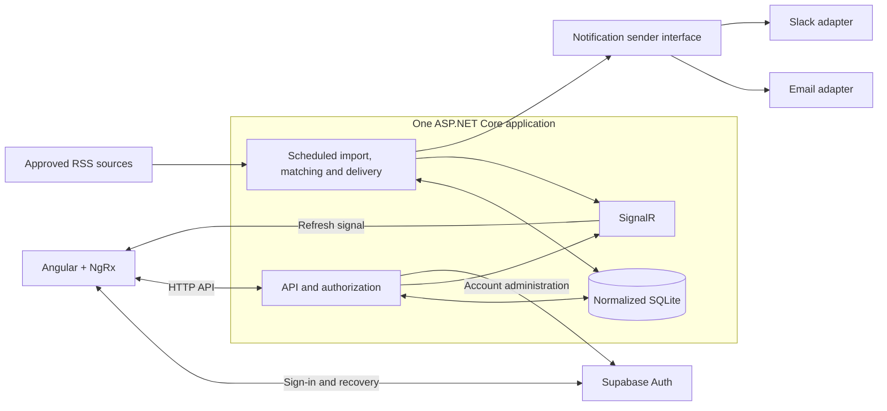

# World Event Alerts

Status: planning. Target: one 24-hour implementation and review cycle.

## Product scope

Build an English-language web app for following world news and receiving personalized alerts. Use Angular 22 with NgRx, ASP.NET Core on .NET 11, EF Core with SQLite, and the Supabase Auth Free plan. Each stable tool version will be pinned after the initial compatibility check.

### User experience

- Sign up with email, verify the address, sign in, and reset the password by email. During signup, require acknowledgement of the privacy notice and record its version and timestamp. Clearly disclose requested alert delivery during onboarding. Users activate their alert rules and can change their delivery preferences. Obtain separate optional consent if marketing is introduced. Confirm the privacy wording and legal basis before public deployment.
- Select topics and predefined tags, or enter an English keyword or phrase. Browse a reverse-chronological feed that loads the next page on scroll. Each card shows the headline, source, publication time and original link.
- Create a news alert with a topic, tag or case-insensitive headline term or phrase. Choose all compatible sources assigned to the topic or a specific subset. The planned topic catalog starts with General News, Crypto, Stock Market, Natural Disasters, and Science & Technology. Topic assignments make a source eligible. Provider categories or simple tagging rules determine which articles match the topic.
- See in-app notifications and unread status. Email is the initial external delivery preference. Slack can be selected once the administrator has configured an eligible destination. Show disabled channels in the profile and preserve the user's preference for when the channel returns.
- Delete the account from the profile. The backend disables delivery, coordinates deletion in Supabase Auth and SQLite, and makes an interrupted deletion resumable.

### Administration

- Provide a separate lazy-loaded admin route. Enforce administrator access in the API. List, edit and delete user accounts and view, edit and pause their alert rules. Record admin changes without leaking credentials or unnecessary personal data.
- On the Sources tab, add approved RSS endpoints, map sources to one or more topics, enable or pause them, change the polling interval, test a connection and run a source on demand. Show the last successful run, imported item count and a safe error summary. New formats can be added through adapters.
- On the Channels tab, configure and test instances of supported delivery types, including Slack destinations, and enable or disable delivery globally. New channel types are implemented through a sender adapter. Show channel status changes to users through persistent in-app updates and SignalR.

## Architecture and behavior

- Verify BBC World RSS as the initial live candidate by checking its HTTP response, stable identity fields and permitted use. If those checks fail, document the reason and select a permitted RSS source. Add other feeds through the same adapter after validation.
- Default to one fetch per enabled RSS source every 30 minutes, shared by all topics and users. Persist settings and deduplicate by source and stable item identity. Seed the first successful import silently. Subsequent runs consider unseen items still present in the feed, including after a temporary failure. Match new items locally against active rules.
- Use normalized tables for accounts, privacy acknowledgements, topics, source mappings, articles, tags, rules, channel preferences, inbox items and delivery attempts. Use a unique constraint for each user, article, and destination or channel as appropriate so overlapping rules and repeated ingestion do not create duplicate notifications.
- Store notifications and channel change history before signaling connected clients. On login or reconnect, the UI reloads the inbox and channel state from the API. Check the current channel state again immediately before delivery. Record the external provider result separately from the inbox status.
- Use Supabase for identity and credential recovery, and SQLite for application data. Configure SMTP for auth emails and for app alerts. Keep provider credentials on the server. Use typed Angular HttpClient services for the application API. Define a shared notification sender interface with separate email and Slack adapters.

## Milestones and acceptance checks

See [MILESTONES.md](MILESTONES.md) for GitHub review checkpoints, validation steps and commit boundaries.

| Status | Milestone | Evidence |
| --- | --- | --- |
| In progress | Scope and source validation | Initial plan and agent instructions. Save a live RSS response summary and verify permitted use. Record compatibility decisions. |
| Pending | Workspace and accounts | Root Git repo, frontend/ and backend/, clean builds, migration, signup, recovery, and a denied admin call from a normal account. |
| Ready for review | News feed and sources | Profile preferences, topic assignment, scheduled and manual imports, RSS images, and duplicate checks. Live BBC and USGS import checked. Confirm permitted use before enabling scheduled imports. |
| Pending | Rules and delivery | Matching and nonmatching samples, saved inbox entries, real email and Slack smoke tests where credentials are available. Demonstrate channel-independent failures. |
| Pending | Admin, realtime and deletion | Edit users and rules, configure and disable channels, verify online and offline views, and test self-deletion and denied cross-account access. |
| Pending | Final review and handoff | Fresh checkout setup, reproducible end-to-end demo, evidence and milestone commits. Report unresolved checks and actual integration status. |

## Optional extensions

- Price alerts after the news demo passes. Start with BTC–USD, selected from an administrator-managed dropdown. Show the latest sampled price, currency and timestamp. Let users choose **At or above** or **At or below** and enter a target price. Evaluate centrally from one shared scheduled request per enabled instrument. Rearm after a sample returns to the opposite side of the threshold.
- Add stock instruments after choosing a suitable provider. Add direct earthquake reports later if users need measured events in addition to related news.

## Progress and submission

- Update milestone status in this plan at each checkpoint and link its commit and verification evidence. Publish the finished work through a GitHub repository once a destination is available.
- Keep the English summaries in [the development log](docs/development-log.md). Preserve the full original prompts and agent handoffs separately for the submission. Keep decision logs, working artifacts and intermediate evidence. Capture actual AI review findings and corrections as they occur.
- In the verification log, record each command or manual action, expected and observed results, and retest outcome. Distinguish live source checks, fixture tests, provider acceptance and confirmed receipt. Document how to run the app and reproduce the demo from a fresh checkout.

## References

### Planned default news feeds

Validate the live payload and permitted use before enabling each feed.

- General News — [BBC World News RSS](https://feeds.bbci.co.uk/news/world/rss.xml)
- Stock Market — [BBC Business RSS](https://feeds.bbci.co.uk/news/business/rss.xml) for business and market headlines.
- Crypto — [Cointelegraph RSS](https://cointelegraph.com/rss) for crypto headlines.
- [BBC feed catalog](https://support.bbc.co.uk/platform/feeds/NewsFeeds.htm) and [BBC RSS terms](https://downloads.bbc.co.uk/usingthebbc/bbc_terms_of_use_19September2022english.pdf)

### Optional market price APIs

- Crypto — [Coinbase BTC–USD ticker](https://api.exchange.coinbase.com/products/BTC-USD/ticker) and [API documentation](https://docs.cdp.coinbase.com/api-reference/exchange-api/rest-api/products/get-product-ticker).
- Stocks — [Alpha Vantage quote API](https://www.alphavantage.co/documentation/#latestprice) as a candidate. Confirm data freshness and access terms before committing to stock price alerts.

### Tooling

- [Angular releases](https://angular.dev/reference/releases)
- [.NET support policy](https://dotnet.microsoft.com/en-us/platform/support/policy/dotnet-core)
- [Supabase SMTP setup](https://supabase.com/docs/guides/auth/auth-smtp)
