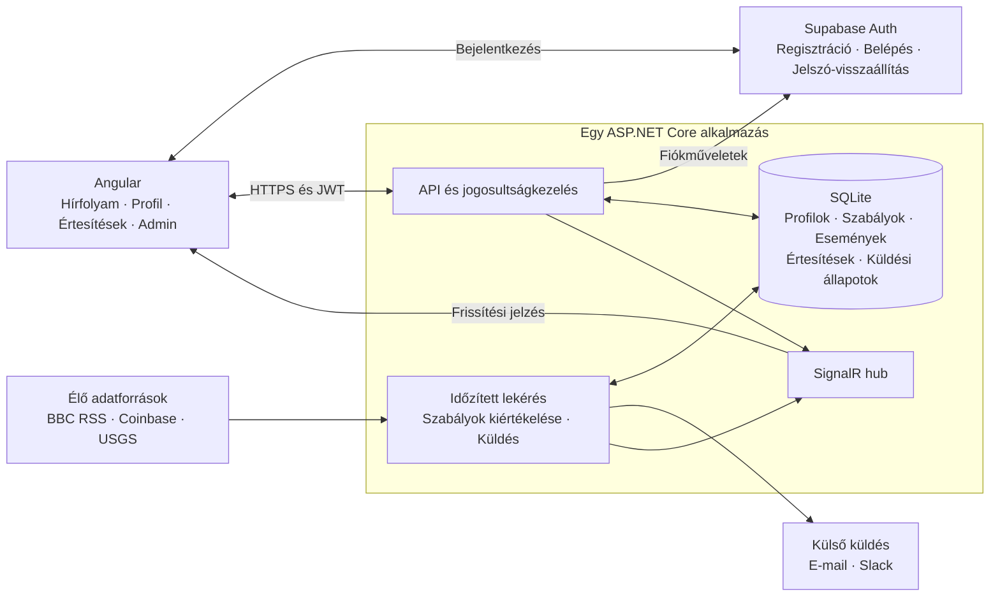

# Development log

The complete public-facing text is recorded in the [full conversation](#full-conversation) at the end of this document.
### Feature folder organization

The user requested separate folders for backend responsibilities and a dedicated folder for each Angular component. The AI kept the feature boundaries, moved the files, updated Angular import paths and recorded the convention in AGENTS.md. Feature NgRx state stays in the parent folder.

This is a retrospective English summary of the planning conversation, followed by ongoing entries. Keep the original prompts separately and preserve their wording for the submission. The rows below capture attribution and decisions.

| User request | Assistant response | Decision and origin |
| --- | --- | --- |
| Explain the assignment, break it down, and translate the full brief into Hungarian. | Summarized the scope and evaluation, proposed milestones and checks, and translated the brief. | The assignment requires visible AI use, milestone commits, original prompt history and evidence of verification. |
| Keep coding simple while using real online news. Discuss SQLite, Angular and .NET. | Proposed a small end-to-end demo, researched candidate feeds, and initially suggested Razor Pages. | The user later specified Angular, .NET, SQLite and Supabase Auth. The updated plan follows that stack. |
| Add signup, topic and tag preferences, custom keywords, a scrolling feed, admin controls, channel preferences, live updates, account deletion and email recovery. | Organized the requirements into user and admin flows. Proposed storing inbox updates before signaling clients and discussed privacy acknowledgement and alert preferences. | The user defined the product scope, suggested SignalR, and set email as the default external channel. Persistence before SignalR and the consent distinction were assistant design recommendations. |
| Keep the app in English, discuss in Hungarian, and make roughly 30-minute news polling configurable. Explore shared market data and omit the dedicated earthquake feed for now. | Proposed shared background polling, item identity deduplication, a silent initial import and Coinbase as a market data candidate. | English UI, admin-configurable polling and the narrower initial scope came from the user. BBC World RSS remains a candidate pending verification. |
| Let admins map sources to topics and allow users to choose sources per rule. | Proposed reusable source adapters, compatible source filtering and shared ingestion. | Dynamic topic-to-source mapping and rule-level source choice were user proposals. |
| Prefer news for the core scope. If price alerts are included, use an instrument dropdown, upper or lower target and latest price. | Recommended keeping price alerts optional and starting with BTC–USD if time permits. | The user proposed the price alert interaction. The assistant proposed deferring the feature until the news flow passes verification. |
| Break the work into trackable tasks and define verification. Create English planning files and a short architecture PDF. | Created the plan, repository instructions and PDF. Documented lazy coding, lazy loading, resource cleanup, SOLID, normalized SQLite, NgRx structure and code-size limits. | The user set these development constraints and requested the deliverables. The assistant checked framework versions and initially included generated API tooling at the user's suggestion. |
| Incorporate feedback shared from another AI. Draw a shared email and Slack delivery interface with separate adapters. Drop Swagger and NSwag and start recording requests, responses and decisions. | Updated both architecture views and repository guidance, and started this log. | The external feedback was supplied by the user. The user adopted the interface refinement and made the decision to drop both tools. The assistant applied it and proposed typed Angular HTTP services. |

## Repository instruction review

- **User request:** Review the user's additions to AGENTS.md and assess whether they fit the project.
- **Assistant response:** Reviewed AGENTS.md alongside PLAN.md. Supported the new lifecycle, logging, delivery and evidence rules. Identified the need to clarify demo channel prerequisites, interrupted-send status, and the scope of the Angular auth interceptor.
- **Decision and origin:** The user authored the additions. The assistant proposed refinements for review. AGENTS.md was left as edited by the user.

## Repository instruction refinements

- **User request:** Apply the refinements recommended in the review.
- **Assistant response:** Updated AGENTS.md to specify the two-channel demo account, distinguish delivery records from receipt, persist interrupted sends as ambiguous on startup, and scope the Angular access token to the configured .NET API.
- **Decision and origin:** The assistant proposed the refinements. The user approved applying them.

## Milestone table and source references

- **User request:** Remove the Time column from the milestone table and list the default BBC, crypto and stock-market sources in PLAN.md.
- **Assistant response:** Removed the estimates and added RSS feed URLs and optional price API references. Live RSS payload and usage checks remain pending.
- **Decision and origin:** The user removed milestone time estimates and requested source references. The assistant selected BBC Business for market headlines and proposed Cointelegraph for crypto headlines and Alpha Vantage for optional stock quotes.

## Generating MILESTONES.md for GitHub review

- **User request:** Create a separate milestone checklist, with planning and the architecture brief first, followed by the application shell, authentication, NgRx and an admin panel. Add mobile UX and Tailwind guidance. Initialize the root repository with the supplied GitHub URL and keep everything local for now.
- **Assistant response:** Generated [MILESTONES.md](../MILESTONES.md) from the user's outline. Expanded it into six checkpoints with scope, verification steps, human review points and suggested commit messages. Also added responsive Tailwind guidance and configured the local Git repository and its origin.
- **Decision and origin:** The user supplied the initial milestone structure and review flow. The first milestone covers the planning documents and architecture brief. The second covers the app shell, registration and login, NgRx groundwork and an admin panel. The user also specified the sequence after each milestone: run checks, record observed results, commit, push the working branch when authorized, and share the commit link and review points. The assistant drafted the file and proposed the remaining milestone details.
- **Human review:** The user will review the generated file and decide whether to accept or revise the proposed breakdown.

## Publishing the planning milestone

- **User request:** Publish the existing project files to the specified GitHub repository.
- **Assistant response:** Verified the existing local Git setup, the origin URL and the absence of a remote default branch. Prepared the planning documents, architecture brief, original assignment and development log for the initial commit.
- **Decision and origin:** The user authorized the first upload and chose the repository. The assistant used the existing local main branch for the initial review baseline.
- **Verification:** The first staged whitespace check flagged a blank line in this log and PDF cross-reference records. Removed the Markdown whitespace and marked PDF and DOCX files as binary to preserve their bytes in Git.

## Local integration setup

- **User request:** Document how to run both projects from Windows CMD, show where to enter the Supabase project configuration, and prepare email, Slack and RSS settings.
- **Assistant response:** Added a CMD setup guide and a JSON example for Supabase, application SMTP, a Slack webhook and the three planned RSS sources.
- **Decision and origin:** The user created the Supabase project and requested the integration configuration. The assistant documented Supabase Auth email separately from application alert email, and used a branch based on remote main because the application shell was still under separate review.

## Application shell and authentication

- **User request:** Start a new branch from the newly merged main. Create separate frontend and backend projects, configure Supabase, protect the feed and other application routes, and build sign-in and registration forms, a header and footer, account and notification controls, and a sortable and filterable feed of 20 items per page. Choose a reusable blue Tailwind palette and document it.
- **Assistant response:** Created Angular and ASP.NET Core projects in one repository. Added NgRx feed state, a development-only SQLite fixture, basic profile and notification views, a server-authorized admin shell, and one local Supabase configuration file. Added a mobile-first Tailwind theme.
- **Decision and origin:** The user specified the authenticated feed as the landing page, the account menu, notification bell, pagination, visual direction and branching rule. The assistant selected the palette, used Feed as the primary nav item, and kept live notification delivery and RSS ingestion for later milestones.
- **Verification:** Both builds passed. The initial Angular bundle exceeded its size warning threshold when Supabase was loaded eagerly. Lazy loading the SDK lowered the initial bundle to about 322 kB and removed the warning. A fresh development database applied the migration and contained 26 demo articles. Anonymous feed and admin API calls returned 401. The public config endpoint excluded a secret-shaped test value.
- **Browser checks:** Edge confirmed mobile redirects to sign-in, the registration acknowledgement checkbox, and no horizontal overflow. A mocked signed-in session and API confirmed the account and notification controls, API bearer header, pagination, topic filtering and denied admin navigation. Real Supabase sign-up, verification, login, recovery and admin-role checks require a configured project. The registration acknowledgement is recorded as Supabase user metadata in this shell. A server-owned acknowledgement record is still pending.

## Supabase roles and test accounts

- **User request:** Add User and Admin roles to .NET and Supabase, and prepare a test account per role for review. Document the account setup in the README. Test passwords are redacted here.
- **Assistant response:** Added the AppRole enum and switched the Admin policy to trusted Supabase app metadata. Documented the two test identities and the Supabase dashboard and SQL steps.
- **Decision and origin:** The user selected the role names and test identities. The assistant chose a User default and protected role metadata. The application branch is a prerequisite and had yet to merge into main.
- **Verification:** The .NET 11 build passed with zero warnings and errors. Hosted role assignment, account creation and signed-in authorization checks are pending privileged Supabase access.

## Single-column news feed

- **User request:** Assign Admin to the account created in Supabase. Change the landing feed to one article card per row with search, filters and sorting above the scrolling list.
- **Assistant response:** Centered the feed and stacked article cards in one column. Preserved the filters and incremental loading. Checked for administrative Supabase credentials, which were unavailable in the session.
- **Decision and origin:** The single-column layout and controls came from the user. The assistant selected a readable maximum width and retained the existing pagination.
- **Verification:** Angular build passed. Edge confirmed that desktop article cards share the same width and horizontal position, appear in successive rows, and still load the next page on scroll with a mocked API.

## Liked posts and role administration

- **User request:** Add likes and a Liked posts entry in the account menu. Show article images or placeholders. Let admins assign roles and grant the first administrator in Supabase. Publish on a separate review branch.
- **Assistant response:** Added user-scoped SQLite likes, image fallbacks and a guarded admin form that applies roles by Supabase UID through a server-side client. Hosted bootstrap still requires privileged project access.
- **Decision and origin:** The user requested the feed and admin capabilities. The assistant chose idempotent like writes, a single reusable feed route component, and a server-side secret with a self-demotion safeguard.
- **Verification:** Angular build passed. The Release backend was built while the running Debug backend retained its files. A temporary SQLite check passed migration, duplicate suppression, account isolation and unlike. A mocked Edge check passed image fallback, like, Liked posts and unlike. Live Supabase role writes remain unverified.

## PR review feedback

- **User request:** Review the current main and apply explicit typing, early exits, Signal Forms, signal-backed templates, enum comparisons and effects. Keep Administration in the account menu for admins. Add linting, formatting, icons, loading skeletons, demo images and a favicon.
- **Assistant response:** Branched from the fetched main at `e867a63`. Applied the feedback across the app, added local illustrations and a favicon, and recorded the conventions in AGENTS.md.
- **Decision and origin:** The user identified the changes during PR review. The assistant chose Angular ESLint and Prettier because TSLint is deprecated, used HTML/CSS icons after the candidate icon package rejected Angular 22, and kept password-bearing calls in the Auth service. The feed returns an empty page after one query. Live RSS thumbnail extraction remains part of RSS ingestion.
- **Verification:** Angular build, ESLint, Prettier and .NET Release build passed. A temporary SQLite check passed image fixture coverage and like isolation. Edge with mocked API responses verified the skeleton, loaded image, source without an image, pagination, user/admin menu visibility and admin role form. The first admin form probe found that its wrapped label had an imprecise accessible name. Added an explicit label association and reran the check successfully.

## Form validation and icon follow-up

- **User request:** Keep the same review branch. Match the Supabase six-character minimum, validate email format with a regex, add a password visibility control, improve the header icons, and render likes as an icon-only toggle.
- **Assistant response:** Added accessible field errors for auth and admin role forms, updated the password rule, and added consistent CSS icons for password visibility, notifications, account and like states.
- **Decision and origin:** The user specified the password minimum and icon behavior. The assistant chose to show validation errors after a field is touched or the form is submitted.
- **Verification:** Angular build, ESLint and Prettier passed. Edge with mocked API responses verified that invalid email, a five-character password and an unchecked privacy notice block registration, while six characters pass the client check. Also verified both password visibility states, malformed admin UUID feedback and the outline-to-filled heart transition.

## Icon library follow-up

- **User request:** Replace the custom SVG icons with a free library, improve the account chevrons and keep the same review branch.
- **Assistant response:** Replaced the SVG masks and CSS-drawn chevron with the locally bundled Bootstrap Icons font. Kept accessible names and selected states.
- **Decision and origin:** The user requested library icons and gave the account chevrons as an example. The assistant chose the MIT-licensed Bootstrap Icons font.
- **Verification:** Edge confirmed font loading, both chevron states, password visibility and the heart transition.

## Profile preferences and topic sources

- **User request:** Build profile preferences with fixed topics and custom labels. Let admins assign additional news portals and a disaster feed to topics, keep news unique, and grant Admin to the supplied Supabase account.
- **Assistant response:** Added user-scoped preferences, a matching feed view, admin source assignment, scheduled and manual RSS/Atom and USGS imports, duplicate detection, and a persistent in-app inbox. Admin bootstrap is still pending privileged Supabase access.
- **Decision and origin:** The user chose separate Crypto, Stock Market and Economy topics, BBC as baseline coverage, additional topic-specific sources and duplicate prevention. The assistant proposed optional assignment keywords, silent first imports, conservative deduplication by canonical URL and same-day normalized headline, and keeping scheduled fetching opt-in while feed usage is under review.
- **Verification:** A first migration run exposed a collision between snapshot entity names and runtime CLR mappings. Replaced the shared snapshot mapping with explicit snapshot entities and reran successfully. SQLite fixture checks passed preference storage, RSS image extraction, silent first import, alert matching, duplicate suppression and read status. Live imports returned 35 BBC World articles and 8 USGS reports. Immediate replays added zero for both. Build, lint, formatting and mocked browser flows passed, and unauthenticated calls to profile, source and inbox endpoints returned 401.

## Profile and admin troubleshooting

- **User report:** Profile preferences would not load, and Administration was hidden after granting the Supabase Admin role.
- **Assistant response:** Confirmed the running backend returned 404 for the new profile route, rebuilt and restarted it, and changed menu visibility to use the API's current authorization decision at sign-in and when the account menu opens.
- **Decision and origin:** The user assigned the hosted admin role. The assistant diagnosed the old local process and chose the backend authorization check as the menu's source of truth.
- **Verification:** The hosted test account obtained 200 for preferences, 204 for admin access, and 200 for admin sources through the Angular proxy. Edge with stale session metadata confirmed that the link appeared when the backend began granting access. Angular build and ESLint passed.

## Administration sections and external delivery

- **User request:** Continue on the same branch. Split administration into sections, list users and assign roles by email, paginate sources, add a create/edit dialog with a dry run and deletion, and deliver alerts through email by default and opt-in Slack. Keep the sender system extensible.
- **Assistant response:** Added Users, News sources and Delivery channels sections, paginated user and source endpoints, a source editor and a no-write test. Added provider availability and user preferences, and a persistent delivery queue with separate SMTP and Slack DM adapters and recent outcomes.
- **Decision and origin:** The user specified the layout and the account email as the shared delivery identity. The assistant used the Slack bot API for personal messages because incoming webhooks post to a fixed destination. Source deletion preserves previously imported news. Registered adapters share preference and queue logic.
- **Verification:** A SQLite upgrade test surfaced an EF tracking conflict when replacing source topics. Replaced the mapping write with parameterized inserts inside the transaction and reran successfully. The harness passed source CRUD and dry runs, directory search forwarding, default email, Slack opt-in, independent failure, disabled channels and deduplication. Edge verified the admin flows and mobile profile with mocked APIs. Both builds, ESLint and Prettier passed. The authenticated local API listed three sources and two channels and the live BBC dry run parsed 36 items. SMTP and Slack credentials, and the privileged hosted Supabase key for real user listing, were absent locally. Live receipt remains unverified.

## Feed repair, recurring jobs and provider configuration

- **User request:** Diagnose the feed error, document where the Supabase secret key goes, add per-source controls, run sources sequentially every 30 minutes, archive news older than seven days, and configure email and Slack from Admin. Find a free SMTP provider and preserve the email default with user opt-out.
- **Assistant response:** Reproduced a 400 caused by the lowercase sort parameter binding to the backend enum. Fixed the boundary and added a clear empty-state action. Added Hangfire import/archive jobs, source flags, a styled email template and encrypted write-only provider settings. Documented Brevo and the Supabase key location.
- **Decision and origin:** The user specified the cadence, retention and configuration workflow. The assistant chose in-process Hangfire storage, kept archived titles and deduplication identities in SQLite, preserved likes and inbox links, and pinned a patched JSON dependency after the package audit flagged a transitive version.
- **Verification:** The previously failing authenticated feed query returned 200, with 20 cards in the unfiltered query and zero current interest matches. The local scheduler started, all three enabled sources have successful imports, and 47 articles were archived. SQLite and Edge checks covered disabled sources, retained likes, provider secrets omitted on read, and email opt-out. Both builds, lint and format passed. Provider receipt still requires real SMTP, Slack and Supabase credentials.

## Responsive article images and alert digests

- **User request:** Improve pixelated images and send links to new matching articles by email and Slack. Group multiple articles from a half-hour window. Keep the same review branch and explain Slack setup.
- **Assistant response:** Added responsive BBC image sizes, avoided enlarging thumbnails from sources without variants, selected suitable RSS image candidates, and grouped queued deliveries by account, channel and closed UTC half-hour window. Updated the email and Slack templates to list individual links.
- **Decision and origin:** The user requested image optimization and digest behavior. The assistant used four verified BBC variants and a 40-link message cap to fit Slack's layout limits.
- **Verification:** Measured real BBC candidates from 320 to 976 pixels. Edge selected 480 pixels on mobile and 976 on desktop. The SQLite harness verified separate windows, no early or duplicate delivery, independent channel outcomes and links in HTML, plain text and mocked Slack DM payloads. Angular build, lint and Prettier passed. The local Supabase secret is present. Real SMTP and Slack settings were absent and receipt remains unverified.

## Email digest limit and Slack setup

- **User request:** Limit emails to five unique article links, show top matching labels, keep all matches in the app, and explain where Slack app setup starts from the workspace screen.
- **Assistant response:** Limited each email window to the five newest distinct links. Added up to five labels ranked by match count across the full window. Kept inbox entries and marked emails' remaining articles as omitted in the delivery log. Expanded the Slack setup steps.
- **Verification:** A SQLite fixture with 55 matches and a repeated canonical URL produced one email with five distinct links, five ranked labels, and all 55 in-app entries retained. Rerunning did not resend. The first label aggregation was rejected by EF Core; a SQL-translatable projection passed the rerun. Live provider credentials were still absent.

### Independent topic and label matching

The user requested topic-based alerts even when custom labels are present, plus a shared editable message template and configuration for additional channels. The AI aligned the personalized feed and alert creation with independent topic and label matches. Runtime verification was blocked by the local command runner.
The AI reused the blue email layout and added a shared admin template editor with preview and reset. Teams, Discord and Telegram provider credentials can be staged in the admin panel. Email and Slack are the active adapters.

### Admin test delivery

The user requested a test-send action for the configured channel. The AI added an admin-only action that uses the saved template and sends a sample to the acting admin's verified email or matching Slack account. Angular and .NET builds passed. An unauthenticated request returned HTTP 401 through the local proxy. Live delivery was not triggered during verification.

### Admin pagination and source controls

The user requested Material pagination, a green or red source switch, and tooltip-labeled source actions. The AI applied Material pagination to the user and source lists and used the existing Bootstrap icon font for editing, running and deleting sources. The user also asked to document the decision to stage only known providers. New integrations require a defined configuration and delivery adapter.

### Admin startup and Slack test connection

The user reported an initial unauthorized admin access check and a refused connection during a Slack test. The AI made both admin checks wait for session initialization and distinguish role discovery from admin authorization. It added a clear message for browser connection failures. The local proxy reached the protected Slack test endpoint, and the machine reached the Slack API over HTTPS. Live delivery was not triggered.

### Delivery feedback

The user requested a loading indicator and a discreet result notification for sending. The AI added a spinner to the active test button and a bottom-right notification for accepted, failed and uncertain outcomes. Provider configuration also shows a saving indicator and a success notification.

### Slack test diagnostics

The user reported that a saved template still produced a failed Slack test. The AI traced the email lookup, direct-message opening and posting steps. The admin test now returns stage-specific troubleshooting hints without exposing provider credentials or recipient details. Both builds passed and the local API was restarted. Live Slack delivery was not exercised.

The user then showed that the Slack test reached chat.postMessage. The AI exposed the Slack error code in the admin diagnostic and added guidance for a disabled Messages Tab and workspace posting restrictions.

### Sign-up confirmation view

The user requested a dedicated confirmation screen after sign-up. The AI replaced the form with a confirmation message and a Back to home action when Supabase requires email verification. The destination remains protected by the session guard.

### Manual source import feedback

The user reported that manual import appeared to do nothing. The screenshot showed a successful run with zero newly added articles. The AI added a source-level progress indicator and a clear successful completion message for an empty import.

The user clarified that BBC showed newer content than the app. The AI compared the three live RSS feeds with local SQLite and found that a known URL had a newer publication timestamp in RSS. The importer now updates the existing article when the same URL has a newer timestamp, without creating a second article.

### Scheduled job intervals

The user asked to configure how often the scheduled jobs run. The AI added a Scheduled jobs admin tab with separate interval choices for importing and archiving. Saved choices persist in SQLite and update Hangfire immediately.

### Additional delivery channel preparation

The user requested additional preparation for Teams, Discord and Telegram on the same review branch. The AI added stable channel identifiers and documented the private destination each future adapter needs. The existing admin configuration remains available for staging provider credentials.

### Angular component templates

The user asked to separate HTML and custom CSS from TypeScript across the Angular app. The AI moved inline templates to sibling HTML files, retained Tailwind utilities in the markup and recorded the convention in AGENTS.md.

## Expanded decision and review evidence

The table and cases below distinguish the user's product and review decisions from the AI's implementation and verification work.

| Decision | User ownership | AI contribution |
| --- | --- | --- |
| Define important events | Set a news-first MVP, fixed topics, custom labels, and extensible source-to-topic assignments. Kept price thresholds optional. | Proposed shared polling, local matching and a replayable baseline to prevent old alerts. |
| Choose architecture | Chose Angular, .NET, SQLite and Supabase, an English UI and a simple implementation. Proposed in-app notifications and SignalR. | Drafted the plan and diagrams, proposed persisting notifications before live updates, and organized the work into reviewable milestones. |
| Manage delivery | Chose default email, optional Slack, global enable and disable, and a shared template. Brought external AI feedback about separate adapters and removed Swagger and NSwag from scope. | Applied a shared sender interface, provider configuration and administrative test sends. |
| Review workflow | Set fresh-base branches, PR review checkpoints, explicit types, Signal Forms and NgRx conventions. Reviewed and merged earlier changes, and identified follow-up issues from screenshots and code. | Applied the requested conventions, reported builds and integration limits, and maintained the log. |
| Defer unknown providers | Asked to stage Teams, Discord and Telegram and document that their configuration is provider-specific. | Added known-provider identifiers and settings. The planned private destinations and delivery adapters remain open. |

## Evidence-driven course corrections

### A zero-import result was insufficient

The AI initially treated a successful run with a zero insert count as adequate evidence. The user rejected that conclusion after seeing newer content in the BBC feed. A direct comparison showed that the same canonical URL had a newer RSS timestamp while SQLite retained the older timestamp. The importer was changed to update the known article. The retest showed the same article ID moving from 10:26 to 14:49 UTC without a duplicate. The insert counter still reported zero for that update, which clarified the difference between a new record and a refreshed record.

### Slack success required several independent checks

The user supplied browser screenshots and retried after each change. A request failing at localhost was distinguished from a Slack provider rejection. Further tests identified missing consent on the installed token, an unmatched workspace member email, and then a posting rejection. The AI exposed the method and Slack error code. The final provider code was messages_tab_disabled. The user enabled the relevant Slack setting and showed the bot's unread badge. Opening the actual message and live delivery of the same RSS alert to two channels were not independently recorded.

### Matching changed after user review

The first personalized feed required topic eligibility and at least one label when labels existed. The user expected a selected topic to trigger an alert independently of labels. The revised feed and alert insertion use any selected topic or any matched label. The clean-clone demo fixture includes a matching topic alongside an unrelated label and checks that there is one alert.

### Builds and runtime evidence are distinct

After the user reported that two admin views did not show locally, builds exposed a C# anonymous-object property mismatch. The AI fixed the mismatched property name and restarted the local API. The frontend and backend then built and the admin route and protected API were reachable. This checked compilation and startup. Signed-in configuration saves and provider receipt require separate verification.

### Inbox and account-menu follow-up

The user reported that opening a notification left the unread badge unchanged, asked why external delivery had not arrived, and requested the signed-in email in the account menu. The AI added per-article read receipts locally and verified queued email and Slack attempts in SQLite. The local delivery schedule distinguishes RSS polling from the fixed 30-minute digest. The read-receipt changes were still local at the folder-organization checkpoint.

### Feature folder organization

The user asked for backend responsibility folders and a dedicated Angular directory for each component, while keeping feature-wide NgRx state in each parent feature. The AI moved backend HTTP handlers, services, models, enums and infrastructure, relocated migrations under feed infrastructure, moved Angular TypeScript and HTML together, and updated route imports and AGENTS.md. Both builds passed. The refactor was published as [dacd753](https://github.com/mzoli95/nov27_zm_rss/commit/dacd7536d89effa35d30f65107e5d82e229fcb45). Existing local inbox changes were preserved independently.

### Consolidated submission evidence

The user requested the full dialogue in this development log instead of maintaining separate transcript and expanded-summary files. The AI used the local session event log to preserve the original order and wording, included assistant progress and answers, and masked credentials and identifiers. The clean-checkout verification and status review are separate commits, [d951bcc](https://github.com/mzoli95/nov27_zm_rss/commit/d951bcccf6c3c0328e75832c970e2f34af7fcedf) and [fe322e7](https://github.com/mzoli95/nov27_zm_rss/commit/fe322e76a3999e27d01f9730206bc4486f3117db). Fixture checks passed. Live two-channel receipt of one RSS alert remains a separate check.

## Full conversation

The transcript follows the chronological session log through the consolidation request and the recorded progress for this export. It includes 81 user messages, 78 assistant answers and 75 assistant progress updates. It preserves the original languages and wording. Credentials, personal identifiers and local account names are masked. Attachment locations are marked. Binary attachments, IDE-only context and tool internals are excluded.

### 001. User

~~~text
E:\nov27

kaptam egy ilyen taskot, ezt tudod értelmezni első körben? utána lebontani feladatokra?

~~~

### 002. Assistant progress

~~~text
Megnézem, milyen feladatleírás van az `E:\nov27` mappában. Utána összefoglalom, mit kér, és végrehajtható lépésekre bontom.
~~~

### 003. Assistant answer

~~~text
Elolvastam a [feladatleírást](E:/nov27/task-04-feature-design-and-build.docx). A feladat lényege, hogy **egy homályos termékötletből saját terv alapján működő prototípust készíts AI-ügynökök segítségével, és végig dokumentáld, hogyan döntöttél és mit ellenőriztél.** A kód azt mutatja meg, hogy működik, amit vállaltál. Az értékelés fókusza a döntéseid és az AI által készített munka ellenőrzése.

### Mit kérnek, és mit kell neked eldöntened?

| Amit kérnek | Amit neked kell meghatároznod |
|---|---|
| A felhasználó riasztásokat állíthasson be fontos világeseményekre. | Mit tekintesz eseménynek, honnan érkezik, és milyen feltétellel vált ki riasztást. |
| Az értesítés működjön e-mailen és Slacken, és lehessen később új csatornát hozzáadni. | Hogyan kapcsolódik a két csatorna a rendszerhez, és hogyan igazolod a kézbesítést. |
| Legyen adminnézet. | Mit kell látnia az adminnak, és szüksége van-e beavatkozási lehetőségre. |
| A munka GitHub-repóban legyen követhető. | Milyen mérföldköveket, ellenőrzéseket és végtermékeket vállalsz a saját tervedben. |

A hírek, a piaci mozgások és a természeti katasztrófák példák. A leírás rád bízza az eseményforrást és az első verzió lefedettségét. A 24 óra ajánlott keret, és kifejezetten elfogadható a részleges megoldás, ha világos, mi működik és miért azt építetted meg.

### Javasolt első verzió

Egy felhasználó kiválaszt egy eseménytípust, beállít egy küszöböt, és megadja, hogy e-mailen, Slacken vagy mindkettőn kér értesítést. Például kérhet jelzést legalább 5-ös magnitúdójú földrengésről. Egy reprodukálható demóesemény végigmegy a teljes folyamaton. Az admin látja a beérkezett eseményt és csatornánként a küldés eredményét.

A demóesemény már az elején lehetővé teszi a teljes folyamat ellenőrzését. Egy élő adatforrást ezután lehet bekötni, ha belefér. A két értesítési csatornánál érdemes külön rögzíteni, hogy a teszt tényleges kézbesítést vagy helyi próbaküldést igazolt.

### Feladatbontás a 24 órás keretre

1. **Terv és elfogadási feltételek — 2 óra.** Kódolás előtt írd le a vállalt funkciókat, a sorrendet és annak indoklását. Határozd meg, mi számít sikeres demónak. Az első prompttól kezdve mentsd a teljes promptelőzményt.
2. **Esemény- és szabálymodell — 3 óra.** Határozd meg az esemény, a felhasználói szabály és a küldési kísérlet adatait. Rögzítsd, mi történik, ha ugyanaz az esemény ismét beérkezik.
3. **Felhasználói folyamat — 5 óra.** Készíts riasztásbeállító felületet, mentsd a szabályokat, és dolgozz fel egy ismételhető demóeseményt. Ellenőrizd a feltétel alatti, a határértéken lévő és a feltétel feletti esetet.
4. **E-mail és Slack — 5 óra.** Kösd be a két csatornát közös küldési interfészen keresztül. Ellenőrizd, hogy az egyik csatorna hibája mellett a másik küldése sikerülhet, és hogy mindkét eredmény látható.
5. **Adminnézet — 3 óra.** Mutasd meg az eseményeket és a küldési kísérleteket. Futtass végig egy sikeres és egy hibás esetet, és nézd meg, hogy a felületen érthető-e, mi történt.
6. **Végigtesztelés és beadás — 6 óra.** Próbáld ki az indítást friss checkoutból. Futtasd végig a demót, ellenőrizd az ismételt esemény és a sikertelen küldés kezelését, majd rendezd a GitHub-repóban a tervet, a promptelőzményt, a döntési naplót, az ellenőrzések bizonyítékait és a futtatási útmutatót. Minden nagyobb mérföldkő kapjon külön, beszédes commitot már munka közben.

A döntési naplóhoz elég egy egyszerű minta: **mit javasolt az AI → mit ellenőriztél → mit tapasztaltál → mit fogadtál el vagy módosítottál, és miért**. Például ha az AI első megoldása kétszer küld értesítést ugyanarra az eseményre, mutasd meg az ismételt bemenettel végzett próbát, a javítást és az újrafuttatás eredményét. Már néhány ilyen konkrét, ténylegesen megtörtént esetből látszik, hogyan dolgoztál.
~~~

### 004. User

~~~text
tudnál lazy codingot végezni? tehát nem túl sokat kódolni, csak a fontos dolgokat beletenni, nem túl komplikálni?

~~~

### 005. Assistant answer

~~~text
Igen. Ennél a feladatnál egy kis, végig működő alkalmazást építenék, egyetlen eseménytípussal és két értesítési csatornával.

- **Felhasználói oldal:** egy űrlap. Beállítod a földrengés magnitúdóküszöbét, és kiválasztod az e-mailt, a Slacket vagy mindkettőt.
- **Eseményfeldolgozás:** egy előre elkészített demóeseményből indulunk. A rendszer ellenőrzi a küszöböt, és eseményenként, szabályonként és csatornánként legfeljebb egyszer indít küldést.
- **Értesítés:** két kis küldőmodul közös interfésszel. Az e-mail SMTP-n, a Slack webhookon keresztül küldhet. Helyi demóban a küldési kísérlet és az eredménye ellenőrizhető. A tényleges kézbesítést külön igazolnánk, ha van hozzá SMTP-hozzáférés és Slack webhook.
- **Adminnézet:** egy táblázat az eseményekkel és a csatornánkénti küldési eredménnyel.

Ehhez elég egy szerveroldali app, SQLite és két egyszerű HTML-oldal. Az élő adatforrást és a többfelhasználós fiókkezelést későbbre hagynám.

A **beadáshoz a dokumentálást megtartanám**. Kódolás előtt rövid terv, menet közben promptnapló és mérföldkő-commitok, a végén pedig három konkrét próba eredménye: a küszöbérték pontosan teljesül, ugyanaz az esemény kétszer érkezik be, illetve az egyik csatorna hibázik, miközben a másik sikeresen küld. Így kevés kóddal is látszik, mit vállaltál és hogyan ellenőrizted.
~~~

### 006. User

~~~text
én inkább valami komolyabbra gondolnék, éles adatokat nem tudnánk venni a netről? a feladathoz kapcsoló hírekhez van valami oldal amit tudnánk használni?

~~~

### 007. Assistant progress

~~~text
Megnézem, milyen nyilvános forrásokból tudnánk élő híreket és eseményeket feldolgozni, és melyik illik a riasztási feladathoz.
~~~

### 008. Assistant answer

~~~text
Igen. A beadáshoz **két élő forrást kötnék be: a BBC World News RSS-t a hírekhez, és a USGS GeoJSON feedjét a földrengésekhez.** Így kétféle riasztási szabályt tudunk bemutatni valós adatokon, ugyanazzal az e-mailes és Slackes küldéssel.

| Forrás | Mire használnánk? | Példa riasztásra |
|---|---|---|
| [BBC World News RSS](https://feeds.bbci.co.uk/news/world/rss.xml) | A nemzetközi hírek címét és eredeti linkjét olvassuk be RSS-ből, API-kulcs nélkül. | „Küldj Slack-üzenetet, ha egy új hír címében szerepel a `ceasefire`.” |
| [USGS földrengésfeed](https://earthquake.usgs.gov/earthquakes/feed/v1.0/geojson.php) | A percenként frissített GeoJSON feedből eseményazonosítót, helyszínt és magnitúdót kapunk. | „Küldj e-mailt, ha legalább 5,0 magnitúdójú földrengést jelentettek.” |

A USGS [élő adatfeedjét](https://earthquake.usgs.gov/earthquakes/feed/v1.0/summary/4.5_day.geojson) meg is nyitottam. Az ellenőrzéskor 10 eseményt adott vissza az előző 24 órából, köztük egy 5,0-s rengést Chile partjainál. Ez már használható bemenet a küszöbérték tesztelésére.

Ha később témacímkék és rovatok szerint is szeretnénk szűrni a híreket, a Guardian API erre ad lehetőséget. A használatához API-kulcs kell. [Guardian Open Platform](https://open-platform.theguardian.com/access/)

**A megvalósítást ettől még egyszerűen tartanám.** Egy háttérfolyamat időnként lekéri a két forrást, SQLite-ban megjegyzi a már látott tételeket, és az újakra lefuttatja a mentett szabályokat. Az adminfelületen látszik a források utolsó sikeres lekérése, a szabálytalálatok és a csatornánkénti küldési eredmény. A demóban az élő lekérés mellett egy elmentett feedmintával is megismételhető ugyanaz a teszt, így az értékelő akkor is végig tudja próbálni, ha éppen nincs friss találat.
~~~

### 009. User

~~~text
sqlite jó ötlet most ide nem? angular és .net nem lenne sok ide?

~~~

### 010. Assistant answer

~~~text
Igen, **SQLite jó választás ehhez a beadandóhoz.** Egyetlen alkalmazáspéldány fut, két feedet kér le időszakosan, és eltárolja az eseményeket, a riasztási szabályokat és a küldési eredményeket. Az értékelő külön adatbázis-szerver nélkül el tudja indítani. Az ismételt értesítéseket adatbázisban is kivédhetjük egy egyedi kulccsal az esemény, a szabály és a csatorna kombinációján.

**A .NET-et megtartanám, az Angulart elhagynám.** Egy ASP.NET Core alkalmazásban a Razor Pages elég a riasztási űrlaphoz és az adminnézethez, egy `BackgroundService` pedig kezelheti a BBC és a USGS időszakos lekérését. Így egyetlen alkalmazást kell elindítani és végigtesztelni. Az Angular akkor érné meg, ha a beadásban külön cél lenne az Angular-tudás bemutatása, vagy a felületnek összetettebb interakciókra lenne szüksége.

Én tehát **ASP.NET Core + Razor Pages + EF Core + SQLite** mellett döntenék. A rendelkezésre álló időt arra fordítanám, ami a demóban számít: élő adatok, követhető küldési eredmények és ellenőrizhető hibakezelés.
~~~

### 011. User

~~~text
az egész doksit fordítsd le magyarra most kérlek

~~~

### 012. Assistant answer

~~~text
# Feladat: Funkció tervezése és megvalósítása egy többértelmű leírás alapján

## Kiinduló helyzet

Egy termékmenedzser pontosan az alábbi leírást adta át neked, minden további információ nélkül:

> „Azt szeretnénk, hogy a felhasználók riasztásokat állíthassanak be, és értesítést kapjanak, amikor valami fontos történik a világban. Ilyen lehet például egy rendkívüli hír, egy piaci mozgás, egy természeti katasztrófa és így tovább. E-mailben és Slacken is működjön. Legyen elég rugalmas ahhoz, hogy később új csatornákat is hozzáadhassunk. Egy adminnézetre is szükségünk van.”

Bármilyen technológiát, programozási nyelvet vagy keretrendszert választhatsz.

Nincs további specifikáció. Nincsenek felületi vázlatok vagy javasolt adatsémák. Arról sincs megállapodás, hogy mi számít „fontosnak”, honnan érkeznek az adatok, vagy hogyan ismeri fel a rendszer az eseményeket.

## A feladatod

AI-ügynökök segítségével juss el ettől a többértelmű leírástól egy működő megvalósításig.

Mielőtt elkezdenéd a megvalósítást, készíts saját munkatervet. Döntsd el, milyen eredményeket kell szerinted leszállítani, milyen sorrendben dolgozol rajtuk, és miért. Maga a terv is része az értékelésnek. Arra vagyunk kíváncsiak, hogyan határozod meg a feladat határait és hogyan szervezed meg a munkát. Egy előre megadott ellenőrzőlista végrehajtása ennek csak egy részét mutatná meg.

Ezután dolgozz a saját terved szerint. Menet közben kritikusan értékeld, amit az AI előállít. Egy eredmény attól még lehet hibás, hogy elsőre hihetőnek tűnik. Tedd láthatóvá, milyen ellenőrzéseket végeztél, mit vetettél el, és hol módosítottál a megközelítéseden. Az ítélőképességed ugyanolyan fontos, mint maga az elvégzett munka.

## Javasolt időkeret

Tervezz 24 órával. Egy részleges, de jól megindokolt megoldás többet ér, mint egy teljes, dokumentálatlan megvalósítás. Az időt a feladat átgondolására és a munkád bemutatására fordítsd. A mennyiség növelése önmagában nem cél.

## Mit értékelünk?

Azt értékeljük, hogyan jutottál el a megoldásig. Egy működő, kiforrott megvalósítás önmagában keveset árul el erről, ha a munkafolyamat nem látható.

Arra vagyunk kíváncsiak, hogyan irányítottad az AI-t, hogyan határoztad meg a problémát, milyen döntéseket hoztál és miért, hol változtattál az eredeti megközelítésen, és hogyan ellenőrizted az eredményeket, mielőtt elfogadtad őket. A beadandó gerincét a munkafolyamat során készült anyagok adják, például a tervek, döntési naplók, promptvázlatok, jegyzetek és köztes eredmények. A kód a munkád egyik bizonyítéka.

Külön figyelmet fordítunk arra, hogyan ellenőrizted az AI által előállított anyagok helyességét. Mutasd meg, mely feltételezéseket kérdőjelezted meg, milyen valótlan állításokat vagy indokolatlan egyszerűsítéseket észleltél, mely kódrészeket írtad át vagy vetetted el, és milyen alapvető ellenőrzésekkel vizsgáltad meg a generált anyagokat.

## AI-eszközök

Bármelyik AI-eszközt használhatod, akár többet is. Nincs kötelező vagy előnyben részesített termék.

## Mit kell beadni?

Oszd meg velünk az eredményeidet egy GitHub-repóban, amely tartalmazza az alábbiakat.

- Minden fontosabb mérföldkőhöz tartozó commit, érdemi commitüzenettel.
- A teljes promptelőzmény, vagyis a munka során használt összes prompt.
- A terveid, a munka közben készült anyagaid és a munkafolyamat bizonyítékai. Ilyenek például a tervezési dokumentumok, a döntési naplók, a promptvázlatok, a köztes eredmények, a jegyzetek, a munkafájlok és a képernyőképek.
- A saját tervedben meghatározott leszállítandó eredmények.
~~~

### 013. User

~~~text
tehát akkor amit elsőre tudunk, kell egy .net és egy angular és sqlite web app, sima free supabases userkezelés legyen mondju, ha regisztrálnak akkor megadhatják, hogy milyen hírekre kiváncsiak témakör szeirnt, illetve labeleket is kiválaszthatnak, egyedileg is, hogy ha valami előfordul, pl ufo észlelés vagy valami, akkor jelezze, vagy ha éppen a bitcoin kilő az égbe
lehetne egy hír feed is nekik az oldalon (fb szerüen lehetne görgetni lefele)

illetve külön egy admin oldal, ahol a felhasználókra rálátunk, tudjuk őket törölni, módosítani, látjuk miket állítottak be, ezeket is tudjuk módosítani, ki/be tudjuk kapcsolni az értesítési csatornákat, illetve újakat tudunk bekonfigolni

a user regisztrációkor gdpr t kell elfogadjon, meg adatkezelést, illetve azt hogy küldhetünk neki értesítéseket, anélkül ne tudjon regisztrálni

defaulton csak email menjen a usereknek, de tudják profil oldalon beállítani hogy emailt vagy slacket vagy mit szeretnének, legyen szinkronban, ha adminból disabledre teszem a slacket, a usernél is legyen disabled (pl ha valami feature nem megy)

csak adminból lehessen új értesítési csatornát beállítani, ez miatt kellene egy signalr vagy mi is, ami értesítést küld a felületre is a usernek, tehát ha éppen online vagy nem, lássa hogy van új értesítési csatorna vagy éppen disabled lett, vagy ha vele kapcsoaltos hír van, ne csak email meg slack menjen, hanem ott is kapjon értesítést

gdpr miatt lehessen felhasználó törlés is profil oldalból, ill emailben pw reset

mivel egészítenéd ki a tervet? egy architekturális rajzot is csinálhjatsz, ne feledd, lazy programing van, egyelőre csak tervezünk

~~~

### 014. Assistant progress

~~~text
A tervet a megadott stackre építem. Megnézem a Supabase, a SignalR és a hozzájárulás feltételeit, mert ezek befolyásolják a regisztrációt és az értesítések működését.
~~~

### 015. Assistant answer

~~~text
**A terv alapja egy Angular webapp, egy ASP.NET Core backend, SQLite az alkalmazásadatokhoz, és Supabase Auth a fiókkezeléshez.** Egy Angular projekten belül lenne a felhasználói felület és a külön `/admin` felület. A .NET backend egy folyamatban futtatná az API-t, az adatforrások lekérését, a riasztások feldolgozását és a SignalR-t.

A tervet három döntéssel egészíteném ki: **a feed és a riasztás külön beállítás**, **az appon belüli értesítés offline állapotban is megmarad**, és **az admin meglévő csatornatípusokból hozhat létre új csatornát**.

### Felhasználói folyamat

- **Regisztráció és profil.** E-mailes regisztráció, címmegerősítés, jelszó-visszaállítás e-mailben, fióktörlés a profilból. Első belépéskor a felhasználó témaköröket és címkéket választ, majd saját kulcsszavakat vagy kifejezéseket is megadhat.
- **Hírfolyam.** Időrendben, lefelé görgetve töltődnek be a hírek. Egy kártyán elég a cím, a forrás, az időpont és az eredeti link. A kiválasztott témák a feedet szűrik. A felhasználó külön szabállyal dönti el, mi szakítsa meg a napját egy értesítéssel.
- **Riasztási szabályok.** A híreknél cím vagy címke alapján keresünk, például `UFO` vagy `UFO-észlelés`. Első körben kisbetűfüggetlen, pontos szó- vagy kifejezésegyezéssel. Ha angol a hírforrás, az `UFO sighting` külön megadható. A Bitcoinhoz mérhető szabály tartozik, például **„BTC–USD legalább 5%-ot emelkedik 1 óra alatt”**. Ehhez időbélyeges árpontokat tárolunk, és akkor riasztunk, amikor a változás átlépi a küszöböt. Ha még nincs elég árhistorika, a szabály vár. Forrásnak a BBC, a Coinbase és a korábban vizsgált USGS jöhet szóba. [BBC World RSS](https://feeds.bbci.co.uk/news/world/rss.xml) · [Coinbase ticker API](https://docs.cdp.coinbase.com/api-reference/exchange-api/rest-api/products/get-product-ticker) · [USGS földrengésfeed](https://earthquake.usgs.gov/earthquakes/feed/v1.0/geojson.php)
- **Értesítések.** Az appban van egy csengő olvasatlan jelzéssel és visszakereshető előzményekkel. Az e-mail az alapértelmezett külső csatorna a felhasználó által aktivált riasztásokhoz. A Slack választható, amikor elérhető és a célcsatorna be van állítva.

### Admin és csatornák

Az admin láthatja, szerkesztheti és törölheti a felhasználókat, illetve módosíthatja és szüneteltetheti a szabályaikat. A felület mutatja az utolsó sikeres forráslekérést, a szabálytalálatokat és a küldési hibákat. Az adminmódosításokról rövid napló készül. Az adminjogot, a felhasználók adataihoz való hozzáférést és az értesítési jogosultságokat a .NET backend ellenőrzi.

**A csatorna globális állapota és a felhasználó választása két külön mező.** Ha az admin letiltja a Slacket, a profilban szürkül a kapcsoló, és a backend a várakozó küldések előtt is ellenőrzi az állapotot. Ha az admin visszakapcsolja, a korábbi felhasználói választás újra érvényes. Az admin az első verzióban például új **Slack célcsatornát** konfigurálhat vagy tesztelhet. Egy új **csatornatípushoz**, például SMS-hez, egy új küldőmodul kell. A webhook és az SMTP-hitelesítő adatok a szerveren maradnak.

**A SignalR az online felületet frissíti, az SQLite őrzi meg az előzményt.** A backend előbb elmenti a személyes értesítést vagy a globális csatornaváltozást, majd jelzi az online klienseknek, hogy töltsék újra az adatokat. Belépéskor és újracsatlakozáskor az Angular az API-ból lekéri az értesítéseket és az aktuális csatornaállapotot. Így az offline felhasználó is látja, mi történt. [Microsoft SignalR kliensdokumentáció](https://learn.microsoft.com/aspnet/core/signalr/javascript-client)

### Regisztráció és adatkezelés

A regisztráció feltétele legyen az **adatkezelési tájékoztató megismerésének visszaigazolása**. Elmentjük a tájékoztató verzióját és a visszaigazolás idejét. A felhasználó által kért riasztást a szabály aktiválásával és a csatornaválasztással kapcsolnám be. A marketingüzenetekhez külön, opcionális hozzájárulás tartozna, ha később lesz ilyen funkció. A kötelező „küldhettek nekem értesítéseket” checkboxot ebben a formában módosítanám, mert a GDPR 7. cikke külön vizsgálja, ha a szolgáltatás igénybevételét a működéshez szükségtelen adatkezelés elfogadásához kötik. [GDPR, 7. cikk](https://eur-lex.europa.eu/eli/reg/2016/679/oj)

A **Supabase Free** elég kiindulásnak az authhoz. A regisztrációs és jelszó-visszaállító levelekhez saját SMTP-t terveznék, mert a Supabase beépített küldése korlátozott. A fióktörlést a profilból és az adminból ugyanaz a backendfolyamat intézi. Először leállítja az új küldéseket, majd törli a Supabase-fiókot és az alkalmazásban tárolt személyes adatokat. Ha az egyik lépés hibázik, a művelet folytatható. [Supabase Free](https://supabase.com/pricing) · [Supabase SMTP](https://supabase.com/docs/guides/auth/auth-smtp) · [Supabase fióktörlés](https://supabase.com/docs/reference/javascript/auth-admin-deleteuser)

### Architektúra



### Milyen sorrendben építeném meg?

1. **Fiók és jogosultságok.** Regisztráció, tájékoztató visszaigazolása, belépés, jelszó-visszaállítás és az admin API védelme.
2. **Egy teljes út élő hírtől az értesítésig.** BBC-feed, görgethető hírfolyam, egy kulcsszavas szabály, mentett appértesítés és e-mail. Ellenőrzésként ugyanazt a hírt kétszer olvassuk be, és egyetlen értesítést várunk felhasználónként és csatornánként.
3. **Slack és adminisztráció.** Felhasználók és szabályok szerkesztése, csatornakonfiguráció, globális kapcsoló, SignalR és fióktörlés. A demóban az egyik felhasználó nyitva tartja a profilt, egy másik később lép be. Mindketten látják a Slack letiltását, és közben az e-mail tovább működik.
4. **Bitcoin, majd USGS.** A Bitcoin bekerül a vállalt demóba, mert megmutatja a számszerű szabályt. A USGS a következő bővítés, ha a teljes út már stabil. A küszöbátlépést elmentett árfolyammintával is megismételjük, hogy a bemutató működjön akkor is, ha épp nyugodt a piac.

A 24 órás beadáshoz minden mérföldkőnél elmenteném a promptokat, a döntések indokait és a tényleges próbák eredményét. A legjobb bemutató szerintem egy **élő hír → szabálytalálat → appértesítés és e-mail**, majd egy **adminból letiltott Slack → azonnali felületfrissítés és elmaradó Slack-küldés**. Ezen már látszik, hogyan működik együtt a termék két oldala.
~~~

### 016. User

~~~text
legyen angol teljesen, akkor nem kell fordítással foglalkozni

tehát a bbc-feed lenne az első valid hírforrásunk? lehetne egy scheduled job akkor, ami lefuthatna fél óránként (ezt lehetne állítani adminból)
és akkor mindig az adott órára nézné csak az új híreket a megfelelő paraméterek által, ez jó lehet?

földrengéshez külön nem kell nem? esetleg a piachoz kéne még, árfolyam változásokról, azt hogy lenne érdemes, hogy minél kevesebb apit használjunk?

~~~

### 017. Assistant progress

~~~text
I’ll check the BBC feed and a market-data endpoint, then pin down how often each job should run and how it should handle missed runs.
~~~

### 018. Assistant answer

~~~text
**Yes. I’d start with BBC World News RSS and Coinbase BTC–USD, and leave the dedicated earthquake feed out of the first release.** The UI, notification templates, documentation, and demo data will all be in English.

### News ingestion

**BBC World News RSS is the first candidate.** BBC documents its World Edition headline feeds, but I couldn’t verify the live XML payload with the browsing tool. Before committing to it for the demo, I’d make a direct HTTP request and check that items have a usable ID or link, title, and publication date. I’d also check the BBC’s feed terms for the planned display and notifications. [BBC feed documentation](https://support.bbc.co.uk/platform/feeds/NewsFeeds.htm) · [BBC feed terms](https://downloads.bbc.co.uk/usingthebbc/bbc_terms_of_use_19September2022english.pdf)

A **30-minute interval** makes sense for the first release. One ASP.NET Core background service can run the job, with an admin-configurable interval, an on/off switch, and a **Run now** button for demos. The admin page should show the last successful run and how many new items it imported.

I’d define **new** as “this item’s ID hasn’t been imported before.” Each run reads the available RSS entries once, saves unseen items using the RSS ID or article URL, and matches them against all users’ rules locally. A hard cutoff at the current hour could miss an item after a delayed or failed run. On the first import, populate the feed silently so users don’t get a backlog of alerts. Catch-up after downtime is limited to entries still in the publisher’s feed.

### Market ingestion

**Start with one trading pair and one shared request every 15 minutes.** Pull recent 15-minute BTC–USD candles from Coinbase, store completed candles in SQLite, and reuse them for every user’s rule. That’s **96 scheduled market requests per day total**, regardless of how many users or Bitcoin rules there are. A 30-minute schedule cuts that to 48, with slower detection. [Coinbase Exchange candles API](https://docs.cdp.coinbase.com/api-reference/exchange-api/rest-api/products/get-product-candles)

For a rule like **“BTC rises at least 5% in one hour,”** compare the latest completed candle’s closing price with the closing price one hour earlier. Send an alert when the change crosses the threshold and rearm it once it falls below again. During the first fetch, request enough recent candles to evaluate the one-hour rule immediately. If a required candle is missing, skip that evaluation and record the gap. This gives us a clear product promise: **alerts on sampled price moves**, with the detection cadence visible in the UI.

Both jobs can run inside the existing .NET backend and write to the same SQLite database. Angular reads the stored news and market data from our API. That gives us two genuinely different alert flows with two external sources, and a demo we can reproduce with saved RSS and candle samples.
~~~

### 019. User

~~~text
beszélni beszélhetünk magyarul, csak az app legyen angol

~~~

### 020. Assistant answer

~~~text
Rendben, magyarul egyeztetünk. Az alkalmazás minden felhasználói szövege angol lesz, beleértve az adminfelületet, a hibaüzeneteket, az e-maileket és a Slack-értesítéseket. Egyetlen nyelvvel indulunk, így fordítási rendszerre sincs szükség.
~~~

### 021. User

~~~text
írd a fentit újra akk

~~~

### 022. Assistant answer

~~~text
**Az első verzióhoz két élő adatforrást használnék: a BBC World News RSS-t a hírekhez, a Coinbase BTC–USD árfolyamadatait a piaci riasztásokhoz.** Külön földrengésforrás egyelőre nem kell. Mi magyarul egyeztetünk, az app felülete, adminoldala és értesítései angolul lesznek.

### Hírek – BBC RSS, alapból 30 percenként

A BBC World News RSS jó első jelölt. A BBC dokumentálja a nemzetközi hírfolyamát, de a böngészőeszközzel az élő XML tartalmát nem tudtam ellenőrizni. A véglegesítés előtt egy közvetlen HTTP-lekéréssel ellenőrizném, hogy kapunk-e címet, stabil azonosítót vagy linket és publikálási időpontot. A megjelenítéshez és az értesítésekhez a BBC felhasználási feltételeit is ellenőrizni kell. [BBC feedek](https://support.bbc.co.uk/platform/feeds/NewsFeeds.htm) · [BBC felhasználási feltételek](https://downloads.bbc.co.uk/usingthebbc/bbc_terms_of_use_19September2022english.pdf)

- **Ütemezés.** Egy .NET háttérfeladat alapból 30 percenként fut. Az admin módosíthatja az intervallumot, szüneteltetheti a lekérést, és a **Run now** gombbal kézzel is elindíthatja. Látja az utolsó sikeres futást és az új hírek számát.
- **Új hírek felismerése.** Minden futás egyszer lekéri az RSS aktuális tartalmát. A rendszer az RSS-azonosító vagy a cikklink alapján menti a még nem látott tételeket, majd helyben ellenőrzi őket az összes felhasználói szabály alapján. Az órához kötött szűrés kihagyhat híreket, ha egy futás csúszik vagy hibázik. A már mentett azonosítók alapján a következő futás bepótolhatja, ami még szerepel a feedben.
- **Első indítás.** Feltöltjük a hírfolyamot az elérhető cikkekkel, és az ezt követően beérkező új tételekre indulnak a riasztások. Így az első betöltés nem zúdít régi híreket a felhasználókra.

### Piac – Coinbase, egy közös lekérés minden felhasználónak

Kezdésnek elég a **BTC–USD, 15 perces árfolyamgyertyákkal**. A backend 15 percenként **egyetlen kéréssel** lekéri a friss gyertyákat, a lezárt gyertyákat elmenti SQLite-ba, és ugyanazokat az adatokat használja minden felhasználó szabályához. Ez **96 ütemezett API-hívás naponta**, a felhasználók számától függetlenül. Ha a 30 perces észlelés is elég, az napi **48 hívás**. [Coinbase árfolyamgyertyák API](https://docs.cdp.coinbase.com/api-reference/exchange-api/rest-api/products/get-product-candles)

Például az **„Alert me if BTC rises 5% in one hour”** szabály az utolsó lezárt gyertya záróárát hasonlítja össze az egy órával korábbival. Akkor küldünk értesítést, amikor a változás először eléri az 5%-ot. Újra akkor jelezhet, ha közben visszaesett a küszöb alá. Az első lekérés rögtön behozhatja az értékeléshez szükséges előzményeket. Ha hiányzik valamelyik összehasonlítandó gyertya, azt az értékelést kihagyjuk, és az admin látja az adathiányt.

Mindkét ütemezett feladat a meglévő ASP.NET Core alkalmazásban futna. Az Angular a saját API-nkból olvasná a mentett híreket és értesítéseket. A demóhoz az élő lekérés mellé elmentenék egy RSS- és egy árfolyammintát, hogy a kulcsszavas találat és az 5%-os küszöbátlépés bármikor megismételhető legyen.
~~~

### 023. User

~~~text
és mit szólnál, ha a felhasználó amikor megadja a szabályait, akkor lenne meg, hogy honnan figyeli a userhez az eseméyneket? szóval akár lehetne ez is dinamikus,a dmin oldalból lenne eg yfül, ahol  témakörökhöz pluszba hozzá lehetne még adni endpointokat, hogy akkor ott figyelje a userhez az is

például
általános hírek
ide mehetne a bbc

kripto hírek
ide is mehetne a bbc, de mehetne mellé a coinbase is

tőzdse
bbc (minden alapja lenne a bbc akkor), mellé mehetne valami tőzsdei hírportál

földrengés, természeti katasztrófa
bbc, meg mellé még ami kell

ha még van ilyen, leírhjatod, ez így jó lenne?

~~~

### 024. Assistant answer

~~~text
Igen, ezt beépíteném. **Az admin állítja össze, hogy egy témához mely források tartoznak, a felhasználó pedig szabályonként választhat az elérhető források közül.** Alapértelmezésben a szabály a témához rendelt összes kompatibilis forrást figyeli. Így a felhasználónak általában elég témát választania, de külön megadhatja, hogy például csak a BBC hírei érdeklik.

### Így nézne ki a gyakorlatban

| Téma az appban | Lehetséges források | Példa szabály |
|---|---|---|
| **General News** | BBC World RSS | „Alert me when a headline contains `UFO sighting`.” |
| **Crypto** | BBC a hírekhez, Coinbase BTC–USD az árfolyamhoz | „Alert me if BTC rises 5% in one hour.” |
| **Stock Market** | BBC Business, később egy pénzügyi hírfeed vagy árfolyamforrás | „Alert me when a headline contains `Nvidia`.” |
| **Natural Disasters** | BBC World, később USGS a mért földrengésekhez | „Alert me when a headline contains `earthquake`.” |
| **Science & Technology** | Később egy külön híroldal RSS-e vagy hivatalos közleményfeed | „Alert me when a headline contains `lunar mission`.” |

A fontos különbség **a forrás által szolgáltatott adat**. Egy Coinbase-gyertyán árfolyamküszöböt tudunk ellenőrizni, egy BBC-címen kulcsszót. Ezért a szabályűrlapon a **Topic → Condition → Sources** sorrendet használnám. Ha az állapot **Price change**, a **Sources** listában csak árfolyamforrás jelenik meg. Ha **Headline contains**, akkor csak hírforrás. A BBC World több témához is hozzárendelhető, de attól még egy általános BBC-cikk csak akkor kerül például a **Crypto** feedbe, ha a feed kategóriája vagy egy egyszerű címkézési szabály oda sorolja.

### Mit állíthat az admin?

Az **Admin → Sources** fülön az admin felveszi a forrást egy támogatott típushoz, például **RSS** vagy **Coinbase price candles**. Megadja a nevet, a témákat és a lekérési gyakoriságot, majd a **Test connection** gombbal ellenőrzi, hogy értelmezhető adat érkezik. A **Disable** leállítja az új lekéréseket, és a profilban is látszik, hogy a forrás átmenetileg nem elérhető. Új RSS-feedet fel lehet venni a felületről. Egy eltérő formátumú API-hoz új adapter kell. A szerver az adminból megadott címeket is ellenőrzi, és csak jóváhagyott külső HTTPS-forrásokat kér le.

```text
Admin → Források hozzárendelése a témákhoz
              ↓
.NET ütemezett lekérés → SQLite → Szabályok kiértékelése → App / E-mail / Slack
                                      ↑
                     Felhasználó: téma + feltétel + forrásválasztás
```

**Egy forrást futásonként egyszer kérünk le**, akkor is, ha a BBC három témához tartozik és száz felhasználó figyeli. A .NET a mentett híreken és árfolyamokon futtatja le a szabályokat. A szabály kétféleképpen tárolhatja a forrásválasztást. **All compatible sources** esetén a később hozzáadott kompatibilis forrás automatikusan bekerül. **Selected sources** esetén a lista addig marad, amíg a felhasználó át nem írja.

Az első verzióban a **BBC RSS-t és a Coinbase BTC–USD-t** kötném be. A dinamikus hozzárendelést azzal mutatnám be, hogy az admin egy már létező RSS-forrást hozzáad egy második témához, és az megjelenik az érintett szabályok forrásválasztójában. Ezzel a két adapterrel már látszik, hogyan bővíthető a rendszer a későbbi tőzsdei vagy földrengésforrásokkal.
~~~

### 025. User

~~~text
szerintem ár változást ne lehessen megadni, nem volt köveletmény most nem? csak a hír? vagy ha lehet ilyent, akkor tudja kiválasztani dropdownból hogy melyik kriptot vgy részvényt akarja figyelni, és akkor beállíthatja hogy ha kisebb vagy nagyobb érték lesz akkor küljdön értesítést, illetve mutassa a jelenlegi értékét is akkor

ez így mennyire jó akkor?

~~~

### 026. Assistant answer

~~~text
Szerintem jó irány. **A piaci mozgás példa volt a briefben, így az első verzió lehet teljes értékű hírriasztó árfolyamfigyelés nélkül is.** Ha beleteszünk egy piaci funkciót, az általad javasolt **árküszöb egyszerűbb és érthetőbb**, mint az egyórás százalékos változás.

Két szabálytípust terveznék:

| Szabály | Mit állít be a felhasználó? | Példa |
|---|---|---|
| **News alert** | Téma, címke vagy saját kulcsszó, opcionálisan hírforrás | „Notify me when a headline contains ‘UFO sighting’.” |
| **Price alert** | Eszköz egy legördülő listából, **At or above** vagy **At or below**, célár | „Notify me when BTC–USD reaches $100,000 or higher.” |

Az árriasztás űrlapján az eszköz kiválasztása után megjelenne a **Latest price**, mellette a deviza és a lekérés ideje. Így látható, milyen friss az adat. Ha a felhasználó az aktuális árnál már alacsonyabb felső küszöböt állít be, mentés előtt jelezném, hogy a feltétel már teljesül, és a következő sikeres lekérés értesítést válthat ki. **Ismételt küldés csak akkor történik, ha az ár előbb visszatér a küszöb másik oldalára, majd újra átlépi.**

Kezdésnek az admin állíthatná össze a választható eszközök listáját, és **egyetlen aktív elemmel, a BTC–USD-vel** indulnánk. A backend időszakosan lekéri az árat, elmenti SQLite-ba, és ugyanazt a mintát használja a felületen és minden felhasználó szabályához. Egy 30 perces ütemezés így **napi 48 lekérés összesen** az egy eszközre. A felület megnyitása és a szabályok száma nem növeli ezt.

**A beadásra a híres folyamatot vállalnám alapnak, és a BTC–USD árküszöböt venném fel első bővítésnek.** A részvényeket későbbre hagynám, mert azokhoz külön árfolyamforrást kell választani. A **Stock Market** témakör ettől még indulhat hírekkel, a **Crypto** témában pedig később egymás mellett működhet a kulcsszavas hírriasztás és az árküszöb.
~~~

### 027. User

~~~text
akkor az eredeti taskot nézve, a megvalósítása körvonalzódott, te is így gondolod? fel tudjuk bontani taskokra, illetve hogy kövessem nyomon a fejlesztésed? tényleg lazy loading legyen, hogy adjam meg hogy mirke figyelj, .md fileban vagy hogy? illetve az ellenőrzése hogy történjen? 

~~~

### 028. Assistant answer

~~~text
Igen, **az eredeti feladathoz már elég pontosan körvonalazódott a megvalósítás**. A vállalt demóban egy felhasználó regisztrál, angol nyelvű hírfolyamot böngész, beállít egy témát és egy kulcsszavas riasztást, majd egy egyező hírre alkalmazáson belül, e-mailben vagy Slacken kap értesítést. Az admin kezeli a felhasználókat, szabályokat, forrásokat és csatornákat. A **BTC–USD árküszöb opcionális bővítés**. Akkor kerül sorra, ha a híres folyamat már végig működik és ellenőriztük.

## Feladatbontás

| # | Feladat | Akkor kész, ha… |
|---|---|---|
| **1** | **Terv és forráspróba** | Leírtuk a vállalt demót és az ellenőrzéseket. Közvetlen lekéréssel ellenőriztük a BBC RSS mezőit, és tisztáztuk a tervezett felhasználás feltételeit. |
| **2** | **Appváz és fiókkezelés** | Indul az Angular és a .NET, működik az SQLite, valamint a Supabase-regisztráció, az e-mail-megerősítés és a jelszó-visszaállítás. A regisztrációhoz szükséges tájékoztató-visszaigazolást mentjük, a backend az adminjogot ellenőrzi. |
| **3** | **Élő hírfolyam és forrásadmin** | A .NET beolvassa a híreket, ugyanaz a cikk ismételt lekérésnél egyszer szerepel, a feed görgetéskor tölti a következő adagot. Az admin beállíthatja a témához rendelt RSS-forrást és a lekérés ütemét, illetve kézzel is indíthat lekérést. |
| **4** | **Szabályok és kézbesítés** | A felhasználó menthet témát, címkét vagy saját kifejezést és opcionális forrásszűrést. Egy egyező hír mentett appértesítést generál, és a beállítás szerint e-mailt vagy Slack-üzenetet küld. Az egyes küldések eredménye látszik az adminban. |
| **5** | **Adminműveletek és élő állapot** | Az admin szerkesztheti a profilokat és szabályokat, törölhet fiókot, valamint konfigurálhatja és kapcsolhatja a támogatott csatornákat. Az online felületen a SignalR jelzi a változást, az offline felhasználó a következő belépéskor megkapja a mentett állapotot. A felhasználó a saját fiókját is törölheti. |
| **6** | **Ellenőrzés és beadás** | Friss checkoutból elindul az app, végigfut a demó, és a GitHub-repóban ott vannak a mérföldkő-commitok, a teljes promptelőzmény, a döntések és az ellenőrzések eredményei. |

## Hogyan add meg, mire figyeljek?

**Egy gyökérszintű `PLAN.md`-ben rögzítsük, mit vállalunk és miből látszik, hogy kész.** Ide kerüljenek a fenti taskok, a sorrendjük és az elfogadási feltételeik. A fejlesztési elveket egy rövid `AGENTS.md`-be érdemes írni, hogy a későbbi munkamenetekben is következetesen alkalmazzam őket. Az induló tartalma lehet például ez:

```md
- Az alkalmazás felülete és értesítései angol nyelvűek.
- Egy Angular appot, egy ASP.NET Core backendet, SQLite-ot és Supabase Authot használunk.
- A hírfolyam adagonként töltődik. Az admin útvonal külön, igény szerint töltődik be.
- Minden feladathoz rögzítsd az elfogadási feltételt és a tényleges ellenőrzés eredményét.
- A BTC–USD árküszöb opcionális. Előbb fusson végig a híres demó.
```

Itt a **lazy loading** konkrétan azt jelenti, hogy a hírfolyam például 20 hírt kér le egyszerre, a következő adagot pedig csak görgetéskor. Az Angular az adminoldal kódját akkor tölti be, amikor megnyitják az admin útvonalat. A **lazy coding** közben abban látszik, hogy az ütemezés és a SignalR belefér ugyanabba a .NET alkalmazásba.

## Hogyan követheted és ellenőrizheted?

A `PLAN.md` mutatja az aktuális állapotot, a Git commitok mutatják, mi változott. Egy `docs/verification.md` fájlba mérföldkövenként beírnám a **próbát, az elvárt eredményt, a tényleges eredményt és az esetleges javítást**. A teljes promptelőzmény külön `docs/prompts.md`-be kerülne. Így egy státuszfrissítésben konkrétan meg tudom mondani, melyik funkció működik, mivel ellenőriztem, és mi van még hátra.

A demóhoz ezt az öt próbát rögzíteném előre:

1. **Egyező és eltérő hír.** A jó témájú, kulcsszóra illeszkedő hír értesítést ad. A többi esetben elmarad a küldés.
2. **Ismételt lekérés.** Ugyanazt az RSS-mintát kétszer feldolgozva egy cikk és egy értesítés jön létre felhasználónként és csatornánként.
3. **Csatorna letiltása.** Az admin kikapcsolja a Slacket. A nyitott profil frissül, a később belépő felhasználó is letiltva látja, és a következő találatnál továbbra is működik az e-mail.
4. **Jogosultság és törlés.** Egy normál felhasználó közvetlen API-hívással sem fér hozzá más profiljához vagy az adminműveletekhez. A saját fiók törlése után megszűnik a hozzáférése, és leállnak az értesítései.
5. **Élő forrás és tényleges kézbesítés.** Élő RSS-lekéréssel ellenőrizzük a forrásintegrációt, mentett mintával megismételjük a szabálytalálatot. Az e-mail és a Slack akkor kap „kézbesítve” eredményt a beadásban, ha a tesztpostafiókban, illetve a Slack-csatornában tényleg megjelent az üzenet.

Az eredeti kiírás szempontjából a legértékesebb bejegyzés egy konkrét eset, amikor az AI javaslatát ellenőriztük, hibát találtunk, kijavítottuk, és ugyanazzal a próbával igazoltuk a javítást. Ezt már az első mérföldkőtől érdemes vezetni.
~~~

### 029. User

~~~text
kezdjük a plan és agents md vel, ezeket ki is töltheted előzőlegesen, amit én írtam elsőkörben azokat vedd alapul, a többit csak egészítsd ki, hacsak nem volt teljesen ellentmondéásod

az agentsbe ami fontos, hogy használjon lazy codingot, tehát a legegyzserübb megoldást ( ha lehet ilyet )
figyeljen oda a memory leakekre, kövesse a SOLID patternt, meg még mit szoktak ilyenkot best practicenak? sqlite legyen normalizálva, angularban használjunk ngrx statekezelést, +state mappába kerüljenek be az affectsek, reducerek, actionsok és selectors
legujjabb angulart és .netet használjuk, ha lehet nswag és swaggert is használjunk, tehát amit backend legenerál az létrejöhetne angularban api.ts ként, hogy ne kelljen újra írni a http requesteket (de ha nem best practice javíts ki)
skálázhatóságra fiygeljen oda, újrafehasználhatóságra, komplexitása 4 paraméternél ne legyen nagyobb egy metódusnak, egy class nem lehet több mint 150-200 sor, tehát azh egyszerüségre törekedjünk, a mappaszerkezet legyen szépen struktúrált, a nov27 mappába mehet a két md file, illetve a két projekt is a frontend és a backend, ez lesz a rootja, ide lesz initelve a git
meg még amit esetleg bele szoktak rakni azt rakd bele, csináld meg mindkettőt angolul, illetve egy rövid pdf et is berakhatsz architektura képpel a rootba, meg leírással, hogy mit fog nyújtani az app, meg hogy milyen lehetőségeket tervezek, mit tudnak a userek majd, milyen technológiákat definiáltunk

~~~

### 030. Assistant progress

~~~text
Elkészítem angolul a `PLAN.md`-t, az `AGENTS.md`-t és egy rövid architektúra-PDF-et. Előtte ellenőrzöm az Angular és a .NET stabil verzióit, illetve az NSwag kliensgenerálás lehetőségeit.
~~~

### 031. Assistant answer

~~~text
Elkészítettem a három angol nyelvű dokumentumot az `E:\nov27` gyökérmappában.

- [PLAN.md](E:/nov27/PLAN.md) — funkciók, architektúra, hat mérföldkő és ellenőrizhető elfogadási feltételek. A hírriasztás a vállalt demó, a BTC–USD árküszöb opcionális bővítés. A BBC RSS az első forrásjelölt, amelyhez még kell a közvetlen lekérési próba és a felhasználási feltételek ellenőrzése.
- [AGENTS.md](E:/nov27/AGENTS.md) — a legegyszerűbb működő megoldásra törekvés, gyakorlatias SOLID, memória- és erőforrás-kezelés, normalizált SQLite, NgRx `+state/`, valamint a metódusonkénti négyparaméteres és az osztályonkénti 200 soros felső határ.
- [architecture-brief.pdf](E:/nov27/architecture-brief.pdf) — egyoldalas termékösszefoglaló architektúra-ábrával. A PDF fájlszerkezetét ellenőriztem, a megjelenését még nem ellenőriztem vizuálisan.

Az **Angular 22 és .NET 11** lett a kiindulási alap. Az OpenAPI-szerződésből NSwag generálná az Angular `api.ts` kliensét, a Swagger UI pedig helyben szolgálna az API kipróbálására. A pontos csomagverziók és a generált kliens fordíthatóságának ellenőrzése az első fejlesztési mérföldkő része.

Ez a kör a tervezési dokumentumokat készítette el. A Git inicializálása és a `frontend/`, illetve `backend/` projektek létrehozása a következő mérföldkőhöz tartozik.
~~~

### 032. User

~~~text
módosítsd az architekturet

**Igen, az architektúrád jó alap ehhez a 24 órás feladathoz.** Az RSS → szabályillesztés → értesítés lánc érthető, az Angular + .NET + SQLite elég hozzá, és jó döntés, hogy az értesítést elmented, mielőtt SignalR-rel jelzel a böngészőnek. Én megtartanám ezt a felépítést.

**Egy dolgot pontosítanék rajta:** rajzold be, hogy az email és a Slack közös kézbesítési interfészen keresztül működik, külön adapterekkel. Így a diagramon is látszik, hogyan tudsz később új csatornát hozzáadni. Ez közvetlenül válaszol a kiírás egyik követelményére.

másik ai val is megbeszéltem kb ezt írta

közben azt is kezd el röviden rögzíteni, hogy milyen kéréseket írok neked (angolul írd kérlek) meg röviden milyen válaszokat adsz, illetve a döntéseikről is, pl itt majdnem minden az én ötletem volt, ez fotnos még, tehát valahogy mutassuk be, hogy használlak, tehát akkor tisztázzuk a kért módosításokkal, illetve a swagger és az nswag nem szükséges most mégsem

~~~

### 033. Assistant progress

~~~text
Frissítem a tervet és a PDF ábráját a közös kézbesítési interfésszel, kiveszem a Swagger és NSwag lépéseket, és elindítom az angol kérés-, válasz- és döntésnaplót.
~~~

### 034. Assistant answer

~~~text
Frissítettem a [PLAN.md](E:/nov27/PLAN.md) és az [architektúra-PDF](E:/nov27/architecture-brief.pdf) ábráját. Az értesítési háttérfolyamat egy **közös kézbesítési interfészen** keresztül hívja a külön e-mail- és Slack-adaptert. Később egy új csatornához új adaptert lehet hozzáadni.

A Swagger és az NSwag kikerült a tervből és az [AGENTS.md](E:/nov27/AGENTS.md)-ből. Az Angular típusos `HttpClient` szolgáltatásokkal hívja majd a .NET API-t.

Elindítottam az angol [fejlesztési naplót](E:/nov27/docs/development-log.md). Röviden rögzíti a kéréseidet, a válaszaimat és a döntések eredetét. A naplóban látszik, hogy a funkciók és a fejlesztési keretek nagy részét te határoztad meg, és hogy a kézbesítési interfész ábrázolása a másik AI által adott, tőled megosztott visszajelzésből jött. A beadáshoz kért szó szerinti promptelőzményt külön kell megőrizni.

A PDF fájlszerkezetét és az új adapterfeliratokat ellenőriztem. A megjelenést nem ellenőriztem vizuálisan.
~~~

### 035. User

~~~text
nézd át az agentset, kiegészítettem néhány dologgal, kérlek értékeld, hogy szerinted is jó lesz-e így

~~~

### 036. Assistant progress

~~~text
Átnézem a mostani `AGENTS.md`-t a terv mellett, és jelzem, hol segítenek az új szabályok, illetve hol nehezíthetik a 24 órás megvalósítást.
~~~

### 037. Assistant answer

~~~text
Igen, **az `AGENTS.md` így jó alap a 24 órás feladathoz**. A kiegészítéseid konkrétak: a háttérfeladatok saját scope-ot kapnak, a `CancellationToken` kivétel a négyparaméteres limit alól, a strukturált naplókban azonosítók alapján követhető a futás, és a bizonytalan kimenetelű küldés nem indul újra automatikusan. Ezeket megtartanám.

Három pontot pontosítanék a megvalósítás előtt:

1. **A demóban legyen egy előkészített felhasználó mindkét külső csatornával.** Az [elfogadási feltétel](E:/nov27/AGENTS.md:60) e-mail- és Slack-küldési rekordot is vár. Ez akkor egyértelmű, ha a tesztfelhasználónál mindkettő engedélyezve van. Egy új felhasználónál továbbra is az e-mail az alapértelmezett. A létrejött küldési rekordot és a tényleges kézbesítést külön érdemes ellenőrizni.
2. **Tegyük ellenőrizhetővé a bizonytalan küldési állapotot.** A [szabály](E:/nov27/AGENTS.md:39) mellé elég egy mondat: a küldési kísérlet állapota a külső hívás előtt legyen `Sending`, és újraindítás után a félbemaradt kísérlet jelenjen meg `Ambiguous` állapotban az adminnézetben. Így külön kezelhető a még el sem indított és a már esetleg kézbesített üzenet.
3. **Az auth interceptor csak a saját .NET API-nak küldje a tokent.** Az [Angular API-szabályban](E:/nov27/AGENTS.md:54) ezt egy mondattal rögzíteném, hogy egy később hozzáadott külső HTTP-hívásra se kerüljön rá automatikusan a felhasználó tokenje.

A konkrét **cím- és kifejezésegyezés szabályait** a `PLAN.md`-ben érdemes véglegesíteni, ahogy az `AGENTS.md` kéri. A demóhoz elég rögzíteni, hogy a címben kis- és nagybetűtől függetlenül keresünk, és példával megmutatni, mi számít találatnak.

Az `AGENTS.md`-t nem módosítottam. Az átnézést és a javaslatokat angolul rögzítettem a [fejlesztési naplóban](E:/nov27/docs/development-log.md:16), a te kiegészítéseidet és az én észrevételeimet külön megjelölve.
~~~

### 038. User

~~~text
az agentset módosíthatod az ajánlásod szerint

~~~

### 039. Assistant progress

~~~text
Beírom a három egyeztetett pontosítást az `AGENTS.md`-be, és rögzítem a változást az angol fejlesztési naplóban.
~~~

### 040. Assistant answer

~~~text
Frissítettem az [AGENTS.md](E:/nov27/AGENTS.md)-t a három egyeztetett pontosítással.

- **Demó:** a tesztfiókban az e-mail és a Slack is aktív. Külön ellenőrizzük a küldési rekord létrejöttét és az üzenet tényleges megérkezését.
- **Félbeszakadt küldés:** a szolgáltató hívása előtt az állapot `Sending`. Újraindításkor a lezáratlan kísérlet `Ambiguous` állapotba kerül, látható az adminfelületen, és kimarad az automatikus újraküldésből.
- **Angular:** az interceptor csak a konfigurált .NET API-kérésekhez csatolja a hozzáférési tokent.

A módosításokat ellenőriztem, és az egyeztetést angolul rögzítettem a [fejlesztési naplóban](E:/nov27/docs/development-log.md:22).
~~~

### 041. User

~~~text
a plan.md ben vedd ki a time oszlopot a milestones and acceptance checksből, mivel ezek nem relevánsak, illetve a referencesbe gyűjts ki a kripto/tőzsde/bbc feed linkeket amik defaultból kelleni fogkank majd

~~~

### 042. Assistant progress

~~~text
Kiveszem a Time oszlopot, és a References részbe összegyűjtöm az alapértelmezett hírfeedeket és az opcionális árfolyamforrásokat. Előtte ellenőrzöm a linkeket.
~~~

### 043. Assistant answer

~~~text
Kivettem a **Time** oszlopot a [mérföldkőtáblázatból](E:/nov27/PLAN.md:56).

A [References részbe](E:/nov27/PLAN.md:78) bekerült három tervezett alapértelmezett hírfeed: **BBC World News** az általános hírekhez, **BBC Business** a tőzsdei hírekhez és **Cointelegraph** a kriptohírekhez. Az opcionális árfolyamriasztásokhoz hozzáadtam a Coinbase BTC–USD API-t és az Alpha Vantage részvényárfolyam-API-t. Az RSS-feedek élő tartalmának és felhasználási feltételeinek ellenőrzése még hátravan.

A változtatást az angol [fejlesztési naplóban](E:/nov27/docs/development-log.md:28) is rögzítettem.
~~~

### 044. User

~~~text
csinálj egy milestonest, amiben felbontod a taskot külön pontokra, amiken külön külön úgy tudunk ahaldni, hogy azt ellenőrizni tudjam, ehhez a feladathoz a kódot a githubon fogom részenként átnézni code review formában


> Work in reviewable milestones. After each milestone, run the relevant checks, record the observed results, commit the changes with a meaningful message, and push the working branch. Share the commit link and note what needs human review. Keep credentials, local databases, and runtime logs out of Git.


ha ezzel megvagy, akkor initeld a root mappába (E:\nov27)

a git repot, aminek ez a https url je [https://github.com/mzoli95/nov27_zm_rss.git](https://github.com/mzoli95/nov27_zm_rss.git)

egyelőre még ne tölts fel semmit, csak hozz létre egy milestones filet (aminek az első lépése az md fileok elkészítése és a brief architektúra legyen)

a második pedig, hogy egy alap projektet hozzon létre, register/loginnal ellátva, ngrx el előkészítve, egy admin panellel is előkészítve, teháta z oldal váza legyen meg


illetve, az agents.md be még mehetne, hogy UX friendly legyen, reszponzív az alkalmazás, tehát mobilra is tudják használni, használjunk tailwindet a css hez

~~~

### 045. Assistant progress

~~~text
Elkészítem a GitHubon külön-külön review-zható mérföldköveket, hozzáadom a mobilos UX- és Tailwind-elvárásokat, majd megpróbálom helyben inicializálni a repót a megadott `origin` URL-lel. Most semmit nem töltök fel.
~~~

### 046. Assistant answer

~~~text
Elkészült az angol [MILESTONES.md](E:/nov27/MILESTONES.md). Hat külön GitHub-review pontra bontja a munkát. Az első a tervezési dokumentumok és az architektúra-brief, a második az Angular és .NET alap, Supabase regisztrációval és belépéssel, előkészített NgRx állapotkezeléssel és adminpanel-vázzal.

Minden mérföldkőhöz tartozik ellenőrzés, javasolt commitüzenet és emberi review-pont. A folyamat szerint az ellenőrzés után rögzítjük a tényleges eredményeket, majd publikáláskor megosztjuk a commit linkjét, mielőtt a következő mérföldkőre lépünk.

Az [AGENTS.md](E:/nov27/AGENTS.md)-be bekerült a Tailwind CSS, a mobilra optimalizált reszponzív UX, valamint a mobilos és asztali ellenőrzés.

A Git-repót inicializáltam az `E:\nov27` mappában `main` ággal, és ellenőriztem az `origin` beállítását. A remote a [megadott GitHub-repóra](https://github.com/mzoli95/nov27_zm_rss) mutat. Commit és feltöltés még nem történt.
~~~

### 047. User

~~~text
a development-log.md filet folyamatosan bővíted, ugye?

~~~

### 048. Assistant answer

~~~text
Igen. A [development-log.md](E:/nov27/docs/development-log.md)-t menet közben angolul vezetem. Röviden rögzítem a kéréseidet, a válaszaimat és azt, hogy melyik döntés kitől indult. A legutóbbi bejegyzésben már szerepel a GitHub-review folyamat, az első két mérföldkő és a Tailwind-kérésed.

Minden mérföldkőnél hozzáadom a tényleges ellenőrzési eredményeket, az esetleges javításokat és a commit linkjét, amint elérhető. A beadáshoz kért szó szerinti promptelőzményt külön vezetjük az angol összefoglalótól.
~~~

### 049. User

~~~text
a milestones.md fileról miért nem írsz benne akkor? fontos, hogy minden releváns kérésemet is rakd bele, az alap feladat az, hogy lássák hogy dolgozok AI val, milyen saját döntéseim vannak, és mit bízok az AI-ra, jelenleg én határozom meg az architektúrát, az irányt, illetve javítom ha valami ajánlásodat kiegészítnék, vagy javítanék

~~~

### 050. Assistant progress

~~~text
A mérföldköves bejegyzés megvan, de nem teszi elég egyértelművé, hogy a `MILESTONES.md` felépítését és a review-folyamatot te határoztad meg. Ezt pontosítom, és visszanézem a korábbi bejegyzéseket is, hogy látszódjon, melyik döntés kitől indult.
~~~

### 051. User

~~~text
értem, de akkor is egy írás kell róla, hogy kértem, hogy generálj egyet, nyilván ezt át fogom nézni, az alap leírást én adtam meg, hogy nézzen ki a flow

~~~

### 052. Assistant progress

~~~text
A naplóban név szerint rögzítem a `MILESTONES.md`-t, a tőled kapott felépítést és azt, hogy az elkészült fájlt te fogod átnézni.
~~~

### 053. Assistant answer

~~~text
Az angol [fejlesztési naplóban](E:/nov27/docs/development-log.md:34) külön bejegyzésben rögzítettem, hogy **te kérted a `MILESTONES.md` elkészítését, és te adtad meg az első két mérföldkövet és a GitHub-review menetét**.

Én ebből elkészítettem a fájlt, és javaslatot tettem a további mérföldkövekre, ellenőrzésekre és commitüzenetekre. A naplóban az is szerepel, hogy az elkészült bontást te fogod átnézni, és te döntesz az elfogadásáról vagy a módosításáról.
~~~

### 054. User

~~~text
**akkor most első körben a git repot inicializáld&#x20;**[https://github.com/mzoli95/nov27_zm_rss.git](https://github.com/mzoli95/nov27_zm_rss.git)
és töltsd fel az eddigi file-okat


~~~

### 055. Assistant progress

~~~text
Ellenőrzöm a helyi repót és a GitHub-ágakat, majd commitolom és feltöltöm az eddigi fájlokat.
~~~

### 056. Assistant answer

~~~text
Az `E:\nov27` helyi Git-repóból feltöltöttem az első mérföldkő fájljait a GitHub `main` ágára. Ellenőriztem, hogy a helyi és a távoli commit egyezik, és a munkakönyvtár tiszta.

**Review:** a `PLAN.md` MVP-határai, a `MILESTONES.md` felosztása és az architektúra-ábra e-mail- és Slack-adapterei. A commitban az eredeti feladatleírás, az `AGENTS.md` és a fejlesztési napló is szerepel. A `.gitignore` kizárja a helyi adatbázisokat, futási naplókat és `.env` fájlokat. [Első commit megnyitása GitHubon](https://github.com/mzoli95/nov27_zm_rss/commit/d362e6789f57320b54bc00604ee2fbf78de54e70)
~~~

### 057. User

~~~text
a kontextusból szedd össze, hogy milyen appot is fejlesztek, innentől kezdve mindig egy külön branchre töltsd fel a módosításokat, most csak a read.me be kell módosítást végezned a root ban, nekem pedig az lesz a feladatom, hogy átnézem mit csináltál, továbbra is vedd figyelembe a .md fileokat a mappában

~~~

### 058. Assistant progress

~~~text
Átnézem a gyökérmappában lévő Markdown-fájlokat, majd elkészítem az angol `README.md`-t. Csak ezt a fájlt commitolom és töltöm fel egy külön ágra a review-hoz.
~~~

### 059. Assistant answer

~~~text
Elkészítettem az angol `README.md`-t, és feltöltöttem a `docs/project-readme` ágra. Egyedül a gyökérszintű `README.md` változott. A `main` érintetlen, és a README összes belső linkjét ellenőriztem.

A review során azt érdemes megnézned, hogy a leírás pontosan adja-e vissza a tervezett RSS-hírfolyamot, az értesítéseket és az adminfelületet, illetve egyértelmű-e, hogy az árfolyamriasztás opcionális. [GitHub diff megnyitása review-hoz](https://github.com/mzoli95/nov27_zm_rss/compare/main...docs/project-readme)
~~~

### 060. User

~~~text
annyit változtass rajta még, hogy adminból miket lehet konfigurálni, illetve hogy további alerting csatornát is be lehetne kötni (ne írd be,e de pl teamsbe is lehet ilyent), szóval minden bővíthető, az api-k is a hírekhez, a kulcsszavakhoz

~~~

### 061. Assistant progress

~~~text
A README-ben pontosítom, mit konfigurálhat az admin, és hogyan bővíthetők a hírforrások, az értesítési csatornák és a kulcsszavas szabályok. A módosítást ugyanarra a review ágra töltöm fel.
~~~

### 062. Assistant answer

~~~text
Frissítettem a `README.md`-t a `docs/project-readme` ágon. Most külön rész sorolja fel, mit állíthat be az admin: a hírforrásokat és lekérési ütemezésüket, a felhasználók riasztási szabályait, valamint a kézbesítési csatornákat és célpontjaikat.

A README azt is leírja, hogyan bővíthető az app új hír-API-kkal, új kulcsszavas és egyéb illesztési feltételekkel, illetve további értesítési csatornákkal. Csak a `README.md` változott.

[A módosítás megnyitása GitHubon](https://github.com/mzoli95/nov27_zm_rss/commit/ca533d1c997384ca01b48b32e151c4c2fde0f494)
~~~

### 063. User

~~~text
indítottam egy PR-t és beengedtem a main-re, innentől mindig a friss main branchből hozz létre egy új branchet, ha kérem.

akkor most hozd létre a projekt vázát, tehát külön frontend és backend repo, .md fileokat mindig vedd figyelembe, első körben egy login/register form legyen, illetve regisztrációhoz kötött legyen az egész, landing page lesz a feed oldal alap elképzelés szerint, tehát redirecteljen a login oldalra, a login oldal. határozzunk meg egy színpalettát kérlek, amit tailwindbe is rakjunk bele, legyen kékes árnyalat, amivel végig dolgozzunk, a színpalettát belerakhatod az agents.md be, hogy ezzel kell dolgoznunk.

a header és footert is elkészítheted, a headernél szabd meg első körben te, hogy milyen menüpontok legyenek, viszont ha beléptünk akkor egy user ikon legyen a jobb oldalán, ami lenyíló (ikon fel-le váltakozzon attól függően hogy interaktálunk vele), itt a user tudjon kijelentkezni, vagy a profiljára menni, vagy az értesítéseire, mivel mellette balra egy harang ikonnak is kell lennie, ami felső indexben növelődik majd ha hír jött, ezt megnyitva látni is fogja az értesítéseit

a landing page maga bejelentkezés után a sima usernek pedig legyen egy filterezhető, soritongozható felület, ahol egyszerre mondjuk 20 hírt tölt be (legyen szépen blokkosítva, cím, kép ha van, rövid leírás, majd egy continue to read... vagy valami szöveg jobb aljára a blokknak)

ha van észrevételed, kiegésziteni valód jelezd, mindenképp átnézném

közben a supabase is fontos illetve a routing, legyen levédve, authal, szóval a configot létrehozhatod, amibe nekem cska az api keyt kelljen beírnom, de csináld úgy meg, mintha ez már meglenne

~~~

### 064. Assistant progress

~~~text
A friss `main`-ből indítok új ágat. Egy repóban, külön `frontend/` és `backend/` mappával készítem el az angol appvázat. A feedet mintaadatokkal teszem review-zhatóvá, a Supabase-belépést pedig a saját projekted konfigurációjára készítem elő.
~~~

### 065. Assistant progress

~~~text
Az Angular és a .NET első buildje lefutott. A feed már szűrhető és 20-as adagokban lapozható. Most ellenőrzöm a mobilos belépési felületet, a védett API-kat és a helyi adatbázis indulását.
~~~

### 066. Assistant answer

~~~text
Elkészült az appváz a friss `main`-ből indított `feat/application-shell` ágon. [GitHub diff review-hoz](https://github.com/mzoli95/nov27_zm_rss/compare/main...feat/application-shell) · [Commit `d73bac8`](https://github.com/mzoli95/nov27_zm_rss/commit/d73bac8852efbb798e3518ce956ed7aa926427b7)

- **Frontend és backend:** külön Angular + NgRx és ASP.NET Core + SQLite projekt, egy repóban. A kék Tailwind-paletta az `AGENTS.md`-be is bekerült.
- **Belépés:** a kezdőoldal a védett feed. Belépés nélkül a loginra irányít. Elkészült a regisztráció, az e-mailes jelszó-visszaállítás és a szerveroldalon védett adminpanel-váz.
- **Felület:** reszponzív header és footer, lenyíló profilmenü és értesítési harang. A feed témára és címre szűrhető, időrendbe rendezhető, és görgetéskor 20-as adagokban tölt. Jelenleg mintaadatokat mutat. A harang számlálóját az élő értesítési mérföldkő köti majd be.

Mindkét build sikeres. A SQLite-migráció lefutott, a védett API-k belépés nélkül `401`-et adtak. Edge-ben ellenőriztem a mobilos átirányítást és a regisztrációs űrlapot, tesztadatokkal pedig a menüt, a szűrést és a lapozást.

**A review-ban a belépés utáni navigációt, a feed elrendezését és a kék palettát nézd meg elsőként.** A valódi Supabase-regisztrációhoz, e-mail-megerősítéshez és belépéshez a projekt URL-je és a publishable key kell. Ezek helyét és az indítást leírtam a [README-ben](E:/nov27/README.md).
~~~

### 067. User

~~~text
írd le, hogy tudom majd cmd ből őket futtatni, illetve a supabaset hova írjam be? létrehoztam a supabase projektet is, illetve előkészíthetnéd az email konfigot és a slack konfigot, illetve az rss api konfigoka tis

~~~

### 068. Assistant progress

~~~text
Megnézem, bekerült-e már az appváz a `main` ágra. Utána leírom a CMD-s indítást, és előkészítem a Supabase-, SMTP-, Slack- és RSS-beállításokat.
~~~

### 069. Assistant progress

~~~text
Az appváz még külön review ágon van. Ezért a friss `main`-ből külön beállítási ágat készítek, önálló útmutatóval és egy teljes JSON-mintával, amit az appvázon helyi konfigurációként használhatsz.
~~~

### 070. Assistant answer

~~~text
Előkészítettem a [helyi konfigurációt](E:/nov27/backend/appsettings.Local.json), és ellenőriztem, hogy a Git kizárja. A helyi checkout az `feat/application-shell` ágon van, így innen indíthatod az appot.

### Supabase beállítása

CMD-ben nyisd meg a fájlt:

```bat
notepad E:\nov27\backend\appsettings.Local.json
```

A `Supabase` részben a `Url` mezőbe írd a projekt URL-jét, a `PublishableKey` mezőbe pedig az `sb_publishable_...` kulcsot. Az `AdminUserIds` maradhat üres. Ha a fiókoddal az adminpanelt is ki akarod próbálni, regisztráció és e-mail-megerősítés után add hozzá a Supabase-felhasználód UUID-ját, majd indítsd újra a backendet.

A Supabase Auth beállításainál legyen engedélyezve az e-mailes regisztráció és címmegerősítés. A **Site URL** legyen `http://localhost:4200`, a **Redirect URLs** listájába pedig vedd fel ezt a kettőt:

- `http://localhost:4200/`
- `http://localhost:4200/update-password`

### Indítás két CMD ablakban

**Backend** az előkészített helyi .NET 11 SDK-val:

```bat
cd /d E:\nov27\backend
set "ASPNETCORE_ENVIRONMENT=Development"
..\.dotnet\dotnet.exe run --urls http://localhost:5090
```

**Frontend** a gépen lévő Node 24.13 mellé a kompatibilis 24.15-ös verzióval:

```bat
cd /d E:\nov27\frontend
npx --yes --package=node@24.15.0 -- npm ci
npx --yes --package=node@24.15.0 -- node node_modules\@angular\cli\bin\ng.js serve --proxy-config proxy.conf.json
```

Ezután nyisd meg a `http://localhost:4200` címet.

### E-mail, Slack és RSS

- **Regisztrációs és jelszó-visszaállító e-mail:** ezt a Supabase küldi. A saját SMTP-szolgáltatót a Supabase projektben állítsd be. [Supabase Custom SMTP](https://supabase.com/docs/guides/auth/auth-smtp)
- **Hírriasztások e-mailben és Slacken:** a helyi JSON-ban előkészítettem a `Notifications.Email` részt az SMTP-adatoknak és a `Notifications.Slack` részt a célcsatorna webhookjának. [Slack Incoming Webhooks](https://api.slack.com/messaging/webhooks)
- **RSS:** a `Rss` részben ott van a BBC World, a BBC Business és a Cointelegraph URL-je, 30 perces alapintervallummal. Ezekhez nem kell API-kulcs.

**A jelenlegi appváz a Supabase-beállításokat használja.** Az SMTP-s hírriasztás, a Slack-küldés és az élő RSS-beolvasás konfigurációs mintát kapott. A bekötésük a következő mérföldkövekhez tartozik. A dokumentációt és a JSON-mintát a friss `main`-ből nyitott külön ágra töltöttem fel. [GitHub diff review-hoz](https://github.com/mzoli95/nov27_zm_rss/compare/main...docs/local-integration-config)
~~~

### 071. User

~~~text
postgresql://postgres:[REDACTED PASSWORD]@db.[REDACTED PROJECT].supabase.co:5432/postgres

ezt hova tudom megadni? supabasehez, ugye ez is kelleni fog

~~~

### 072. Assistant answer

~~~text
Ehhez az apphoz **nem kell megadnod a PostgreSQL connection stringet**. A Supabase-t a belépéshez és a fiókkezeléshez használjuk. A hírek és a riasztások adatait a .NET backend helyi SQLite-adatbázisban tárolja.

A [backend/appsettings.Local.json](E:/nov27/backend/appsettings.Local.json) `Supabase` részébe ezt írd:

```json
"Supabase": {
  "Url": "https://[REDACTED PROJECT].supabase.co",
  "PublishableKey": "[REDACTED SECRET]",
  "AdminUserIds": []
}
```

A `PublishableKey` értékét a Supabase projekt **API Keys** oldaláról másold ki. Mentés után indítsd újra a backendet. A PostgreSQL connection string akkor kellene, ha később az alkalmazás adatait is átköltöztetnénk SQLite-ról a Supabase PostgreSQL-adatbázisába.
~~~

### 073. User

~~~text
igen, de a felhasználókezeléshez kell supabase, ahhoz hogy be tudjanak lépni, regisztrálni tudjanak

~~~

### 074. Assistant answer

~~~text
Igen, **a regisztrációhoz és a belépéshez Supabase Auth kell**, és az appváz már erre van bekötve. A Supabase kezeli a fiókokat, a jelszavakat, az e-mail-megerősítést és a jelszó-visszaállítást. Az alkalmazás az Auth API-n keresztül éri el ezeket, ezért a PostgreSQL connection stringet nem kell megadnod.

A [helyi konfigurációban](E:/nov27/backend/appsettings.Local.json) a `Supabase.Url` értéke legyen `https://[REDACTED PROJECT].supabase.co`, a `Supabase.PublishableKey` értéke pedig a dashboardról kimásolt `sb_publishable_...` kulcs. A Supabase-ben engedélyezd az e-mailes regisztrációt, majd a fájl mentése után indítsd újra a backendet. Ezután a **Create an account** űrlap a saját Supabase projektedben hozza létre a felhasználót.
~~~

### 075. User

~~~text
roleokat hogy tudok létrehozni? szeretnék User role-t meg Admin role-t, és ha megtudod valósítani, akkor ezeket te is létrehozhatnád nekem, .netben is enumként, hogy ilyen roleok vannak, illetve supabaseban is, illetve mindkettőre létrehozhatsz 1-1 teszt usert, amit a readmebe is beleírhatsz

[REDACTED EMAIL]
[REDACTED PASSWORD]


[REDACTED EMAIL]
[REDACTED PASSWORD]

~~~

### 076. Assistant progress

~~~text
Megnézem a jelenlegi jogosultságkezelést és a távoli `main` állapotát. A két szerepkört úgy érdemes kialakítani, hogy regisztrációkor mindenki `User` legyen, és `Admin` jogosultságot csak megbízható szerveroldali beállítás adhasson.
~~~

### 077. Assistant answer

~~~text
Elkészült a két szerepkör a .NET-ben `AppRole.User` és `AppRole.Admin` enumként. Minden megerősített fiók alapból `User`. Az adminpanelhez a backend a Supabase védett `app_metadata.app_role` mezőjében ellenőrzi az `Admin` értéket. Ez váltja fel a korábbi `AdminUserIds` beállítást.

A [README-ben](E:/nov27/README.md) szerepel a két tesztfiók, az `[REDACTED EMAIL]` és a `[REDACTED EMAIL]`, valamint a létrehozásuk és az adminjog kiosztásának lépései. **A fiókokat még nem hoztam létre a Supabase-ben**, mert ehhez adminisztrátori hozzáférés szükséges. A jelszót kihagytam a Gitből. A két tesztfiókhoz külön jelszót használj.

A .NET build sikeres. A review-ban a két fiókkal ellenőrizhető, hogy az admin eléri az `/admin` oldalt, a normál felhasználó admin API-hívása pedig `403`-at kap. A jogosultsági ág az appvázra épül, mert az még külön review alatt van. [Csak a jogosultsági módosítások a GitHubon](https://github.com/mzoli95/nov27_zm_rss/compare/feat/application-shell...feat/supabase-roles)
~~~

### 078. User

~~~text
miért disabled minden gomb a bejelentkezésnél? nézd meg

~~~

### 079. Assistant progress

~~~text
Megnézem, hogy az űrlap érvényessége, a Supabase-konfiguráció vagy az API elérhetősége miatt tiltott-e a belépés. A kulcs értékét nem írom ki.
~~~

### 080. Assistant answer

~~~text
Megnéztem. **A helyi Supabase-konfigurációd megvan, de a jelenleg futó backend üres beállításokat ad vissza.** Emiatt az Angular nem tudja inicializálni a Supabase-klienst, és letiltja a belépés és a regisztráció gombját.

Külön tesztpéldányon ellenőriztem, hogy a backend a `backend` mappából, `Development` módban elindítva beolvassa az URL-t és a publishable key-t. A futó példányodat nem állítottam le.

A backend CMD ablakában nyomj `Ctrl+C`-t, majd indítsd újra így:

```bat
cd /d E:\nov27\backend
set "ASPNETCORE_ENVIRONMENT=Development"
..\.dotnet\dotnet.exe run --urls http://localhost:5090
```

Ezután frissítsd a `http://localhost:4200/login` oldalt. A belépés gombja akkor válik aktívvá, ha megadtál egy érvényes formátumú e-mail-címet és egy jelszót.
~~~

### 081. User

~~~text
továbbra sem válik aktivvá, tehát [REDACTED EMAIL] és [REDACTED PASSWORD] al mennie kellene


[Attachment omitted from the public transcript: 1 image(s)]
~~~

### 082. Assistant progress

~~~text
A képen továbbra is a hiányzó Supabase-konfiguráció üzenete látszik. Megnézem, melyik folyamat szolgálja ki a backendet, és miért ad üres beállítást.
~~~

### 083. Assistant answer

~~~text
Újraindítottam a helyi backendet `Development` módban, és ellenőriztem, hogy az Angular most megkapja a Supabase-konfigurációt. Frissítsd a [belépési oldalt](http://localhost:4200/login). Érvényes e-mail-cím és jelszó megadása után a gombnak aktívnak kell lennie.

**A tesztfiókkal külön probléma van.** Kipróbáltam az `[REDACTED EMAIL]` belépését a megadott jelszóval, és a Supabase `invalid_credentials` hibát adott. Ez azt jelenti, hogy a fiók vagy a jelszó még nincs így beállítva a projektben.

A Supabase **Authentication → Users** alatt ellenőrizd, hogy létezik-e az `[REDACTED EMAIL]` fiók, és szükség esetén hozd létre vagy állíts be hozzá új jelszót. A belépéshez megerősített e-mail-cím kell. Az adminpanelhez ezen felül az `app_metadata.app_role` értéke legyen `Admin`, a [README-ben leírtak szerint](E:/nov27/README.md).
~~~

### 084. User

~~~text
nem hozta létre, de a roleokat sem ahogy látom, illetve a pw settingset hol találom? min 8 karakter kell, nem default 12

~~~

### 085. Assistant progress

~~~text
Ellenőrzöm, hol állítható a nyolckarakteres minimum, és van-e hozzáférésem a Supabase-ben a fiókok és szerepkörök beállításához.
~~~

### 086. Assistant answer

~~~text
A Supabase-ben a **Minimum password length** mezőt állítsd **8-ra** itt: **Authentication → Sign In / Providers → Email**. Az Angular regisztrációs és új jelszó űrlapja már 8 karaktert kér. A belépéskor a Supabase a meglévő jelszót ellenőrzi. [Supabase jelszóbeállítások](https://supabase.com/docs/guides/auth/password-security)

A két tesztfiókot még létre kell hozni az **Authentication → Users → Add user** alatt. Az alkalmazásszerepkörök a felhasználó védett `app_metadata.app_role` mezőjében vannak tárolva, ezért a Supabase felületén nincs hozzájuk külön szerepkörlista.

- **`[REDACTED EMAIL]`** automatikusan `User` az appban, ha a mező üres.
- **`[REDACTED EMAIL]`** akkor kap `Admin` jogot, ha a létrehozott fiók UUID-jával lefuttatod a [README-ben lévő SQL-t](E:/nov27/README.md:25).

A .NET-kód elkészült, de a Supabase-projektben a fiókokat, a szerepkör-hozzárendelést és a jelszóminimumot adminisztrátori hozzáférés nélkül nem tudtam beállítani.
~~~

### 087. User

~~~text
létrehoztam a usert, futtasd le az sql-t hogy admin legyne, illetve a feed landing paget nem így képzeltem el, fent ugye lehet filterezni, sortingolni, keresni, viszont görgethető lenne az egész, egyenként jelenne meg egy blokkba, mint pl egy fb hírfolyam

~~~

### 088. Assistant progress

~~~text
Átalakítom a feedet egyetlen, függőlegesen görgethető oszlopra, a keresőt, szűrőt és rendezést felül hagyva. Közben ellenőrzöm, elérhető-e olyan Supabase-hozzáférés, amellyel kioszthatom az adminjogot.
~~~

### 089. Assistant answer

~~~text
A feed most **egyetlen függőleges oszlopban, soronként egy hírkártyával** jelenik meg. A kereső, a témaszűrő és a rendezés felül maradt. Edge-ben mintaadatokkal ellenőriztem, hogy a kártyák egymás alatt jelennek meg, és görgetéskor betöltődik a következő adag. [Feed módosítása GitHubon](https://github.com/mzoli95/nov27_zm_rss/commit/17812a32f2829c523c5da97f4412de320da55c7e)

**Az adminjog kiosztása még hátravan.** A jelenlegi Supabase-hozzáféréssel az SQL-t nem tudtam lefuttatni. Ha a létrehozott fiók címe `[REDACTED EMAIL]`, ezt futtasd a Supabase projekt **SQL Editor** felületén:

```sql
update auth.users
set raw_app_meta_data = coalesce(raw_app_meta_data, '{}'::jsonb)
  || jsonb_build_object('app_role', 'Admin')
where email = '[REDACTED EMAIL]'
returning email, raw_app_meta_data ->> 'app_role' as app_role;
```

Ha az eredmény `[REDACTED EMAIL] | Admin`, nyisd meg a [helyi adminoldalt](http://localhost:4200/admin) ezzel a fiókkal.
~~~

### 090. User

~~~text
plusz ötlet, lehessen likeolni egy hírt, liked posts vagy valami fülön meg is jelenhetne, persze a user ikon alatt, illetve csináld meg az admin jog kiosztását, (adminból is lehessen admin rolet kiosztani usereknek )

valamint ha van kép akkor a feedbe jelenjenek meg, egyébként legyenek skeltonok, ha ezekkel megvagy akkor egy új branchen ezeket feltöltheted a gitre

~~~

### 091. Assistant progress

~~~text
Hozzáadom a kedvelést és a profilmenüből elérhető Liked posts nézetet, valamint a kép nélküli hírek helykitöltőit. Az adminpanelbe szerveroldalon védett szerepkör-kiosztást teszek, és ellenőrzöm, hogy a Supabase-projektben tudok-e már adminjogot adni.
~~~

### 092. Assistant answer

~~~text
Feltöltöttem a változtatásokat a `feat/liked-posts-admin-roles` ágra. [GitHub diff review-hoz](https://github.com/mzoli95/nov27_zm_rss/compare/feat/single-column-feed...feat/liked-posts-admin-roles) · [Commit `aeb2849`](https://github.com/mzoli95/nov27_zm_rss/commit/aeb28497ae7b238d8b15580a4d9ce3fbf68e4b0b)

- **Kedvelések:** a hírkártyák kedvelhetők, a profilmenü **Liked posts** pontja pedig a saját mentett híreket mutatja.
- **Képek:** ha van betölthető kép, megjelenik a kártyán. Hiányzó vagy hibás kép esetén helykitöltő látszik.
- **Adminisztráció:** az adminpanel **User roles** részén egy felhasználó Supabase UUID-ja alapján kiosztható a `User` vagy az `Admin` szerepkör. A jogosultságot a backend ellenőrzi.

**Az első adminjog kiosztása még hátravan.** A Supabase-projekthez nincs adminisztrátori hozzáférésem. Az első admin beállításának SQL-je és az adminpanelhez szükséges szerveroldali kulcs helye a [README-ben](E:/nov27/README.md) szerepel. Az élő szerepkörmódosítást még nem ellenőriztem.

Az Angular és a .NET build sikeres volt. SQLite-on ellenőriztem az ismételt kedvelés kezelését és a fiókok közötti elkülönítést, Edge-ben pedig tesztadatokkal a helykitöltőt és a **Liked posts** folyamatot.
~~~

### 093. User

~~~text
ezeket fentről lefelé betudom egnedni, nem lesz konflict ugye?


[Attachment omitted from the public transcript: 1 image(s)]
~~~

### 094. Assistant progress

~~~text
Ellenőrzöm az ágak sorrendjét és a friss távoli `main`-t, hogy meg tudjam mondani, melyik merge-sorrenddel kerülhetők el az ütközések.
~~~

### 095. Assistant answer

~~~text
Igen. Ellenőriztem a távoli `main`-t és az ágak commitjait. **A képen látható három ágat fentről lefelé beengedheted**, de külön review-hoz előbb az appvázat engedd be:

1. `feat/application-shell`
2. `feat/supabase-roles`
3. `feat/single-column-feed`
4. `feat/liked-posts-admin-roles`

Mindegyik ág az előzőre épül. A jelenlegi `main` alapján ebben a sorrendben **nem várható konfliktus**, ha a GitHubon a **Create a merge commit** opciót választod. A **Squash and merge** átírja a commitazonosítókat, amitől a következő PR diffje korábbi módosításokat is újra mutathat.
~~~

### 096. User

~~~text
fontos észrevétel, a kódban használj expliciit típusokat, ezt hozzá is adhatod az agentshez, ahogy lehet a var használatát kerüljük


illetve a példákhoz is legyenek képek, skeltonban töltődjenek be a blokkok (ha lehet, hírekből is szedjünk képeket, ahol nincs kép ott nem kell betölteni a képet hozzá, de a helyet megtarthatnánk, a léyneg nézzen jól ki


.netben a lekérdezéses metódusoknál vezessük be azt, hogy az elején egy feltételben lekérjük, hogy egyáltalán van e értelme további logikán végig menni, mert akkor egyből visszatérhet null értékkel, ha nincs adat


admin panel a user ikon dropdownjába kell, csak admin joggal látható


prettier és tslint kellene még bele nem? illetve ahol if feltétel van html ben majd, vagy bármi régi szintax, az újat használjuk (tehát @if stb),


svg helyett használjunk html ekben ikonokat


auth.session()

ezeket pedig vagy signalokkal használjuk, vagy async selectorokkal pls, tehát ahol tudunk használjunk signalt is, ez több helyen előfordul, fontos hogy csak signalként használjuk html oldalon ezeket, de ha lehet inkább selectorba írjuk meg és arra hivatkozzunk


a html oldalon szintén észrevétel, hogy nem enumokat használunk, hanem stringeket, kérlek mindenhol ahol string egyezőséget nézünk, enumot használjunk


html oldalon formoknál ne régi elavult formokat használjunk, az ngmodelt felejtsük el, signal formokat használjunk, amennyire lehet a logikákat (ami főleg api hívásos) azt az effectsbe tegyük


frontenden is használjunk típus átadásokat pl valami:string='1'

illetve a metódusok ha megkövetelik a visszatérrési értéküket is írjuk ki típussal


pl :&#x20;

| &#x20;&#x20;private clearPending(id: number) : void {                                                        |
| ------------------------------------------------------------------------------------------------------------ |
| &#x20;&#x20;&#x20;&#x20;this.pending.update(ids => new Set([...ids].filter(pendingId => pendingId !== id))); |
| &#x20;&#x20;}                                                                                                |

ha nincs return


plusz generálhatnál egy favico-t is pls, és cseréld le a defaultot


ezek lehetnének a PR-okra reflektálások, mert azokat nézve jutottak eszembe ezek, nézd azért meg azt is hogy minden up-to-date e a mostani main branchen, minden PR-t átnéztem, egyelőre a kód még változhat, csak ezeket a javaslatokat csináld meg

~~~

### 097. Assistant progress

~~~text
Lekérem a friss `main`-t, és abból indítok review ágat. A PR-észrevételeidet az űrlapokra, állapotkezelésre, típusokra és a feed megjelenésére alkalmazom. A TSLint helyett az Angularhoz illeszkedő aktív lint eszközt ellenőrzöm.
~~~

### 098. Assistant progress

~~~text
A friss `main` tartalmazza a korábbi módosításokat. A három űrlap már Signal Formsot használ, a kedvelés és a szerepkör mentése NgRx effectbe került. A demóhoz helyi illusztrációkat készítettem, így a képek betöltése külső szolgáltató nélkül is kipróbálható.
~~~

### 099. Assistant answer

~~~text
A friss `main`-ből indított `refactor/pr-review-feedback` ágra feltöltöttem a PR-észrevételeid alapján készült módosításokat. [GitHub diff review-hoz](https://github.com/mzoli95/nov27_zm_rss/compare/main...refactor/pr-review-feedback)

- **Kód:** explicit C# és TypeScript típusok, `void` visszatérési típusok, enumok a véges UI-állapotokhoz, és korai visszatérés üres feed esetén, külön adatbázis-lekérdezés nélkül. A szabályok bekerültek az [AGENTS.md](E:/nov27/AGENTS.md)-be.
- **Angular:** a bejelentkezési, feed- és adminűrlap Signal Formsot használ. A sablonok signalokon és selectorokon keresztül olvasnak állapotot. A kedvelés és a szerepkör mentése NgRx effectbe került. A jelszavas műveleteket az Auth szolgáltatás kezeli, így a jelszó nem kerül NgRx actionbe.
- **Felület:** az **Administration** csak adminnak látható a profilmenüben, a szerveroldali ellenőrzés is megmaradt. A feed betöltéskor skeleton kártyákat mutat, három demóhír-típushoz helyi illusztráció készült, a kép nélküli kártyák megtartják a kép helyét. A fejléc HTML/CSS ikonokat és az oldal saját favicont kapott.
- **Eszközök:** Prettier és Angular ESLint került be. A TSLint már megszűnt. [TSLint projekt](https://github.com/palantir/tslint)

Az Angular és a .NET build, a lint és a formázásellenőrzés sikeres. Edge-ben tesztadatokkal ellenőriztem a skeletonokat, a képeket, a lapozást és az adminmenü láthatóságát. **Review-ban a feed betöltési állapotát és az adminmenüt nézd meg elsőként.** Az élő hírek képeinek kinyerése az RSS-beolvasási mérföldkő része.
~~~

### 100. User

~~~text
kifelejtettem, ugyanerre a branchre még tedd fel, a validáció kezelést a formokhoz, szóval jelenleg 6 karakter van supabaseban megada, szóval minimum annyi kell, email formátumra is kell egy regex ami nézi, pw-nél jó lenne ha lenne egy show icon, de valami szépet válassz, meg a harang és user ikon is lehetne szebb

a likeolásnál a Like szöveg nem kell, csak egy szivecske ikont rakj oda (teli és nem teli obv)

~~~

### 101. Assistant progress

~~~text
Ugyanarra a review ágra teszem fel. A jelszóminimumot hat karakterre állítom, látható mezőhibákat adok az űrlapokhoz, és frissítem a jelszó-, fejléc- és kedvelésikonokat.
~~~

### 102. Assistant answer

~~~text
Feltöltöttem ugyanarra a `refactor/pr-review-feedback` ágra. [Commit megnyitása GitHubon](https://github.com/mzoli95/nov27_zm_rss/commit/f2a6ad7fbff8e3075af194f0c52cbcd60cc91dc4)

- Az e-mail-formátumot regex ellenőrzi, a jelszóminimum **6 karakter**. Az űrlapok a mezők mellett mutatják a hibákat.
- A jelszómező szem ikonjával megjeleníthető és elrejthető a jelszó. A harang és a profil ikonja is megújult.
- A kedvelés gombján csak a szív látszik: üres vagy teli. A képernyőolvasó továbbra is jelzi a gomb nevét és állapotát.

Az Angular build, az ESLint és a Prettier ellenőrzése sikeres. Edge-ben tesztválaszokkal ellenőriztem az 5 és 6 karakter közötti határt, a hibás e-mailt, a jelszómutatást és a szív állapotváltását.
~~~

### 103. User

~~~text
az ikonokon még módosíts, ne svg t használj, vmi libraryt hozzá ami free, a user melletti fel és le nyíl nem szép így pl, ugyanerre a branchre menjen

~~~

### 104. Assistant progress

~~~text
Ugyanazon az ágon lecserélem az ikonokat egy ingyenes, helyben betöltött ikonfontra. A profilmenühöz egységes fel- és lefelé mutató ikont használok.
~~~

### 105. Assistant answer

~~~text
Az ikonokat lecseréltem a helyben betöltött, MIT-licencű Bootstrap Icons ikonfontra. A profilmenü nyitáskor felfelé, záráskor lefelé mutató chevront kapott. A harang, a profil, a jelszómutató és az üres vagy teli szív is ugyanebből az ikonkészletből jön. [Bootstrap Icons](https://icons.getbootstrap.com/usage/)

Edge-ben ellenőriztem az ikonfont betöltését és a nyilak váltását. Az Angular build, az ESLint és a Prettier ellenőrzése sikeres. A módosítás ugyanarra a `refactor/pr-review-feedback` ágra került. [Commit `c47fab9`](https://github.com/mzoli95/nov27_zm_rss/commit/c47fab92ba74a16f4e8a2bb3c4d1a4b7f2593636)
~~~

### 106. User

~~~text
bement a merge, átnéztem, így egyelőre jó, most a profil oldalt csináljuk meg, itt tudja megnézni a preferenciáit, kiválasztani miket szeretne, fix témakörök lennének pl tech stb hogy mikről szeretne értesítést kapni, labeleket is tudjon megadni hogy milyen témában figyeljék mégjobban az értesítéseket, illetve ha kriptó vagy tőzsdéről van szó akkor ahogy kértem is, van egy alap hír keresés a bbc től, de tudok hozzárendelni több portált is amit lefuttat és megnézi hogy ezzel akpcsolatosan van e valami új hír, ezeket az adminba tedd bele, hogy ott lehessen hozzárendelni a témákhoz (fix témák ugye a tech hír, állatvilág, város, politika stb, tőzsde, gazdaság, de lehetne külön kripto és tözsde is mert ahhoz hozzá tudnánk rendelni, ha meg katasztrófa akkor pl földrengéses apit lehetne hozzárendelni és több hírt lehetne kapni, fontos hogy hír duplikáció ne legyen)

szóval ezeket is akkor valósítsd meg kérlek idáig

az admin uid je [REDACTED ID]
adhatsz neki admint

~~~

### 107. Assistant progress

~~~text
A friss `main`-ből indítok új ágat a profilhoz, a témákhoz rendelhető forrásokhoz és az ismétlődő hírek kiszűréséhez. Külön ellenőrzöm, hogy a megadott Supabase UID-hoz van-e jogosultságom adminszerepkört adni.
~~~

### 108. Assistant progress

~~~text
A profil és az admin forráskezelés már be van kötve. Most a teljes láncot ellenőrzöm: egy beérkező cikk illeszkedik a mentett témához és címkéhez, megjelenik az értesítések között, az ismételt import pedig nem hoz létre másolatot. A megadott UID-hoz továbbra sincs Supabase adminhozzáférésem.
~~~

### 109. Assistant answer

~~~text
A profilpreferenciák és a hírforrás-kezelés elkészült a friss `main`-ből indított `feat/profile-and-news-sources` ágon. [GitHub diff review-hoz](https://github.com/mzoli95/nov27_zm_rss/compare/main...feat/profile-and-news-sources)

- **Profil:** választható többek között technológia, állatvilág, városok, politika, gazdaság, tőzsde, kripto és természeti katasztrófák. Egyéni címkékkel, például `bitcoin` vagy `space travel`, tovább szűkíthetők a találatok. A **View matching news** megmutatja, milyen cikkek illenek a mentett preferenciákhoz.
- **Admin:** a BBC adja az alapforrásokat. Az **Administration → News sources** alatt egy témához több jóváhagyott RSS- vagy Atom-feed is rendelhető. Földrengésekhez USGS-forrás is hozzáadható. A **Run now** kézi importot indít, a 30 perces automatikus lekérés helyi beállításból kapcsolható be.
- **Értesítések:** az első sikeres import feltölti a feedet. Az utána érkező új találatok megjelennek a harang alatt. Az import azonos URL vagy azonos napon publikált, egyező cím alapján szűri a duplikációkat. Az e-mailes és Slack-kézbesítés külön mérföldkő.

Az élő tesztben **35 BBC-cikket és 8 USGS-jelentést** olvastam be. Az azonnali ismétlés mindkét forrásnál **0 új tételt** adott. A profilmentést, az admin-hozzárendelést és a harang működését Edge-ben tesztadatokkal is ellenőriztem.

**Az adminjog kiosztása még hátravan.** A Supabase-projekthez nincs jogosultságom a módosítás végrehajtására. A megadott UID-hoz ezt futtasd a projekt **SQL Editor** felületén:

```sql
update auth.users
set raw_app_meta_data = coalesce(raw_app_meta_data, '{}'::jsonb)
  || jsonb_build_object('app_role', 'Admin')
where id = '[REDACTED ID]'::uuid
returning id, raw_app_meta_data ->> 'app_role' as app_role;
```

Ha a visszaadott sorban `Admin` szerepel, jelentkezz ki és lépj be újra. Az **Administration** megjelenik a profilmenüben.
~~~

### 110. User

~~~text
a preferenciákat nemt udja betölteni, adtam neki admin jogot, de az admin se jelent meg


[Attachment omitted from the public transcript: 1 image(s)]
~~~

### 111. Assistant progress

~~~text
Megnézem, hogy a futó backend ismeri-e az új preferencia-végpontot, és a profilmenü honnan olvassa az adminjogot. A Supabase-kulcsot és a munkamenet adatait nem írom ki.
~~~

### 112. Assistant progress

~~~text
Megvan a preferenciahiba oka: a 5090-es porton még a régi backend fut, ezért az új végpont `404`-et ad. Újraindítom az aktuális builddel. Az adminmenüt is a backend jogosultság-ellenőrzéséhez kötöm, hogy a böngészőben tárolt régi munkamenet ne rejtse el az újonnan kapott szerepkört.
~~~

### 113. Assistant answer

~~~text
Javítottam mindkét hibát. **Frissítsd az oldalt.** A profilpreferenciáknak be kell töltődniük, és a profilmenü megnyitásakor meg kell jelennie az **Administration** menüpontnak. Újra belépni nem kell.

A helyi backendből még a régi build futott, ezért a profil végpontja `404`-et adott. Újraindítottam az aktuális builddel. Az adminmenü most a backendtől kérdezi le az aktuális jogosultságot, így a böngészőben tárolt korábbi szerepkör nem rejti el.

Az `[REDACTED EMAIL]` fiókkal ellenőriztem, hogy a profilpreferenciák és az admin forráslista betöltődnek, az adminjog-ellenőrzés pedig sikeres. A javítás ugyanarra a review ágra került. [Commit `afcc989`](https://github.com/mzoli95/nov27_zm_rss/commit/afcc989532114310d9fd7e754df2e8154472f803)
~~~

### 114. User

~~~text
ugyanehez a branchez mehet, az admin panel legyen tabosítva (akár oldal tabok legyenek, mitn a staging.toyzumi.hu fejlesztésemen, a léyneg, hogy a userek is fel legyenek sorolva, ha lehet akkor email alapján lehessen roleket hozzárendelni, a sourcesek is legyenek paginator alapúak, új létrehozása popupként egy + ikon megjelnítése után jöjjön, illetve lehessen törölni is őket, vagy módosítani, továbbá létrehozás előtt egy test gomb lehetne ott hogy jó-e a konfig, a másik, hogy az email és slackre is kell értesítést kapnia a usereknek, de ez bővíthető kellh ogy legyen, tehát úgy kéne elkészíteni, hogy első körben default legyen email (slack opcionálisan, gondolom ott emailt kell megadnia ha van slacke, de amivel regisztrált legyen az a user)
tehát ha kell pl teamset meg egyéb csatornákat tudjunk bevonni

illetve ha még valami meglátásod van a profil oldalra meg az admin oldalra, beletehetnéd, híreknél csak ennyi van, vagy még valamit érdemes lenne beletenni a trask alapján? illetve a plans.md és agents.md alapjján?

~~~

### 115. Assistant progress

~~~text
Ugyanazon az ágon folytatom. Az admint oldalsó lapokra bontom, a forrásokhoz lapozást és szerkesztőablakot adok, az értesítéseknél pedig közös kézbesítési felületre kötöm az e-mailt és a Slacket. Ellenőrzöm, hogyan lehet a Slack-célpontot a regisztrációs e-mailhez kapcsolni.
~~~

### 116. Assistant progress

~~~text
Az adminfelület három lapra vált, és a forrásokat mentés nélkül is lehet tesztelni. A Slackhez a felhasználó igazolt regisztrációs e-mailjét használom a munkaterületen belüli kereséshez. Így a hírriasztás személyes üzenetként megy, miközben az e-mail és a Slack kézbesítési eredménye külön követhető.
~~~

### 117. Assistant answer

~~~text
Elkészült az adminfelület és az e-mailes, illetve Slackes értesítés. Ugyanarra a `feat/profile-and-news-sources` ágra töltöttem fel. [GitHub-commit](https://github.com/mzoli95/nov27_zm_rss/commit/c590c940868164cb0f5d846d30016e3bff77be1d)

- **Users:** lapozható felhasználólista, e-mailes keresés és szerepkörváltás a felhasználó sorából.
- **News sources:** lapozható lista. A **+ Add source** szerkesztőablakot nyit, ahol több téma is hozzárendelhető. A **Test source** mentés nélkül ellenőrzi a forrást. A források szerkeszthetők és törölhetők, a már importált cikkek megmaradnak.
- **Delivery channels:** a profilban az e-mail alapból be van jelölve, a Slack opcionális. Mindkettő az igazolt regisztrációs e-mailt használja. A Slack bot ezen a címen keresi meg a munkaterület tagját, majd közvetlen üzenetet küld. Az admin kapcsolhatja a csatornákat és láthatja a kézbesítési eredményeket. További csatorna ugyanahhoz a közös interfészhez új adapterrel köthető be. [Slack e-mailes keresés](https://docs.slack.dev/reference/methods/users.lookupByEmail/)

A helyi backendet újraindítottam. Az éles BBC-próba **36 olvasható cikket** talált mentés nélkül. A build, a böngészős adminpróbák és a kézbesítési sor tesztjei sikeresek voltak. **Az élő felhasználólistához és szerepkörmódosításhoz még kell a Supabase szerveroldali titkos kulcsa.** Az éles e-mail- és Slack-kézbesítéshez az SMTP-adatok és a Slack bot token is hiányzik. A mezők helye az [indítási útmutatóban](E:/nov27/docs/local-setup.md) szerepel.

A briefhez a hírfolyam jelenlegi funkciói elegendők. A következő körben a **szabályonkénti forrásválasztást** tenném előre, hogy a felhasználó például csak egy adott portál kriptohíreire kérhessen jelzést. A tervből még a fióktörlés, a SignalR-es frissítés és a tényleges e-mailes, illetve Slackes kézbesítés igazolása van hátra.
~~~

### 118. User

~~~text
nem tölti be a feedet, keresd meg, mi lehet a baj, az admin oldalon lévő secret keyt hol találom? hova írjam be a konfigba?
sources (2.kép) pedig legyen kikapcsolható elemenként, illetve defaulton amik bent vannak fusson mindegyik, hangover scheduled jobot is rakjunk rá, ami 30 percenként lefuttatja sorban őket és minden új hírt betölt, a régieket meg lementi cachebe.

fontos, egy scheduld job legyen arra is, hogy a 7 napná régebbi híreket archiválja, hogy kevesebb mérete legyen

a delivery channelnél is adminbólt udjam bekonfigurálni a dolgokat, amik szükségesek hozzá, legyen egy default email sablon (design maradhatna) nézz egy ingyenes smpt t, hogy ne kelljen gmailból kivennem az adataiamt, és hja egy usernek jön értesítése, akkor default menjen ki, de tudja kikapcsolni a user ha nem szeretné, illetve slacket is felületről tudjam megadni, illetve ha mást szeretnék megadni, készítrsük elő a kódot, pl teams meg egyéb ilyenekre gondolok


[Attachment omitted from the public transcript: 2 image(s)]
~~~

### 119. Assistant progress

~~~text
Először reprodukálom a feedhibát a helyi API-n. Utána beállítom az egyes források kapcsolóját, a 30 perces importot és a hétnapos archiválást. Közben utánanézek a Supabase-kulcs pontos helyének és egy Gmail nélküli, ingyenes SMTP-lehetőségnek.
~~~

### 120. Assistant progress

~~~text
Megtaláltam a feedhiba okát: az API `400`-at adott, mert az Angular `newest` értékét nem tudta a .NET rendezési enumjához kötni. Külön javítom ezt a szerződést, és az archiválásnál megtartom a cikk azonosítóját, hogy a régi tételeket az import ne vegye fel újra.
~~~

### 121. Assistant progress

~~~text
A build és a böngészőpróba sikeres. SQLite-on azt is ellenőriztem, hogy a letiltott forrás kimarad az importból, a mentett kedvelések archiválás után is elérhetők, és a provider titkai nem jelennek meg visszaolvasáskor. Most újraindítom a helyi appot, és a korábban hibás feedkérést a futó API-n is ellenőrzöm.
~~~

### 122. Assistant answer

~~~text
**Javítottam a feedet, és újraindítottam a helyi backendet.** A rendezési paraméter miatt az API `400`-at adott. Most az általános feed 20 hírt ad vissza. A mentett preferenciáidhoz jelenleg nincs találat, ezért ott megjelenik a **Show all news** gomb. Frissítsd az oldalt.

### Supabase secret key

A Supabase projektben nyisd meg a **Settings → API Keys → Publishable and secret API keys** részt. Az `sb_secret_...` kulcsot a [backend/appsettings.Local.json](E:/nov27/backend/appsettings.Local.json) fájlban a meglévő `Supabase.SecretKey` mezőbe írd, majd indítsd újra a backendet. Ez kell az admin felhasználólistához és az igazolt cím lekéréséhez kézbesítéskor. A fájlt a Git kizárja. [Supabase útmutató](https://supabase.com/docs/guides/getting-started/migrating-to-new-api-keys)

### Források és archiválás

A források egyenként kikapcsolhatók. A Hangfire induláskor, majd **30 percenként** sorban lefuttatja az aktív forrásokat. A már ismert hírek azonosítói SQLite-ban maradnak, így az ismételt import nem duplikálja őket.

A napi archiválás a **7 napnál régebbi** híreket kiveszi az aktív feedből, törli az előnézeti szöveget és a kép URL-jét, majd tömöríti az adatbázisfájlt. A címek, linkek és kedvelések megmaradnak. Helyben mindhárom aktív forrás lefutott, és **47 cikk archiválódott**.

### E-mail és Slack

Az **Administration → Delivery channels → Configure** alatt beírhatók az SMTP-adatok és a Slack bot token. A titkok titkosítva tárolódnak. Az e-mail alapból be van jelölve a profilban, kikapcsolható, és kék HTML-sablont kapott. A Slack opcionális. További csatorna, például Teams, külön adapterrel köthető be.

Gmail nélkül a **Brevo Free** használható, napi **300 küldéssel**. Az Email beállításaihoz `smtp-relay.brevo.com`, `587`, **STARTTLS**, a Brevo SMTP-belépési név, a generált SMTP-kulcs és egy igazolt feladói cím kell. Az élő kézbesítés ellenőrzéséhez még szükség van a szolgáltatói adatokra. [Brevo SMTP-beállítás](https://help.brevo.com/hc/en-us/articles/7924908994450-Send-transactional-emails-using-Brevo-SMTP) · [Ingyenes csomag](https://help.brevo.com/hc/en-us/articles/208580669-FAQs-What-are-the-limits-of-the-Free-plan)

A javítás ugyanarra a review ágra került. [Commit `566de92`](https://github.com/mzoli95/nov27_zm_rss/commit/566de927c439aa8963bbfc52c2978a22f9445d54)
~~~

### 123. User

~~~text
a képek legyenek kérlek optimalizáltak, mehet ugyanerre a branchre még mindig.
most pixelesek eléggé, valamint akkor kérlek csináld meg az email küldést, csak értesítés legyen azh adott linkre, ha éppen új valami jött be, vagy ha 30p alatt több minden, akkor egymás alá a linkeket az adott cikkre elküldhetné emailben, illetve slacken is (slack konfig hogy is van?)

~~~

### 124. Assistant progress

~~~text
Ugyanazon az ágon folytatom. Megnézem, milyen felbontású képeket adnak a feedek, és a kézbesítést úgy alakítom át, hogy félórás időablakonként egy e-mail vagy Slack-üzenet fogja össze az új találatok linkjeit. A Slack beállítását is leírom.
~~~

### 125. Assistant progress

~~~text
A BBC feedje 240 px széles előnézetet adott, ezért életlen volt asztali méretben. Ellenőriztem a nagyobb CDN-változatokat, és a böngésző most a kártyához illő méretet választhatja. A félórás összesítés tesztje azt is igazolta, hogy több találat linkje egy üzenetbe kerül, üres időablakban pedig nem indul küldés.
~~~

### 126. Assistant answer

~~~text
Feltöltöttem a képoptimalizálást és a félórás hírösszesítőt ugyanarra a `feat/profile-and-news-sources` ágra. A helyi backendet újraindítottam. [GitHub-commit](https://github.com/mzoli95/nov27_zm_rss/commit/98fc4ecff28585d8a249e162ca5312cd4722fc7b)

**Képek.** A BBC 240 pixeles előnézete helyett a böngésző a kijelzőhöz illő változatot tölti be. Edge-ben mobilon 480, asztalon 976 pixeles képet választott. Más források kis képeit a feed nem nagyítja fel.

**Értesítések.** Minden lezárt félórás időablak után csatornánként egy üzenet megy az új, preferenciáidnak megfelelő cikkekről. Egy találatnál egy link, több találatnál egymás alatt jelennek meg a linkek. Üres időablakban nincs küldés. Az e-mail megtartotta a kék sablont.

**Slack beállítása**

1. A Slack app **OAuth & Permissions** részében add hozzá a `users:read.email`, `im:write` és `chat:write` botjogokat, majd telepítsd az appot a munkaterületre.
2. Az `xoxb-` kezdetű bot tokent írd be az **Administration → Delivery channels → Slack → Configure** alatt.
3. A **Profile → Delivery channels** részen kapcsold be a Slacket. A Slack-fiók e-mail-címe egyezzen az alkalmazásban igazolt címmel. [Slack API útmutató](https://docs.slack.dev/reference/methods/users.lookupByEmail/)

A Supabase secret key már be van állítva. Az **éles küldéshez** még meg kell adni a Slack bot tokent, illetve az **Email → Configure** alatt a Brevo SMTP-adatokat. A csoportosítást, az e-mail sablon linkjeit és a Slack-üzenetet tesztadatokkal ellenőriztem. [Brevo SMTP-beállítás](https://help.brevo.com/hc/en-us/articles/7924908994450-Send-transactional-emails-using-Brevo-SMTP)
~~~

### 127. User

~~~text
egyszerre csak top 5 link jelenjen meg email sablonban, ne legyenek duplikációk, alatta meg a labelek is megjelenhetnének top 5 pl ha solanára keres és 10 hír volt solanáról, 5 öt küld emailben, de a felületen láétja mindegyiket akkor

slacket meg mutasd, képen ezt látom, hol tudom beállítani&#x20;


[Attachment omitted from the public transcript: 1 image(s)]
~~~

### 128. Assistant progress

~~~text
Az e-mailt úgy módosítom, hogy félóránként legfeljebb öt különböző cikklinket és alattuk legfeljebb öt egyező címkét mutasson. A többi találat továbbra is elérhető marad az alkalmazásban. A képen látható Slack-menühöz megmutatom, melyik felületen kell létrehozni a botot.
~~~

### 129. Assistant answer

~~~text
Az e-mail most félóránként **legfeljebb az 5 legfrissebb, különböző cikklinket** mutatja. A linkek alatt legfeljebb **5 egyező címke** jelenik meg, találatszám szerint rangsorolva. Ha például tíz Solana-hír érkezik, az e-mailben öt link és a `solana · 10` sor látszik. Mind a tíz hír elérhető a feed **My interests only** szűrőjével.

Tesztadatokkal ellenőriztem, hogy 55 találatból is egyetlen, ötlinkes e-mail készül, és az ismételt futás nem küldi újra. A helyi backendet újraindítottam. [GitHub-commit](https://github.com/mzoli95/nov27_zm_rss/commit/a78bb69db8ad7115618b0b0c3245b2342d784c2e)

### Slack beállítása a Teszt munkaterülethez

A képen a Slack profilmenüje van nyitva. A bot létrehozásához külön böngészőlapon nyisd meg a [Slack Your Apps oldalt](https://api.slack.com/apps).

1. Kattints a **Create New App → From scratch** gombra. Névnek írd be például a `World Event Alerts` nevet, és válaszd a **Teszt** munkaterületet.
2. Az app bal oldali menüjében nyisd meg az **OAuth & Permissions → Bot Token Scopes** részt. Add hozzá a `users:read`, `users:read.email`, `im:write` és `chat:write` jogosultságokat.
3. Ugyanezen az oldalon válaszd az **Install to Workspace → Allow** lehetőséget. Ezután másold ki a **Bot User OAuth Token** mező `xoxb-` kezdetű értékét. [Slack telepítési útmutató](https://docs.slack.dev/app-management/quickstart-app-settings/)
4. A saját appodban nyisd meg az **Administration → Delivery channels → Slack → Configure** részt, és oda illeszd be. Mentés után a **Profile → Delivery channels** alatt kapcsold be a Slacket.

A bot **közvetlen üzenetet** küld annak a Slack-tagnak, akinek az e-mail-címe megegyezik az appban igazolt címmel. Az élő Slack- és e-mail-kézbesítés még a szolgáltatói beállításokra vár.
~~~

### 130. User

~~~text
létrehoztam a botot elvileg, az app baloldali menüjében oauthot nem látok, oldalon nem látom?

~~~

### 131. Assistant progress

~~~text
Megnézem a Slack aktuális útmutatóját, hogy pontosan melyik oldalon keresd az OAuth-beállításokat.
~~~

### 132. Assistant answer

~~~text
Az **OAuth & Permissions** a Slack fejlesztői felületén van. A képen látható **Teszt** munkaterület bal oldali menüje a csatornákat és az üzeneteket mutatja.

1. Nyisd meg külön böngészőlapon a [Slack Your Apps oldalt](https://api.slack.com/apps), és kattints a **létrehozott app nevére**.
2. Az app beállításainál a bal oldali **Features** részben keresd az **OAuth & Permissions** menüpontot.
3. A **Bot Token Scopes** alatt add hozzá a `users:read`, `users:read.email`, `im:write` és `chat:write` jogosultságokat, majd kattints az **Install to Workspace** gombra. Ha már telepítetted az appot, válaszd a **Reinstall to Workspace** lehetőséget. [Slack útmutató](https://docs.slack.dev/app-management/quickstart-app-settings/)
4. Az ugyanitt megjelenő `xoxb-` kezdetű **Bot User OAuth Token** értékét a saját appodban az **Administration → Delivery channels → Slack → Configure** mezőbe írd.

Ha a **Your Apps** listában sem látod a botot, ellenőrizd, hogy ugyanazzal a Slack-fiókkal vagy-e belépve, amellyel létrehoztad. Ha a listában ott van, de az app beállításainál sincs **OAuth & Permissions**, küldj képet arról a bal oldali menüről, a token kitakarásával.
~~~

### 133. User

~~~text
1. Az ugyanitt megjelenő `xoxb-` kezdetű **Bot User OAuth Token** értékét a saját appodban az **Administration → Delivery channels → Slack → Configure** mezőbe írd.


ezt nem találom

~~~

### 134. Assistant answer

~~~text
Két külön felületen keresd:

- **A tokent a Slackben:** [Slack Your Apps](https://api.slack.com/apps) → kattints a létrehozott app nevére → **OAuth & Permissions**. Az **OAuth Tokens** részben jelenik meg az `xoxb-` kezdetű **Bot User OAuth Token**, miután az appot az **Install to Workspace → Allow** lépéssel telepítetted a **Teszt** munkaterületre. [Slack útmutató](https://docs.slack.dev/app-management/quickstart-app-settings/#3-installing-and-authorizing-the-app)
- **A beillesztés helye a saját appodban:** nyisd meg a [helyi adminoldalt](http://localhost:4200/admin) → bal oldalt **Delivery channels** → a **Slack** sorban **Configure** → **Slack bot token** → **Save provider settings**. Ezután a **Profile → Delivery channels** alatt kapcsold be a Slacket.

Ha valamelyik lépésnél hiányzik a gomb vagy a mező, küldj képet arról az oldalról, a token kitakarásával.
~~~

### 135. User

~~~text
és az emailt hogy paraméteremzem be?

~~~

### 136. Assistant progress

~~~text
Ellenőrzöm a Brevo SMTP-adatait, hogy pontosan meg tudjam mondani, mit írj az Email mezőkbe.
~~~

### 137. Assistant answer

~~~text
A **hírértesítő emaileket** az alkalmazásban állítsd be az **Administration → Delivery channels → Email → Configure** menüben. A Supabase külön kezeli a regisztrációs és jelszó-visszaállító emaileket.

1. A Brevo felületén nyisd meg a **Settings → SMTP & API → SMTP** fület. Másold ki a **Login** értékét, generálj egy **SMTP key**-t, és ellenőrizd, hogy a használni kívánt feladó címe jóvá van hagyva a Brevóban. [Brevo SMTP útmutató](https://help.brevo.com/hc/en-us/articles/7924908994450-Send-transactional-emails-using-Brevo-SMTP) · [SMTP-kulcs létrehozása](https://help.brevo.com/hc/en-us/articles/7959631848850-Create-and-manage-your-SMTP-keys)
2. Az alkalmazás **Email** beállításait töltsd ki így.

| Mező | Érték |
|---|---|
| **SMTP host** | `smtp-relay.brevo.com` |
| **Port** | `587` |
| **TLS mode** | `STARTTLS` |
| **SMTP login** | A Brevo SMTP fülén látható **Login** |
| **SMTP key or password** | A generált Brevo **SMTP key** |
| **Verified sender email** | A Brevóban jóváhagyott feladói cím |
| **Sender name** | `World Event Alerts` |

Kattints a **Save provider settings** gombra. Ha az Email csatorna **Disabled** állapotban van, kapcsold be az **Enable** gombbal.

Ellenőrzéshez legyen bekapcsolva az email a profilodban, és legyen legalább egy figyelt témád. Az első import csendes. Egy későbbi futásnál, ha érkezik új találat, a regisztrációkor megerősített címedre megy az összefoglaló, legfeljebb öt különböző cikklinkkel. A küldés állapotát az **Administration → Delivery channels → Recent delivery attempts** alatt látod.
~~~

### 138. User

~~~text
akkor segíts, ez hogy is van most?


[Attachment omitted from the public transcript: 1 image(s)]
~~~

### 139. Assistant answer

~~~text
Jó helyen vagy. A képen a **Your SMTP Settings** alatt látszik a szerver, a port és a belépési név. A lenti **Master Password** sorban a kulcs maszkolva van, a csillagos érték önmagában nem használható.

1. Jobb felül kattints a **Generate SMTP key** gombra. Adj neki egy nevet, például `World Event Alerts`, és létrehozáskor másold ki a teljes kulcsot.
2. A saját alkalmazásodban nyisd meg az **Administration → Delivery channels → Email → Configure** menüt, és töltsd ki a mezőket.

| Mező | Mit írj be |
|---|---|
| **SMTP host** | `smtp-relay.brevo.com` |
| **Port** | `587` |
| **TLS mode** | `STARTTLS` |
| **SMTP login** | A képen a **Login** sorban látható `@smtp-brevo.com` végű cím |
| **SMTP key or password** | Az újonnan generált teljes SMTP-kulcs |
| **Verified sender email** | A Brevo bal oldali menüjében, a **Senders, domains, IPs → Senders** alatt jóváhagyott feladói cím |
| **Sender name** | `World Event Alerts` |

Kattints a **Save provider settings** gombra. Ha az Email csatorna **Disabled**, kattints az **Enable** gombra. Amikor új, a preferenciáidhoz illő cikk érkezik és a profilodban be van kapcsolva az email, az app a regisztrált címedre küldi az értesítést. A küldést a **Recent delivery attempts** alatt tudod ellenőrizni.
~~~

### 140. User

~~~text
miért nem engedi lementeni? minden benne van most


[Attachment omitted from the public transcript: 1 image(s)]
~~~

### 141. Assistant progress

~~~text
Megnézem a mentési útvonalat a frontendtől a backendig, hogy kiderüljön, mi váltja ki a hibaüzenetet.
~~~

### 142. Assistant answer

~~~text
A képen látható SMTP-beállítások rendben vannak. A kód alapján a **Save provider settings** mentéskor ellenőrzi a mezőket, majd titkosítva tárolja őket SQLite-ban. A Brevóhoz csak a tényleges emailküldéskor kapcsolódik, így ez az üzenet még nem Brevo-hiba.

A **„Could not save provider settings.”** az app általános hibaüzenete. A futó backend naplóját innen nem tudtam megnyitni. A konkrét okhoz nyomj **F12 → Network**, kattints újra a mentésre, majd nyisd meg a `PUT /api/admin/channels/Email/config` kérést.

- **400** esetén a **Response** fülön lehet a validáció részlete.
- **401 vagy 403** esetén a bejelentkezést vagy az admin jogosultságot kell ellenőrizni.
- **500** esetén a mentéskor keletkező backendhiba a `.NET` terminálban látszik.

Küldd el a **státuszkódot** és a hibaüzenetet. A **Payload** fülön rajta van az SMTP-kulcs, azt ne küldd el.
~~~

### 143. User

~~~text
megjelent egy új hír, de a harangnál nem jelezte, ezt megnéznéd még? illetve most akkor email is és slackre is menni fog? akkor a teamset is meg még egy kettő egyebet előkészíthetnél, admin oldalon is legyen egy cms ahol összelehet állítani az üzenetet a usereknek, ez standard legyen


[Attachment omitted from the public transcript: 1 image(s)]
~~~

### 144. Assistant progress

~~~text
Megnézem, mikor kap egy új cikk harangjelzést, és hol lehet a közös üzenetsablont, illetve a további csatornákat bekötni.
~~~

### 145. Assistant answer

~~~text
A harang csak az **olvasatlan személyes értesítéseket** számolja. A képen a cikk `General News` besorolású, és a `My interests only` szűrő ki van kapcsolva. Ha van kiválasztott témád, annak egyeznie kell a cikk valamelyik témájával. Ha címkéket is megadtál, legalább az egyiknek szerepelnie kell a címben vagy az összefoglalóban. Egy forrás első sikeres importja csendes, a harang pedig jelenleg percenként frissül. A konkrét cikknél a mentett preferenciák és az importnapló nélkül nem tudtam megállapítani, melyik feltételen múlt a jelzés.

**Email és Slack egyszerre is mehet.** Mindkettőhöz mentett, aktív adminisztrátori konfiguráció kell. Az email alapból be van kapcsolva a felhasználónál, a Slacket a profilban külön kell engedélyezni. A Slack a regisztrált, megerősített emailcím alapján keresi a felhasználót a workspace-ben. A küldés a félórás ablak lezárása után indul. Az előző képen az email konfiguráció mentése hibát jelzett, így az emailküldést még nem tudom működőnek tekinteni. A tényleges eredmény az admin **Recent delivery attempts** listájában látható.

A CMS-t egy **Administration → Message templates** fülként alakítanám ki, közös szerkeszthető tárggyal és bevezetővel, előnézettel és alaphelyzetbe állítással. A cikklinkeket és címkéket az app illesztené be, a megjelenítést pedig a csatornaadapter adná hozzá. Az emailben maradna az öt egyedi link és az öt címke, a teljes találati lista pedig az alkalmazásban. A Teams, Discord és Telegram a meglévő kézbesítési interfészhez illeszkedhet külön adapterrel.

A GitHubon ellenőriztem az import, a harang és a kézbesítés kódját. A helyi futtatókörnyezet nem indított parancsot, ezért a harangot élőben nem tudtam ellenőrizni, és a CMS, illetve az új adapterek még nincsenek implementálva.
~~~

### 146. User

~~~text
a matching newsre nem talál semmit, de vannak hírek, nézd meg az összekötést


[Attachment omitted from the public transcript: 1 image(s)]
~~~

### 147. Assistant progress

~~~text
Végigkövetem, hogy a „View matching news” link milyen szűrőt küld, és a backend hogyan alkalmazza a mentett témákat és címkéket.
~~~

### 148. Assistant answer

~~~text
A GitHubon végigkövettem az összekötést. A **View matching news** link bekapcsolja a `My interests only` szűrőt, a backend pedig a **mentett** profilbeállításokat olvassa.

A képen az összes téma be van jelölve, de a `bitcoin, hungary, solana` címkék tovább szűkítik a listát. Egy cikk akkor jelenik meg, ha valamelyik kiválasztott témába tartozik, **és** a címében vagy az összefoglalójában szerepel legalább az egyik címke. A korábbi teknősös cikk például csak akkor jelenne meg, ha az összefoglalójában szerepelne valamelyik. A keresés az elmúlt hét aktív híreire terjed ki.

A leggyorsabb ellenőrzéshez írd be ideiglenesen a `turtles` címkét, hagyd bejelölve a **General News** témát, és a **Save preferences** sikeres visszajelzése után nyisd meg a **View matching news** oldalt. Ha a korábbi cikk még látszik a normál feedben, a szűrt listában is meg kell jelennie.

Az útvonalat a forráskódban ellenőriztem. A helyi futtatókörnyezet nem indult el, így a mentett preferenciáidat és az aktuális cikkeket élőben nem tudtam összevetni.
~~~

### 149. User

~~~text
A CMS-t egy **Administration → Message templates** fülként alakítanám ki, közös szerkeszthető tárggyal és bevezetővel, előnézettel és alaphelyzetbe állítással. A cikklinkeket és címkéket az app illesztené be, a megjelenítést pedig a csatornaadapter adná hozzá. Az emailben maradna az öt egyedi link és az öt címke, a teljes találati lista pedig az alkalmazásban. A Teams, Discord és Telegram a meglévő kézbesítési interfészhez illeszkedhet külön adapterrel.


készítsd elő a többi csatorna configot is, mindegyikhez azonos legyen a template amit cms ből tudunk szerkeszteni, de te add meg az alap templatet a meglévő design pattern alapján, illetve ha témát is kijelölök, akkor az alapján is kéne értesítés, hogy ott történt valami, ne csak a labelek alapján adjon értesítést, megjelölt téma alapján is

~~~

### 150. Assistant progress

~~~text
A témákat és a címkéket önálló találati feltételként kezelem, hogy bármelyik egyezése jelezhessen. Megnézem, hogyan lehet a meglévő üzenetdizájnt közös CMS-sablonként használni a csatornákhoz.
~~~

### 151. Assistant answer

~~~text
A személyre szabott hírfolyam és az értesítések most ugyanazt a szabályt követik. Elég, ha a cikk egy kijelölt témához tartozik **vagy** valamelyik címke szerepel a címében vagy az összefoglalójában. Ha minden témát kijelölsz, a címkék nem szűkítik le a találatokat.

Az **Administration → Message templates** fülön egy közös tárgy és bevezető szerkeszthető, élő előnézettel és alaphelyzetbe állítással. Az email és a Slack ezt a sablont használja a saját megjelenítésével. Az email megtartja a kék dizájnt, az öt egyedi cikklinket és a legfeljebb öt címkét.

A **Teams, Discord és Telegram** konfigurációs mezői bekerültek a **Delivery channels** fülre. Ezeknél a tényleges kézbesítéshez még külön adapter és felhasználói címzés kell.

A módosításokat helyben alkalmaztam. A parancsfuttató hibája miatt buildet és futáspróbát nem tudtam végezni, a GitHub-integráció pedig megtagadta az írást, így commit és push nem készült.
~~~

### 152. User

~~~text
a delivery channels és message templatesben mélg mindig nem látom a módosításokat localban

~~~

### 153. Assistant progress

~~~text
Ellenőrzöm, hogy a módosítások valóban az `E:\nov27` munkapéldányba kerültek-e, és hogy onnan fut-e a frontend.
~~~

### 154. Assistant progress

~~~text
A fájlok a helyükön vannak. Az Angular build sikerült, a backend buildben pedig találtam egy típushibát, ami miatt a régi API maradt használatban. Javítottam, és most az új builddel indítom újra a helyi alkalmazást.
~~~

### 155. Assistant answer

~~~text
Javítottam a backend fordítási hibáját, és újraindítottam a helyi frontendet és backendet. Mindkét build sikerült. Frissítsd az [admin oldalt](http://localhost:4200/admin) a `Ctrl+F5` billentyűkkel.

- **Delivery channels** alatt megjelenik a Teams, a Discord és a Telegram konfigurációja. A három csatorna kézbesítése még előkészítés alatt áll.
- **Message templates** külön menüpontként jelenik meg. Itt szerkeszthető az email és a Slack közös tárgya és bevezetője, előnézettel és visszaállítással.

Ellenőriztem, hogy az admin oldal és az új, védett API-útvonal elérhető. A sablon mentését bejelentkezett adminnal még nem próbáltam ki.
~~~

### 156. User

~~~text
legyen teszt küldés is admin felületből a meghatározott felületre

~~~

### 157. Assistant progress

~~~text
Az aktív email- és Slack-adapterhez tesztküldést teszek az admin felületre. A mintaüzenet a mentett sablont használja, és a bejelentkezett admin megerősített címére, illetve az ahhoz tartozó Slack-fiókra küldhető.
~~~

### 158. Assistant answer

~~~text
A helyi [admin felületen](http://localhost:4200/admin) a **Delivery channels** alatt megjelent a **Send test** gomb a konfigurált Email és Slack csatornáknál.

A tesztüzenet a mentett CMS-sablont használja, `[Test]` jelöléssel. Emailnél az admin megerősített címére megy, Slacknél az ugyanehhez az emailcímhez tartozó fiók kapja meg privát üzenetben. A küldés státusza megjelenik a felületen. A Teams, Discord és Telegram tesztküldése a kézbesítési adapterek elkészülte után lesz elérhető.

Mindkét build sikerült, a helyi backendet újraindítottam, és bejelentkezés nélkül az új végpont `401`-et adott. Éles tesztüzenetet nem küldtem.
~~~

### 159. User

~~~text
a paginator lehetne materialui s mindenhol

második képen pedig az hogy fut vagy nem fut egy switch (toggle) legyen jobb oldalán, és ha on akkor zöld, ha off akkor piros, mellette legyenek ikonnal a többiek... ceruza a szerkesztés, delete a trash ikon, a run now meg mondjuk egy villám ikon, de ha rávisszük az egeret akkor irja ki hintel hogy mi micsoda.

írjuk bele az .md be is, hogy mivel különböző config beállításai lehetnek egy adott appnak, amihez értesítést küldenénk, ezért csak előkészíteni tudtam néhányat, teljesen újat aminek ismeretlen a konfigurációja nem kötöttem be a dinamikus lehetőséget


[Attachment omitted from the public transcript: 2 image(s)]
~~~

### 160. Assistant progress

~~~text
Átnézem, hol van számozott lapozás, és egységesítem Angular Materiallal. A hírforrások műveleteit a kártya jobb oldalára teszem, és dokumentálom a csatornák konfigurációs korlátját.
~~~

### 161. Assistant answer

~~~text
A helyi [admin felületen](http://localhost:4200/admin) a **Users** és a **News sources** listák Angular Material lapozót kaptak. A görgethető hírfolyam továbbra is folyamatosan tölti a cikkeket.

A hírforráskártyák jobb oldalán zöld kapcsoló jelzi, ha az ütemezett import engedélyezett, piros, ha ki van kapcsolva. Mellette ceruza jelöli a szerkesztést, villám az azonnali futtatást, kuka a törlést. Mindegyikhez tartozik angol súgó.

A [PLAN.md](/E:/nov27/PLAN.md) rögzíti, hogy a Teams, Discord és Telegram konfigurációja elő van készítve. Minden új szolgáltatóhoz külön meg kell határozni a hitelesítést, a címzést és az üzenetformátumot, majd hozzá kell adni a kézbesítési adaptert. Ismeretlen szolgáltatót az admin felületről dinamikusan hozzáadni jelenleg nem lehet.

Mindkét build sikerült, és újraindítottam a helyi alkalmazást. Az admin oldal elérhetőségét ellenőriztem, a lapozást és a kapcsolót bejelentkezett adminnal még nem próbáltam végig. A változtatások helyben vannak.
~~~

### 162. User

~~~text
első betöltésnél unauthorized hiba jön az admin/accessre, ezt kezeljük le, vszeg angular oldalon előbb lefut valami, minthogy a user authentikált volna

illetve a slack connection refusedet dobott


[Attachment omitted from the public transcript: 2 image(s)]
~~~

### 163. Assistant progress

~~~text
Átnézem, mikor indul az admin jogosultság ellenőrzése, és külön ellenőrzöm, hogy a Slack-tesztnél a helyi szerver vagy a Slack-kapcsolat hibázott-e.
~~~

### 164. Assistant answer

~~~text
Az Angular most megvárja a Supabase-munkamenet betöltését, és csak bejelentkezett felhasználónál hívja az `admin/access` végpontot. Az admin műveletekhez továbbra is admin jogosultság kell.

A Slack-tesztnél a képen a böngésző a `localhost:4200` kapcsolatát nem tudta megnyitni. Most a helyi tesztvégpont elérhető, és a Slack API is válaszolt a gépről. Ha a helyi kapcsolat ismét megszakad, a felület ezt külön jelzi.

Mindkét build sikerült, a backendet újraindítottam. Frissítsd az [admin oldalt](http://localhost:4200/admin), majd próbáld újra a **Slack → Send test** gombot. A tényleges Slack-kézbesítést még nem ellenőriztem.
~~~

### 165. User

~~~text
egy notification és loading is kell minden ilyen esetben, szóval jobb alul vagy középen alul megjelenhetne hogy sikeresen kiment az email, meg amíg küldi kis loading ikon lehetne vagy valami

~~~

### 166. Assistant progress

~~~text
Az email- és Slack-tesztküldés közben forgó ikont mutatok a gombon, az eredmény pedig jobb alul jelenik meg. A visszajelzés külön jelzi, ha a szolgáltató elfogadta az üzenetet, vagy ha hiba történt.
~~~

### 167. Assistant answer

~~~text
Az admin **Send test** gombján email- és Slack-küldés közben forgó ikon jelenik meg. Jobb alul egy bezárható értesítés jelzi, hogy a szolgáltató elfogadta az üzenetet, hiba történt, vagy a kézbesítés nem volt megerősíthető.

A szolgáltató beállításainak mentése is kapott betöltésjelzőt és sikeres mentéskor értesítést.

Az Angular build sikerült, és a helyi [admin oldal](http://localhost:4200/admin) elérhető. Éles tesztüzenetet nem küldtem.
~~~

### 168. User

~~~text
slack továbbra sem működik, nézd át kérlek mi szükséges hozzá

a sablonunk megvan ghozzá


[Attachment omitted from the public transcript: 2 image(s)]
~~~

### 169. Assistant progress

~~~text
A sablon mentése sikerült. Megnézem a Slack-kézbesítés három lépését, hogy a teszt meg tudja mondani, a token, a címzett keresése vagy az üzenet elküldése akadt el.
~~~

### 170. Assistant answer

~~~text
A képen látható `{}` payload rendben van. A backend a bejelentkezett admin megerősített emailcímét és a mentett sablont használja. A korábbi hibaüzenetből nem derült ki, melyik Slack-lépés akadt el.

A **Send test** most kiírja, hogy a címzett keresése, a privát beszélgetés megnyitása vagy az üzenet elküldése hibázott. A Slackhez ezt ellenőrizd:

1. A **Teszt** workspace-ben legyen aktív Slack-fiók **pontosan azzal az emailcímmel**, amit az appban adminként használsz. A bot ezen a címen keresi a címzettet. [Slack emailalapú keresés](https://docs.slack.dev/reference/methods/users.lookupByEmail/)
2. A Slack app **OAuth & Permissions → Bot Token Scopes** részén legyen `users:read.email`, `im:write` és `chat:write`. Ha hozzáadtál egy jogosultságot, telepítsd újra az appot ugyanabba a workspace-be, majd mentsd az aktív `xoxb-` tokent az alkalmazás **Delivery channels → Slack → Configure** menüjében. [Slack app telepítése](https://api.slack.com/apps) · [Privát beszélgetés megnyitása](https://docs.slack.dev/reference/methods/conversations.open/) · [Üzenetküldés](https://docs.slack.dev/reference/methods/chat.postMessage/)

Mindkét build sikerült, és a backendet újraindítottam. Frissítsd az [admin oldalt](http://localhost:4200/admin), és próbáld újra a **Slack → Send test** gombot. A konkrét okot az új értesítés fogja mutatni, ha a Slack válaszol. Éles tesztüzenetet nem küldtem.
~~~

### 171. User

~~~text
ezek vannak

ezt írja most az error


[Attachment omitted from the public transcript: 2 image(s)]
~~~

### 172. Assistant answer

~~~text
A képen mindhárom szükséges jogosultság látszik. A hiba azt jelzi, hogy **az appban elmentett bot tokenhez a Slack még nem adta meg a `users:read.email` jogosultságot**. A scope hozzáadása után a workspace-ben is jóvá kell hagyni a módosítást.

1. A Slack app **OAuth & Permissions** oldalának tetején kattints a **Reinstall to Workspace** gombra, és hagyd jóvá a jogosultságokat a **Teszt** workspace-ben.
2. Ugyanott másold ki a **Bot User OAuth Token** teljes `xoxb-` értékét.
3. A saját appban nyisd meg az **Administration → Delivery channels → Slack → Configure** menüt. Illeszd be a tokent, kattints a **Save provider settings**, majd a **Send test** gombra. A képen látható **Saved. Leave blank to keep.** azt jelenti, hogy üres mezővel a korábban mentett token marad használatban.

Ha ezután a hiba arra vált, hogy **„no matching member”**, a jogosultsági ellenőrzésen már átjutottál. Akkor a **Teszt** workspace-ben kell aktív Slack-fiók az appban használt admin emailcímmel.
~~~

### 173. User

~~~text
újra tettem, most ez a hiba


[Attachment omitted from the public transcript: 1 image(s)]
~~~

### 174. Assistant answer

~~~text
Az új token mentése sikerült, és a Slack már engedi az email szerinti keresést. A mostani hiba azt jelenti, hogy **a bot workspace-ében nincs aktív Slack-tag azzal az emailcímmel, amellyel a World Event Alertsbe bejelentkeztél**.

1. A World Event Alerts **Profile** oldalának tetején nézd meg a bejelentkezett fiók emailcímét. Ha ez továbbra is `[REDACTED EMAIL]`, a bot ezt a címet keresi.
2. A **Teszt** Slack workspace-ben ellenőrizd a saját fiókod emailcímét. Ha eltér, a legegyszerűbb, ha a Slackben ténylegesen használt címhez hozol létre egy megerősített World Event Alerts-fiókot, és a jelenlegi adminnal admin jogot adsz neki.
3. Jelentkezz be az egyező című adminfiókkal, és indítsd újra a **Slack → Send test** tesztet. A bot privát üzenetet küld az egyező Slack-fióknak.

A sablonon és a tokenen ehhez nem kell változtatni.
~~~

### 175. User

~~~text
regisztráció után egy olyan legyen elő, hogy kiküldtük a megerősítő linket emailre, fogadd el és kattints a vissza a főoldalra gombra


[Attachment omitted from the public transcript: 1 image(s)]
~~~

### 176. Assistant progress

~~~text
Sikeres regisztráció után az űrlapot egy angol visszaigazoló nézet váltja fel, amely megmutatja, melyik címre ment a link, és visszavezet a főoldalra.
~~~

### 177. Assistant answer

~~~text
Sikeres regisztráció után a **Check your email** nézet váltja fel az űrlapot. Megmutatja, melyik címre ment a megerősítő link, és kéri, hogy nyisd meg a linket a fiók aktiválásához. Alatta megjelenik a **Back to home** gomb.

Az Angular build sikerült, és a helyi regisztrációs oldal elérhető. Tesztregisztrációt nem indítottam.
~~~

### 178. User

~~~text
szóval még mindig ezt írja ki a slack, admin is lettem, vizsgáld meg, hogy mi lehet itt a baj


[Attachment omitted from the public transcript: 1 image(s)]
~~~

### 179. Assistant progress

~~~text
A képen a Slack már megtalálta a címzettet és megnyitotta a privát beszélgetést. A hiba az üzenet elküldésekor jön. Megnézem, mely Slack-hibákat fedi el most az általános üzenet.
~~~

### 180. Assistant answer

~~~text
A képen a Slack már megtalálta a címzettet és megnyitotta a privát beszélgetést. A `chat.postMessage` lépésnél utasította el az üzenetet, így a World Event Alerts admin jogosultságán már átjutott a kérés.

A korábbi értesítés elfedte a konkrét Slack-hibakódot. Javítottam ezt, a backend build sikerült, és újraindítottam a helyi API-t. A [helyi admin oldalon](http://localhost:4200/admin) a **Slack → Send test** most a pontos kódot is kiírja.

Ha `messages_tab_disabled` jelenik meg, a Slack app beállításaiban az **App Home → Messages Tab** kapcsolót kell bekapcsolni. A képből ezt még nem lehet biztosan megállapítani. [Slack `chat.postMessage` hibakódok](https://docs.slack.dev/reference/methods/chat.postMessage/#errors)
~~~

### 181. User

~~~text
Slack chat.postMessage (messages_tab_disabled): Enable the Messages Tab under App Home in the Slack app settings.

~~~

### 182. Assistant answer

~~~text
Megvan az ok. A Slack app **Messages Tab** funkciója ki van kapcsolva, ezért a bot nem tud privát üzenetet küldeni.

1. Nyisd meg a **World Event Alerts** appot a [Slack fejlesztői felületén](https://api.slack.com/apps).
2. A bal oldali menüben válaszd az **App Home** pontot.
3. A **Show Tabs** résznél kapcsold be a **Messages Tab** kapcsolót. A felhasználói üzenetküldést engedélyező külön opciót nem kell bekapcsolni, ha a bot csak értesítéseket küld.
4. Menj vissza a [helyi admin oldalra](http://localhost:4200/admin), és kattints a **Slack → Send test** gombra. A tesztüzenetet a Slackben a bottal folytatott privát beszélgetésben keresd.
~~~

### 183. User

~~~text
elvileg kiment, de nem látopm, itt mit kell csinálni?


[Attachment omitted from the public transcript: 1 image(s)]
~~~

### 184. Assistant answer

~~~text
A bal oldali **1** jelvény alapján megérkezett egy olvasatlan üzenet a bottól. Most a **Home** fülön vagy, ahol az üzenetek nem jelennek meg.

Frissítsd a Slack felületét (`Ctrl+R`), majd nyisd meg újra a **World Event Alerts** appot. Felül a **Messages** fülön keresd a `[Test]` kezdetű üzenetet.

Ha frissítés után is csak **Home** és **About** látszik, ellenőrizd a [Slack app beállításaiban](https://api.slack.com/apps), hogy a **World Event Alerts → App Home → Show Tabs → Messages Tab** be van kapcsolva. Az üzenet megtekintéséhez nem kell újabb tesztet küldened.
~~~

### 185. User

~~~text
ezeknek nem működik a kézzel schedule job elindítása, nézd még ezt meg kérlek


[Attachment omitted from the public transcript: 1 image(s)]
~~~

### 186. Assistant progress

~~~text
Megnézem, hogy a villám gomb ténylegesen elindítja-e az importot, és hogy a felület hogyan különbözteti meg a sikertelen futást attól, amikor az RSS-ben egyszerűen nincs új cikk.
~~~

### 187. Assistant answer

~~~text
A képen a kézi import **sikeresen lefutott**. A BBC Businessnél frissült a **Last successful run** időpontja, és az import 0 új cikket adott hozzá.

A villám gomb most forgó ikont mutat, amíg az adott forrás importja fut. Ha nincs új cikk, a felület egyértelműen jelzi: **“Import completed. No new articles to add.”** Ha a futás hibázik, külön hibaüzenet jelenik meg.

Az Angular build sikerült. Bejelentkezett adminnal új importot nem indítottam.
~~~

### 188. User

~~~text
a linken van új cikk, csak nem szinkronizál, tehát valami nem jó itt

~~~

### 189. Assistant progress

~~~text
Összevetem, hogyan olvassa be az app az RSS-listát, és melyik ponton eshet ki egy cikk az importból vagy a hírfolyamból.
~~~

### 190. Assistant progress

~~~text
Találtam konkrét eltérést. A BBC ugyanazon a cikklinken újabb dátumot közölt, de az adatbázisban a cikk a régi időponttal maradt. Emiatt a frissítés nem került előre a hírfolyamban.
~~~

### 191. Assistant answer

~~~text
Találtam egy szinkronizálási hibát. Amikor a BBC egy meglévő cikket ugyanazon a linken újabb dátummal közölt, az import megtartotta a régi dátumot. Így a frissített cikk hátrébb maradt a hírfolyamban.

Javítottam az importot. Ha ugyanahhoz a linkhez újabb dátum érkezik, frissül a meglévő cikk dátuma, címe és összefoglalója, duplikáció nélkül.

A backend build sikerült, és újraindítás után a helyi adatbázisban is ellenőriztem a javítást. A BBC viharról szóló cikkének időpontja **10:26 UTC-ről 14:49 UTC-re** frissült, miközben a cikk azonosítója megmaradt. Az import ennél a futásnál továbbra is **0 új cikket** jelzett, mert egy meglévő rekord frissült.
~~~

### 192. User

~~~text
akkor most még a scheduled jobok kellenének, hogy hány percenként fussanak le

~~~

### 193. Assistant progress

~~~text
Ellenőrzöm a Hangfire jelenlegi ütemezését, és megnézem, hogyan lehet az intervallumokat az admin felületről állítani.
~~~

### 194. Assistant answer

~~~text
A helyi [admin felületen](http://localhost:4200/admin) a **Scheduled jobs** fülön külön állítható a két Hangfire-feladat gyakorisága.

| Feladat | Alapértelmezés | Választható intervallum |
|---|---|---|
| Hírforrások importálása | 30 percenként | 5–60 perc |
| 7 napnál régebbi cikkek archiválása | Naponta 02:15 UTC-kor | 30–1 440 perc |

A **Save schedules** SQLite-ba menti a kiválasztott intervallumokat, és azonnal frissíti a Hangfire ütemezését.

Mindkét build sikerült, az adatbázis-migráció lefutott, és újraindítottam a helyi backendet. A mentést bejelentkezett adminnal még nem próbáltam ki.
~~~

### 195. User

~~~text
tehát akkor ha van két user, mindkettőnek külön email és külön slack üzenet fog menni, ugye?

~~~

### 196. Assistant answer

~~~text
Igen. Mindkét felhasználó külön összefoglalót kap a **saját preferenciáihoz illő új hírekről**.

- **Email:** a saját megerősített emailcímére megy, ha a profiljában engedélyezve van az email.
- **Slack:** külön privát üzenetet kap, ha a profiljában bekapcsolta a Slacket, és a bot workspace-ében van aktív Slack-fiókja ugyanezzel az emailcímmel.

Ha ugyanaz a hír mindkettőjüknek releváns, mindketten megkapják. A küldés a félórás összesítő ablak végén indul, feltéve, hogy az adott csatorna az admin felületen is aktív.
~~~

### 197. User

~~~text
küld fel akkor a commitot pls

~~~

### 198. Assistant progress

~~~text
Átnézem a helyi változtatásokat, ellenőrzöm, hogy csak a projekthez tartozó fájlok kerüljenek a commitba, majd feltöltöm a munkabranchet.
~~~

### 199. Assistant answer

~~~text
Feltöltöttem a [604f84e commitot](https://github.com/mzoli95/nov27_zm_rss/commit/604f84e64d425b9e26afd2f1f5d19c117bfc7d06) a `feat/profile-and-news-sources` branchre. A helyi munkapéldány tiszta, helyi konfiguráció, adatbázis és napló nem került a commitba.

Az Angular és .NET build sikerült. Review-nál a **Scheduled jobs** mentését, a sablon szerkesztését és az email/Slack tesztküldést érdemes végigpróbálni.
~~~

### 200. User

~~~text
a telegram és a többi belevan úgy konfigurálva, hogy a kódba is benne van? csak a konfig részéte elég kitölteni, ugyye? meert enumnak nem láttam, hogy bene tlenne a slcakmeleltt

~~~

### 201. Assistant answer

~~~text
**A Telegram, a Discord és a Teams konfigurációját már el lehet menteni, de ettől még nem küldenek üzenetet.** A mezőik a `ProviderSettings.PreparedChannels` listán keresztül jelennek meg az adminfelületen. Ezért látod mellettük a **Configuration available · delivery pending** állapotot.

Jól láttad, hogy a `DeliveryChannels` definícióban csak az **Email** és a **Slack** szerepel. Ez jelenleg konstansokat tartalmazó osztály. Ehhez a két csatornához van regisztrált kézbesítési adapter, ezért működik náluk a **Send test** és a felhasználónkénti küldés.

A többi csatornához még kell egy-egy adapter és egy mód arra, hogy az alkalmazás tudja, melyik felhasználónak hova küldjön. A közös CMS-sablont ezek az adapterek is használhatják.
~~~

### 202. User

~~~text
megtudjuk csinálni azt is ugyanerre a brancre? jó lenne ha előkészítenénk őket

~~~

### 203. Assistant progress

~~~text
Ugyanazon a branchen folytatom. Megnézem, hogyan lehet a három csatornát a meglévő kézbesítési interfészhez kötni úgy, hogy mindenki csak a saját értesítéseit kapja.
~~~

### 204. Assistant answer

~~~text
Feltöltöttem a [959ce52 commitot](https://github.com/mzoli95/nov27_zm_rss/commit/959ce5298564e6df47b354950304f966d72ffe6b) ugyanarra a `feat/profile-and-news-sources` branchre. A Teams, Discord és Telegram bekerült a közös `DeliveryChannels` definícióba, és az admin konfiguráció ezeket az azonosítókat használja. A .NET build sikerült.

A konfiguráció kitöltése **még nem indít küldést**. Ehhez csatornánként kell egy kézbesítési adapter és egy felhasználóhoz kötött privát célpont. A [PLAN.md](/E:/nov27/PLAN.md) rögzíti, hogy ehhez Teams-beszélgetésreferencia, Discord-felhasználóazonosító, illetve Telegram privát chat-azonosító szükséges.
~~~

### 205. User

~~~text
szintén ide, az auth-nál a html t vedd külön, ne a ts-be legyen, és máshol is ha van még ilyen, vedd külön a html és css részt (de css ugye tailwind, szval érted)

~~~

### 206. Assistant progress

~~~text
Külön HTML-fájlba teszem az auth és a többi komponens inline sablonját. A Tailwind osztályok a HTML-ben maradnak, a komponenshez tartozó egyedi CSS pedig külön fájlba kerül. Ugyanarra a branchre töltöm fel.
~~~

### 207. Assistant answer

~~~text
Az auth és a többi Angular-komponens inline sablonját külön `.html` fájlba tettem. A Tailwind osztályok a HTML-ben maradtak. Az egyedi CSS már a `styles.css`-ben volt. A konvenciót az `AGENTS.md`-ben is rögzítettem.

Az Angular build sikerült. A [70055a9 commitot](https://github.com/mzoli95/nov27_zm_rss/commit/70055a96ae4f1fab2281b161c514eaa81635257f) feltöltöttem a `feat/profile-and-news-sources` branchre.
~~~

### 208. User

~~~text
az api kulcsokat összegyüjtsük egy fájlba vagy feltöltötted így őket?

~~~

### 209. Assistant progress

~~~text
Ellenőrzöm, mely konfigurációs fájlok kerültek Gitbe, és hol tárolja az app a helyi kulcsokat. Az értékeket nem olvasom ki.
~~~

### 210. Assistant answer

~~~text
A valódi API-kulcsokat **nem töltöttem fel**. Ellenőriztem, hogy a `backend/appsettings.Local.json`, a helyi SQLite-adatbázis és a titkosítási kulcsok mappája ki van zárva a Gitből. A repóban az alapbeállítások és a konfigurációs mintafájlok vannak.

- **Supabase:** a helyi `backend/appsettings.Local.json` `Supabase` szekciójában állítható be.
- **Slack bot token és SMTP-kulcs:** az **Administration → Delivery channels** felületen menthető. Az app titkosítva tárolja őket a helyi SQLite-adatbázisban.

Így nem kell külön fájlba összegyűjteni a valódi kulcsokat. A beállításhoz a repóban lévő mintafájlok használhatók.
~~~

### 211. User

~~~text
tehát ez most egy projekt feladat volt, fontos, hogy más is elérje, az api kulcsokat hogy tudom átandi? szedd össze mindet,a mit nem töltöttél fel egy fileba és írd le hogy kell őket berakni

~~~

### 212. Assistant progress

~~~text
Összeállítok egy Gitből kizárt helyi átadófájlt a futtatáshoz szükséges beállításokkal, és leírom, hova kell bemásolni. A kulcsértékek nem kerülnek a chatbe.
~~~

### 213. Assistant answer

~~~text
Elkészítettem a [helyi átadófájlt](/E:/nov27/backend/.keys/handover/appsettings.Local.json). Egy fájlban tartalmazza a **Supabase projekt URL-jét és kulcsait, a Brevo SMTP-beállításokat és a Slack bot tokenjét**. Ellenőriztem, hogy a fájl ki van zárva a Gitből. Az eredeti helyi konfigurációt nem írtam felül.

**Átadás és beállítás**

1. Az átadófájlt csak a jogosult értékelőnek add át privát, titkosított fájlmegosztással. A fájl olvasható formában tartalmazza a kulcsokat.
2. Az értékelő a saját klónjában másolja a fájlt a `backend/appsettings.Local.json` helyre. A `backend/.keys` mappát és a helyi adatbázist nem kell átmásolnia.
3. A `backend` mappában indítsa el a backendet CMD-ből.

   ```cmd
   set ASPNETCORE_ENVIRONMENT=Development
   dotnet run --urls http://localhost:5090
   ```

4. Egy másik CMD-ablakban, a `frontend` mappából indítsa el a frontendet.

   ```cmd
   npm ci
   npm start -- --proxy-config proxy.conf.json
   ```

Ezután az app a [localhost:4200](http://localhost:4200) címen nyílik meg. Az admin felület eléréséhez az értékelőnek külön fiók és admin jogosultság kell a Supabase projektben. A Slack privát üzenet teszteléséhez ugyanezzel az emailcímmel kell tagnak lennie a bot Slack workspace-ében.
~~~

### 214. User

~~~text
itt látszik, hogy jött notification, de ha rámentem, nem tünt el az egyes, unread maradt, illetve email és slack értesítés nem jött, valamint ha dropdownba lenyitom, ott lehetne az email cím hogy kivel van belépve


[Attachment omitted from the public transcript: 1 image(s)]
~~~

### 215. Assistant progress

~~~text
Megnézem, mi történik az értesítésre kattintáskor, és ellenőrzöm az email- és Slack-kézbesítés adatbázisban rögzített állapotát. A bejelentkezett fiók emailcímét beteszem a felhasználói menübe.
~~~

### 216. Assistant progress

~~~text
A képen látható cikkhez két email- és két Slack-küldés várakozik a sorban. Ezek a 16:30–17:00 közötti összesítő ablakba kerültek. Egy korábbi cikknél az emailt elfogadta a szolgáltató, a Slack-küldés viszont hibával zárult.
~~~

### 217. Assistant answer

~~~text
Javítottam az olvasatlanszámlálót. Ha a harang menüjében vagy a **Notifications** oldalon rákattintasz egy cikkre, az adott értesítés olvasottra vált, és a számláló frissül. A felhasználói menü tetején most látszik a bejelentkezett fiók emailcíme.

A képen szereplő cikkhez **két email- és két Slack-küldés** volt várakozó állapotban az adatbázisban. A kézbesítés magyar idő szerint 17:00 után válik esedékessé, amikor lezárul a félórás összesítő ablak. Egy korábbi cikknél az emailt elfogadta a szolgáltató, a Slack-küldés viszont hibával zárult. A mostani négy küldés végső eredményét még nem ellenőriztem.

Mindkét build sikerült, és a helyi backendet újraindítottam. A változtatások helyben vannak.
~~~

### 218. User

~~~text
de 5 percre van állítrva most a kiküöldés nem?

~~~

### 219. Assistant progress

~~~text
Ellenőrzöm, hogy az 5 perc az RSS-import vagy az email- és Slack-küldés ütemezésére vonatkozik.
~~~

### 220. Assistant answer

~~~text
A helyi adatbázisban most **10 perc** van beállítva az RSS-importhoz. Az email- és Slack-küldés külön ütemezést használ. A kód **30 perces összesítő ablakokba** gyűjti a találatokat, és a worker 10 másodpercenként ellenőrzi, hogy lezárult-e egy ablak. A **Scheduled jobs** fülön beállított 5 perc csak a hírek beolvasását gyorsítaná.

Az IDE-kijelölésben a Supabase titkos kulcs, az SMTP-kulcs és a Slack bot token is láthatóvá vált. Ezeket cseréld le, mielőtt továbbadod a konfigurációt.
~~~

### 221. User

~~~text
akkor most értékeld, hogy minden megvan -e, ezzel kapcsolatosan, ez a feladatleírás:

ezt most már egyelőre ne tedd bele semmibe, csak beszéljük meg:

# Task: Feature Design & Build from a Vague Brief

## Scenario

A product manager has handed you the following brief — exactly as written, nothing more:


*"We want users to be able to set up alerts so they get notified when something important happens in the world — like breaking news, market movements, natural disasters, that kind of thing. Should work for both email and Slack. Make it flexible enough that we can add more channels later. We need an admin view too."*


You may use any technology, language, or framework you choose.


There is no further specification. No wireframes. No schema proposal. No agreement on what "something important" means, where the data comes from, or how events are detected.

## Your Task

Using AI agents, take this brief from ambiguity to a working implementation.


**Before you start building, define your own plan of attack.** Decide what deliverables you think this brief requires, what order to tackle them in, and why. Your plan is itself part of the evaluation — we want to see how you scope and structure work, not just how you execute a predefined checklist.


Then execute against your own plan. As you go, **critically assess what the AI produces**: don't assume outputs are correct just because they look plausible. Surface the checks you run, the things you reject, and the course-corrections you make — that judgment is as important as the work itself.

## Suggested Timeframe

Plan for **24 hours**. A partial but well-reasoned solution beats a complete but undocumented one — use the time to think, plan, and show your work, not to maximize output.

## A Note on What We're Evaluating

We are not evaluating the solution itself. We are evaluating how you arrived at it.


A working, polished implementation with no visible process tells us very little. What we want to see is how you directed the AI: how you framed the problem, what decisions you made and why, where you course-corrected, and how you validated output before accepting it. The artifacts of that process — plans, decision logs, prompt drafts, notes, intermediate outputs — are the submission. The code is evidence, not the point.


We pay particular attention to **how you evaluated the validity of what the AI produced** — the assumptions you challenged, the hallucinations or shortcuts you caught, the code you rewrote or rejected, and the sanity checks you applied to generated artifacts.

## AI Tooling

Use any AI tool(s) you prefer — there is no required or favored product.

## What to Submit

Please share your results with us via a GitHub repository that must contain:

- commits for each major milestone, with meaningful commit messages
- your prompt history — all prompts used during the process
- your plans, working artifacts, and evidence of how you worked — design docs, decision logs, prompt drafts, intermediate outputs, notes, scratch files, screenshots, etc.
- your deliverables — as defined by your own plan

~~~

### 222. Assistant progress

~~~text
A kiírás alapján külön nézem meg, mi működik az appban, és mit tud a GitHub-repó már most bizonyítani a döntéseidről, a review-król és az ellenőrzésekről. Csak olvasok, nem módosítok fájlt.
~~~

### 223. Assistant answer

~~~text
**Az MVP lefedi a briefet, de a beadás még nincs lezárva.** Van működő hírimport, témákra és címkékre épülő találatkeresés, alkalmazáson belüli értesítés, email- és Slack-adapter, valamint adminfelület. A legnagyobb hiány a kiírás szempontjából a **teljes prompttörténet** és egy **rögzített, reprodukálható end-to-end ellenőrzés**.

| Követelmény | Hol tartunk |
|---|---|
| **Saját terv a fejlesztés előtt** | Megvan. A terv, a mérföldkövek és az architektúrabrief dokumentálják a kezdeti scope-ot és a fejlesztési sorrendet. [PLAN.md](/E:/nov27/PLAN.md) · [MILESTONES.md](/E:/nov27/MILESTONES.md) · [Architecture brief](/E:/nov27/architecture-brief.pdf) |
| **Felhasználói riasztások valós eseményekhez** | A beállított témák és címkék alapján keletkeznek értesítések a beolvasott hírekből. Az árfolyamküszöb külön, opcionális scope maradt. A brief nyitott megfogalmazása alapján ez védhető döntés, ha a bemutató egyértelműen piaci **hírekről** beszél. |
| **Email és Slack** | A személyenkénti kézbesítés és az admin tesztküldés megvan. Az adatbázisban láttam szolgáltató által elfogadott emailt, egy sikertelen Slack-küldést és későbbi várakozó küldéseket. A Slack tesztüzenetnél láttunk olvasatlan jelzést. Egy valódi RSS-találat **mindkét csatornán igazolt megérkezése** még nincs dokumentálva. |
| **Bővíthetőség és admin** | Megvan a közös kézbesítési interfész, két aktív adapter, közös sablon, valamint az admin felhasználó-, forrás- és csatornakezelés. Teamshez, Discordhoz és Telegramhoz konfigurációs előkészítés készült. A brief a későbbi bővíthetőséget kéri, amit az email és a Slack külön adaptere már bemutat. |
| **Commitok és emberi review** | Vannak érdemi mérföldkő-commitok és PR-ok. Az utolsó olvasottsági javítás és a fiók emailcímének megjelenítése még csak helyben van. [Feature branch](https://github.com/mzoli95/nov27_zm_rss/tree/feat/profile-and-news-sources) |
| **Teljes prompttörténet és ellenőrzési bizonyíték** | A fejlesztési napló összefoglalja a kéréseket, válaszokat és a döntések eredetét. Ez jó döntési napló, de a kiírás az **összes eredeti promptot** kéri. Külön teljes exportot nem találtam a követett fájlok között. [Development log](/E:/nov27/docs/development-log.md) |

**A legerősebb beadási anyag már megvan a beszélgetésben.** Te határoztad meg a termék irányát, a technológiákat és a review folyamatát. Két eset különösen jól mutatja az ellenőrzésedet:

- Az import **0 új cikket** jelzett, de te jelezted, hogy a BBC-n frissebb tartalom van. Az RSS és a helyi SQLite összevetése igazolta, hogy ugyanaz a cikklink újabb dátummal érkezett. A javítás után ugyanaz a rekord frissült. Ez jó példa arra, hogy felülbíráltad az AI első válaszát, és mérhető ellenőrzést kértél.
- A Slacknél a generikus hiba elfedte a valódi okot. A tényleges API-válasz alapján jutottunk el a jogosultságtól az email-egyezésen át a letiltott **Messages Tab** beállításig. Ebből jól látszik, melyik feltételezést milyen megfigyelés váltotta fel.

**Beadás előtt három dolgot zárnék le.**

1. **Exportálnám az eredeti promptokat**, az eredeti megfogalmazással és sorrendben, a titkok és személyes adatok kitakarásával. A döntési napló maradhat angol összefoglaló.
2. **Lefuttatnék egy tiszta klónból reprodukálható demót.** Egy új cikk egyezzen egy mentett szabállyal, jelenjen meg az alkalmazásban, érkezzen meg emailben és Slack privát üzenetben, majd egy ismételt importnál ne duplikálódjon. A build, a kézbesítési státusz és a tényleges beérkezés külön bizonyíték.
3. **A terv státuszait hozzáigazítanám a valósághoz.** A SignalR és a profilból indított fióktörlés a saját tervben szerepel, de kész implementációt nem találtam hozzájuk. Ezeket nyíltan lezáratlan scope-ként jelölném, és a demo alapján frissíteném a mérföldköveket. [PLAN.md](/E:/nov27/PLAN.md) · [MILESTONES.md](/E:/nov27/MILESTONES.md)

A 24 órás kiírás alapján **az eredeti promptok és a bizonyítható demo lezárása többet ér, mint még egy új funkció**. Ehhez az értékeléshez nem módosítottam semmit.
~~~

### 224. User

~~~text
**az utóbbio 3 pontot akkor még csináld meg kérlek, ez gondolom új doksikat jelent, ugye? külön brancre fel is töltheted őket egyenként, illetve  már most is van vezetve a fejlesztési utam, hogy mi az én felelősségi köröm stb, lehetne ugyanaz a név, csak \_moreDetailed vagy valami ilyesmi nem? vagy hogy expanded, ahogy az egész**

nincs semmi kivetnivaló a beszélgetésünkben, ugye?

csináld meg a három pontot.

~~~

### 225. Assistant progress

~~~text
Három külön review-ágra bontom a beadási anyagot. Az eredeti promptokat elkülönítem a kibővített angol döntési naplótól, a demónál pedig külön rögzítem a helyben igazolt működést és a tényleges beérkezést. A beszélgetésből a kulcsokat és a személyes adatokat kitakarom.
~~~

### 226. Assistant progress

~~~text
A tiszta klónból mindkét build sikerült, és a backend friss SQLite-adatbázisba 96 BBC-cikket importált. Az ismételhető próba azt is igazolta, hogy egy új találathoz egy olvasatlan értesítés és csatornánként egy küldés keletkezik. Ez a próba helyettesítő küldőket használt, így a valódi inboxba érkezést külön fogom jelölni.
~~~

### 227. Assistant answer

~~~text
Három külön review-ágra feltöltöttem a beadási anyagot. A tiszta klónos ellenőrzés és a mérföldkövek frissítése elkészült. A teljes prompttörténet és az éles kétcsatornás kézbesítés igazolása még nyitott.

| Review-ág | Mi került bele |
|---|---|
| [`docs/prompt-history-expanded`](https://github.com/mzoli95/nov27_zm_rss/commit/736106810702645f8aed48cdd76e9c617b0d7464) | `development-log-expanded.md` a döntéseiddel, az AI feladataival és a review során kért korrekciókkal. A `prompt-history.md` eredeti, időrendi idézeteket tartalmaz. Ez **részleges rekonstrukció**, így az összes eredeti promptot kérő beadási pont még nyitott. |
| [`docs/demo-verification`](https://github.com/mzoli95/nov27_zm_rss/commit/d951bcccf6c3c0328e75832c970e2f34af7fcedf) | Tiszta klónból mindkét build sikerült, hat SQLite-migráció lefutott, és 96 BBC-cikk betöltődött. A reprodukálható próba igazolta a találatot, az olvasatlan értesítést, a csatornánkénti küldést és a duplikációmentes ismétlést. A próbában helyettesítő küldők futottak. Ugyanannak a valódi RSS-riasztásnak az emailes és Slackes megérkezését még nem igazoltam. |
| [`docs/submission-status`](https://github.com/mzoli95/nov27_zm_rss/commit/fe322e76a3999e27d01f9730206bc4486f3117db) | A `PLAN.md` és a `MILESTONES.md` az ellenőrzött állapotot mutatja. A SignalR, az önkiszolgáló fióktörlés és a teljes admin felhasználó- és szabályszerkesztés halasztott scope-ként szerepel. |

**A beszélgetés tartalmában nem látok beadási problémát.** Kifejezetten jó bizonyíték, hogy a nulla új cikket jelző importnál nem fogadtad el az első magyarázatomat, és konkrét ellenőrzést kértél. A nyers beszélgetésben és néhány képernyőképen viszont kulcsok és személyes adatok is megjelentek. A közzétett dokumentumokból ezeket kihagytam. A teljes exportot is kitakarva add be, a korábban láthatóvá vált titkos kulcsokat pedig cseréld le átadás előtt.
~~~

### 228. User

~~~text
ugyanerre a branchre még annyit csináljunk meg, hogy a mappa struktúrákat alakítsuk ki, ha van controller külöün controller backendbe, service, model, enum, infrastrukltúra stb, szóvla most egybe van minden, egy mappába ne legyen ennyi minden egyben,e z is kimaradt az agentsből
frontendnél ugyanez, több ts és html egymá smellett vannak, mindegyiknek külön mappa kellene, szóval az egy parent mappán belült öbb al mappa kellene, a state maradhat a parent mappában

~~~

### 229. Assistant progress

~~~text
A feature branchen átrendezem a backendet felelősségi körök szerint, a frontenden pedig a komponensek saját mappába kerülnek. A `+state` mappák a feature gyökerében maradnak, és a szabályt az `AGENTS.md`-ben is rögzítem.
~~~

### 230. Assistant answer

~~~text
A mappaszerkezet átrendezését feltöltöttem a [dacd753 commitban](https://github.com/mzoli95/nov27_zm_rss/commit/dacd7536d89effa35d30f65107e5d82e229fcb45) a `feat/profile-and-news-sources` branchre.

- A backend feature-ökön belül külön mappába kerültek a HTTP-végpontok, szolgáltatások, modellek, enumok és infrastruktúra. Az EF Core-migrációk az infrastruktúra alatt vannak.
- Az Angular-komponensek saját almappát kaptak, bennük a TypeScript- és HTML-fájlokkal. A `+state` a szülő feature-mappában maradt.
- Az új konvenciót rögzítettem az `AGENTS.md`-ben.

Az Angular és a .NET build sikerült. A korábbi olvasottsági javítás és az emailcím megjelenítése megmaradt helyi módosításként.
~~~

### 231. User

~~~text
ezeket a kéréseket is még eleírtad az expanded logba? illetve így most nincs benne minden,nézd át újra kérlek, az egész beszélgetést rakd akkor bele, maszkolva az api kulcsokat

~~~

### 232. Assistant progress

~~~text
Megkeresem az eredeti beszélgetésnaplót, hogy a részleges promptlistát teljes átiratra tudjam cserélni. Az `expanded` naplóba a mappaszerkezeti kérést és a legutóbbi review-döntéseket is beírom. A közzététel előtt külön ellenőrzöm a maszkolást.
~~~

### 233. User

~~~text
tudod mit a teljes beszélgetős filet töröld inkább, **development-log.md** &#x20;

ennek a legvégére tedd bele, az elején pedig legyen egy hivatkozás rá hogy a végén van a teljes beszélgetés, de akkor tényleg a teljeset rakd bele, fontos, hogy ne hagyj ki részleteket, a te oldaladról is írhatod a kontextus miatt, hogy mikről beszéltünk, illetve a development-log.md file többi részét is bővítheted , ha még nem tetted (pl mappa struktúra javítás legutóbb)

~~~

### 234. Assistant progress

~~~text
A teljes szöveges átiratot a `development-log.md` végére teszem, az elejére pedig ugrólinket rakok. A külön promptfájlt és a kibővített napló tartalmát ebbe az egy dokumentumba vonom össze. A szöveges üzenetek sorrendjét megőrzöm, a csatolmányok helyét jelölöm, a kulcsokat és jelszavakat pedig maszkolom.
~~~
